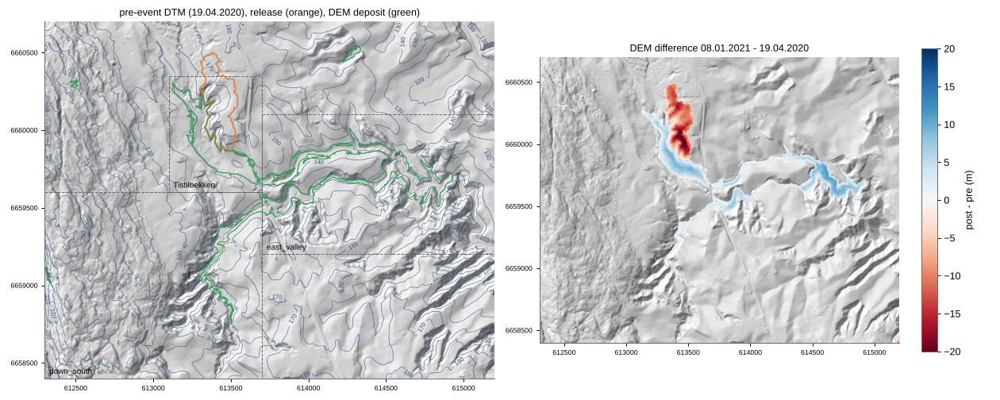
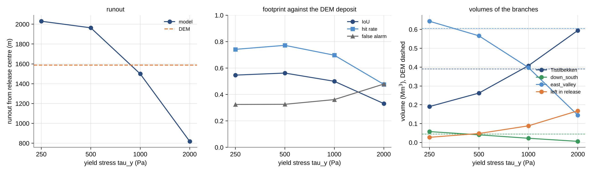
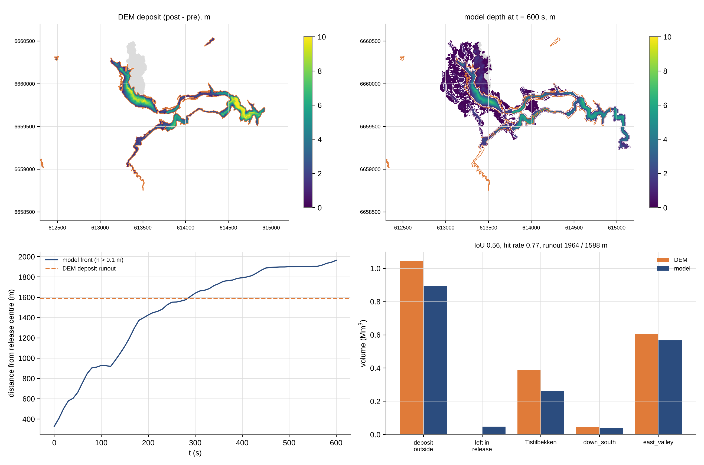
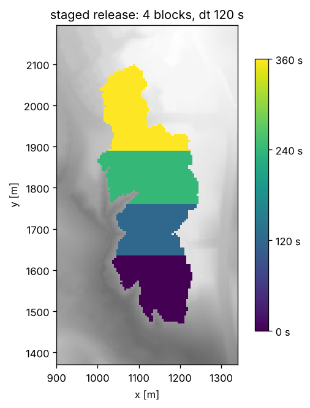
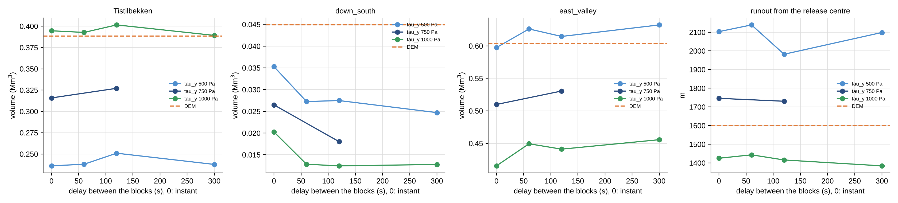
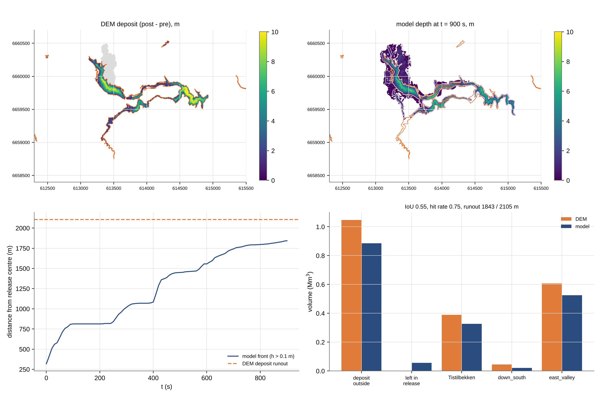

# 26 Gjerdrum quick-clay slide, 30.12.2020 (SFLOW, Herschel-Bulkley W 120 5)

Real terrain from the Kartverket laser projects on hoydedata.no (EPSG:25832, NN2000):

- pre-event: project 4241 "Gjerdrum Ullensaker Nannestad 5pkt 2020", flown 19.04.2020
- post-event: project 5001 "Gjerdrum 5pkt 2021", flown 08.01.2021 (covers the slide and the runout)

Both DTMs averaged to 5 m (bilinear from the ImageServer, then block mean onto the cells). The release is the
scar: inside the box 613150-613650 E, 6659700-6660500 N where post < pre - 1 m. The bed is the pre-event surface,
in the release area the post-event surface (the sliding surface with the material that stayed on it); the
initial level (F 73 1) is the pre-event surface in the release area. Mobilised volume on the 5 m grid
0.94 Mm³ (NGU 2021/023: 1.35 Mm³ mobilised, 0.47 Mm³ left over the sliding surface, 0.926 Mm³ deposited in
the outlet area). Domain 612300-615200 E, 6658700-6660700 N (local x - 612300, y - 6658700), 580 x 400 cells.

## Data and set-up

The DEMs are not part of the repository (5 m GeoTIFFs, 3 MB each). Download and set-up:

    python3 ../tools/fetch_hoydedata.py --list --bbox 612300 6658700 615200 6660700
    python3 ../tools/fetch_hoydedata.py 4241 gjerdrum_pre_2020_DTM_5m.tif  --bbox 611000 6658000 615500 6662500 --res 5
    python3 ../tools/fetch_hoydedata.py 5001 gjerdrum_post_2021_DTM_5m.tif --bbox 611000 6658000 615500 6662500 --res 5
    python3 ../tools/slide_terrain.py gjerdrum_pre_2020_DTM_5m.tif gjerdrum_post_2021_DTM_5m.tif . \
            --bbox 612300 6658700 615200 6660700 --dx 5 --release 613150 6659700 613650 6660500 --thr 1.0

This writes geo.dat (DiveMESH G 10 1), sflow-level.dat (SFLOW F 73 1) and reference.npz. The pre-event DTM has
126 cells without data in the south-east corner (filled from the post-event DTM, far from the flow).

## Runs

Instant release (the event was retrogressive over several minutes: the instant release is an upper bound of the
energy), Herschel-Bulkley with tau_y about the remoulded shear strength s_ur (0.5 kPa), K 15 Pa s^n, n 0.35,
rho 1900 kg/m³; series tau_y 0.25 / 0.5 / 1 / 2 kPa (W 125). 600 s.

    ../tools/run_case.sh <REEF3D> <DiveMESH> . <run>/tau500 "mpirun -np 2"
    python3 ../tools/rheo_eval.py terrainslide <run>/tau500 . results tau500

regions.json: boxes (EPSG:25832) for the volumes of the branches (Tistilbekken next to the scar, the valley to the east with the dam, the branch to
the south).

## Results (instant release, 600 s, 2 ranks, 31 - 49 min each)

F 73 placed 0.934 Mm³ in 3665 cells (0.938 Mm³ on the DEM grid; the DiveMESH interpolation of geo.dat).
Volume conserved to 4e-5. DEM deposit (post - pre > 0.5 m outside the release, patches of at least 1000 m²):
1.05 Mm³, 0.27 km², runout 1590 m from the release centre.

| tau_y (Pa) | runout (m) | IoU | hit rate | Tistilbekken (Mm³) | east valley (Mm³) | south (Mm³) | left in release (Mm³) |
|---:|---:|---:|---:|---:|---:|---:|---:|
| DEM  | 1590 |  |  | 0.39 | 0.61 | 0.045 | (in the bed) |
| 250  | 2030 (east boundary) | 0.55 | 0.74 | 0.19 | 0.64 | 0.058 | 0.027 |
| 500  | 1960 | 0.56 | 0.77 | 0.26 | 0.57 | 0.041 | 0.048 |
| 1000 | 1500 | 0.50 | 0.70 | 0.41 | 0.40 | 0.022 | 0.088 |
| 2000 |  820 | 0.33 | 0.48 | 0.60 | 0.15 | 0.006 | 0.168 |

- The flow follows the ravines of the DEM: Tistilbekken, the junction, both channels around the ridge to the east
  and the start of the southern branch, at all tau_y; tau_y 0.5 - 1 kPa (s_ur about 0.5 kPa) bracket the runout.
- No single tau_y gives both branches: 1 kPa fills Tistilbekken (0.41 against 0.39 Mm³) and stops short in the east
  valley (0.40 against 0.61 Mm³), 0.5 kPa fills the east valley and empties Tistilbekken. With the instant release the
  whole mass leaves at once; in the retrogressive event the later blocks came down onto the deposit in the ravine.
  A staged release (later blocks after minutes) is the next test.
- False alarms (0.33 at 0.5 kPa): a thin sheet over the field west of the scar (the instant release spills over the
  rim of the scar) and the run beyond the end of the east deposit; with 0.25 kPa the material reaches the east boundary
  (x 615200) - extend the domain for weaker material.
- The southern branch: the DEM deposit runs 800 m further south along Tistilbekken (partly piped, the culverts are not
  in the bed); the model stops at the bend at 6659200 N.
- The remnant of 0.47 Mm³ over the sliding surface (NGU) is part of the bed (post-event surface in the release area);
  the model leaves 0.03 - 0.17 Mm³ more there.

## Staged release (F 74, 21.11.2026)

The event was retrogressive: does a release of the scar in blocks, from the toe to the backscarp, give the split
between Tistilbekken and the east valley that no single tau_y gives with the instant release?

- **Set-up:** the domain extended east to 615500 E (640 × 460 cells at 5 m, 320 × 230 at 10 m), the rest as above:

      python3 ../tools/slide_terrain.py gjerdrum_pre_2020_DTM_5m.tif gjerdrum_post_2021_DTM_5m.tif staged \
              --bbox 612300 6658400 615500 6660700 --dx 5 --release 613150 6659700 613650 6660500 --thr 1.0
      python3 ../tools/staged_release.py staged --blocks 4 --dt 120 --png

  `staged/control.txt` and `staged/ctrl.txt` (tau_y 750 Pa, `F 74 1`, 900 s) hold the keys; regions.json with the
  east valley to 615500 E.
- **Blocks:** 4 bands of equal volume (0.23-0.24 Mm³ each) from the southern toe (block 0, at the start) to the
  backscarp (block 3), released after 0 / Δt / 2Δt / 3Δt; also 8 bands. Δt 60 / 120 / 300 s (the whole release over
  3 - 15 min; NGU: the main slide about 03:45 - 04:00).
- **Runs:** 10 m screening (2.5 - 4 min each on 2 cores, 900 s; 1200 - 1500 s with the longer delays), tau_y 0.5 /
  0.75 / 1 kPa; two 5 m runs at 0.75 kPa (25 min each).

| tau_y | Δt (s) | grid | runout (m) | IoU | Tistilbekken (Mm³) | east valley (Mm³) | south (Mm³) | left in release (Mm³) |
|---:|---:|---|---:|---:|---:|---:|---:|---:|
| DEM | | | 1590 | | 0.39 | 0.60 | 0.045 | |
| 500 | 0 | 10 m | 2103 | 0.52 | 0.236 | 0.597 | 0.035 | 0.041 |
| 500 | 60 | 10 m | 2139 | 0.53 | 0.238 | 0.626 | 0.027 | 0.033 |
| 500 | 120 | 10 m | 1982 | 0.57 | 0.251 | 0.615 | 0.027 | 0.035 |
| 500 | 300 | 10 m | 2098 | 0.54 | 0.238 | 0.632 | 0.025 | 0.032 |
| 500 | 60, 8 blocks | 10 m | 2238 | 0.52 | 0.220 | 0.653 | 0.013 | 0.029 |
| 750 | 0 | 10 m | 1746 | 0.56 | 0.316 | 0.510 | 0.026 | 0.060 |
| 750 | 120 | 10 m | 1730 | 0.56 | 0.327 | 0.531 | 0.018 | 0.049 |
| 750 | 0 | 5 m | 1892 | 0.53 | 0.311 | 0.511 | 0.030 | 0.065 |
| 750 | 120 | 5 m | 1843 | 0.55 | 0.326 | 0.526 | 0.021 | 0.056 |
| 1000 | 0 | 10 m | 1425 | 0.47 | 0.395 | 0.415 | 0.020 | 0.082 |
| 1000 | 60 | 10 m | 1443 | 0.49 | 0.393 | 0.449 | 0.013 | 0.068 |
| 1000 | 120 | 10 m | 1416 | 0.48 | 0.401 | 0.441 | 0.012 | 0.068 |
| 1000 | 300 | 10 m | 1384 | 0.48 | 0.389 | 0.456 | 0.013 | 0.066 |
| 1000 | 60, 8 blocks | 10 m | 1452 | 0.54 | 0.360 | 0.495 | 0.008 | 0.063 |

- **The delay does not change the split.** Tistilbekken stays within 0.015 Mm³ of the instant release at each tau_y,
  on both grids. The east valley gains 0.02 - 0.06 Mm³ with the staged release: the later blocks run down the same
  channel over the deposit of the earlier ones instead of being held in Tistilbekken by it.
- **The yield stress sets the split:** 0.39-0.40 Mm³ in Tistilbekken needs 1 kPa, 0.60 Mm³ in the east valley 0.5 kPa,
  with any timing. A retrogression of one material is not the explanation.
- **What could be:** a strength that depends on the history of the material. Material that stops close to the scar
  (Tistilbekken) is less remoulded and stronger; material that runs 1.5 km is remoulded and weak (s_ur). A remoulding
  law, τ_y from about s_u towards s_ur with the accumulated strain or travel (carried with the flow), is the next
  feature (in the spirit of NGI's BingClaw).
- 10 m and 5 m agree on the volumes of the branches within 0.005 Mm³ (0.75 kPa).
- Runout at 5 m: the DEM reference of the evaluator reads 2105 m in the extended domain, because a patch of
  post − pre > 0.5 m at the new east edge (615345-615495 E, 0.2 ha) is taken as deposit; the slide deposit ends at
  614925 E (1590 m, as before).
- The fronts advance in pulses (each block pushes the deposit of the ones before), and the 0.5 kPa runs still move at
  900 s at the east end.

