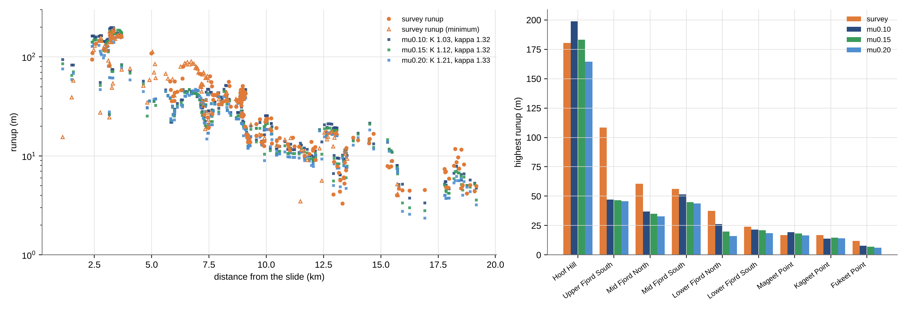
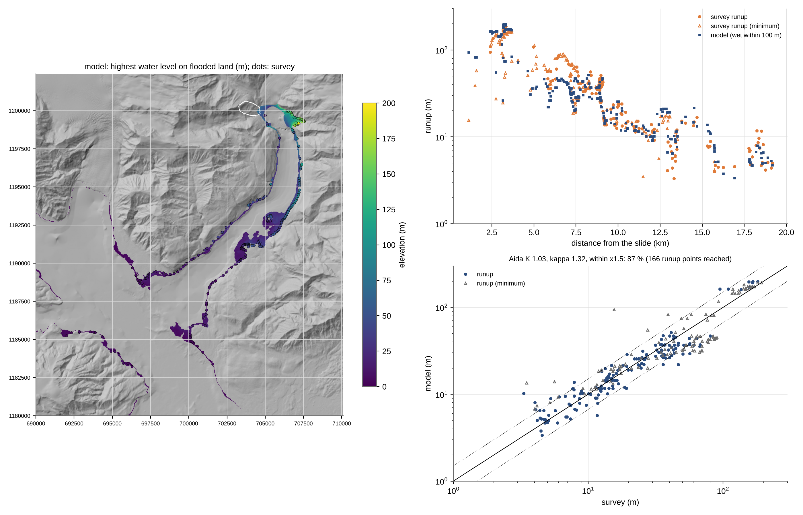

# 27 Taan Fiord landslide tsunami, 17.10.2015 (SFLOW two-layer model W 150, Voellmy)

A rock slide of 73 - 76 Mm³ at the terminus of Tyndall Glacier fell into Taan Fiord, Alaska. The tsunami ran up
193 m on the fan directly across the fjord (Hoof Hill), more than 100 m along 1.5 km of shore and about 15 m at the
mouth of the 17 km long fjord (Higman et al. 2018, Sci. Rep. 8:12993).

## Data

- Terrain: Cannon, George & Iverson (2017), USGS data release https://doi.org/10.5066/F73R0RR3.
  - `Icy_Bay_Terrain_Model.tif`: IFSAR topography with the pre-event bathymetry. 5 m, EPSG:3338 (Alaska Albers),
    elevations relative to an approximate sea level.
  - `Icy_Bay_Terrain_Model_with_2015_slip_surface.tif`: the same model with the inferred sliding surface; the
    difference is the release (72.6 Mm³).
  - Both are on ScienceBase (the download page has a human check): download them by hand.
- Runup: Lynett et al. (2025), Sci. Data, DesignSafe PRJ-5941, https://doi.org/10.17603/ds2-0sek-4434:
  `Taan_field_data_w_lat_lon_ortho_corrected.xlsx`, sheet "Table_Data_For Paper". It has 379 entries: 177 Runup,
  119 Runup_min, plus flow depths and other types. Elevations are relative to the sea level at the time of the
  tsunami (tide −0.94 m MSL).
  - `runup_albers.csv` (in this folder): that table with x, y in EPSG:3338 (rasterio.warp.transform from the
    latitude and longitude).

## Set-up

    python3 ../tools/slide_terrain.py Icy_Bay_Terrain_Model.tif Icy_Bay_Terrain_Model_with_2015_slip_surface.tif . \
            --bbox 690000 1180000 710100 1202400 --dx 30 --release 703000 1199400 705000 1200900 --thr 0.5
    mv sflow-level.dat slide-level.dat        # W 161 1: the top of the initial slide (the pre-event terrain)

- Clip geo.dat at 900 m. The mountains above that are not reached; the top of the slide source is at 790 m:

      python3 -c "import numpy as np; g=np.loadtxt('geo.dat'); g[:,2]=np.minimum(g[:,2],900); np.savetxt('geo.dat',g,fmt='%.2f %.2f %.3f')"

- Domain 20.1 × 22.4 km (Taan Fiord and the north-east of Icy Bay), 670 × 747 cells of 30 m, 2 ranks.
- The bed is the pre-event terrain, in the release area the sliding surface.
- W 161 places 70.3 Mm³: 72.6 Mm³ on the grid, less the DiveMESH interpolation of the steep scar.
- Water: sea level F 60 0. Slide: W 150 1, ρ_s 2400 kg/m³ (1.8e11 kg / 7.6e7 m³), Voellmy W 120 2 with μ = tan W 121,
  ξ 500 m/s², interface drag C_d 0.005, submergence depth W 156 1 m.
- Hydrostatic water (A 220 0; the slide layer stops with A 220 > 0), 900 s. P 112 1 stores the maxima (highest water level of every cell); P 18 2.

## Evaluation

    python3 ../tools/rheo_eval.py tsunamirunup <run> . runup_albers.csv results mu0.10
    python3 ../tools/rheo_eval.py tsunamiseries . runup_albers.csv results mu0.10:<run1> mu0.15:<run2> mu0.20:<run3>

- The model runup at a survey point is the highest water level of the cells that were wet at any time within 100 m
  of the point.
- Points within 300 m of the release are left out.
- Aida K and κ are computed over the full runups the wave reached (model above 0.5 m).

## Results (Voellmy μ 0.10 / 0.15 / 0.20, ξ 500, 900 s, 56 - 57 min each on 2 cores)

ctrl.txt holds μ 0.10 (W 121 5.7), the best of the series.

| μ (W 121) | slide u_max | at the 193 m mark | Hoof Hill (180 m) | Aida K | κ | within ×1.5 | not reached |
|---|---|---|---|---|---|---|---|
| 0.10 (5.7°)  | 67 m/s | 193 m | 199 m | 1.03 | 1.32 | 87 % | 15 |
| 0.15 (8.5°)  | 61 m/s | 178 m | 183 m | 1.12 | 1.32 | 83 % | 17 |
| 0.20 (11.3°) | 54 m/s | 141 m | 165 m | 1.22 | 1.33 | 74 % | 22 |

- Hoof Hill (180 m) is the highest Runup point; the 193 m mark is a Runup_min.
- 294 survey points in the domain; Aida K and κ over the reached full runups.
- Higman et al. (2018) estimate a slide speed of at least 36 - 45 m/s.
- Highest runup by location, survey / μ 0.10 (m):
  - Hoof Hill 180 / 199, Upper Fjord South 109 / 47, Mid Fjord North 61 / 37, Mid Fjord South 56 / 52,
  - Lower Fjord North 38 / 26, Lower Fjord South 24 / 22, Mageet Point 17 / 19, Kageet Point 17 / 14, Fukeet Point 12 / 8.
- The shore opposite the slide and the lower fjord and Icy Bay agree. The peaks along the upper fjord (5 - 8 km from
  the slide, 60 - 110 m surveyed) stay at 35 - 50 m whatever the friction, so the friction is not the cause.
  Candidates are dispersion and the wave shape (hydrostatic water: the slide layer does not run with A 220 yet) and
  the 30 m cells on the steep fans.
- Flooded land: 8.7 - 10.3 km² (Taan Fiord and the north-east of Icy Bay; the survey: over 20 km² in all of Icy Bay).

