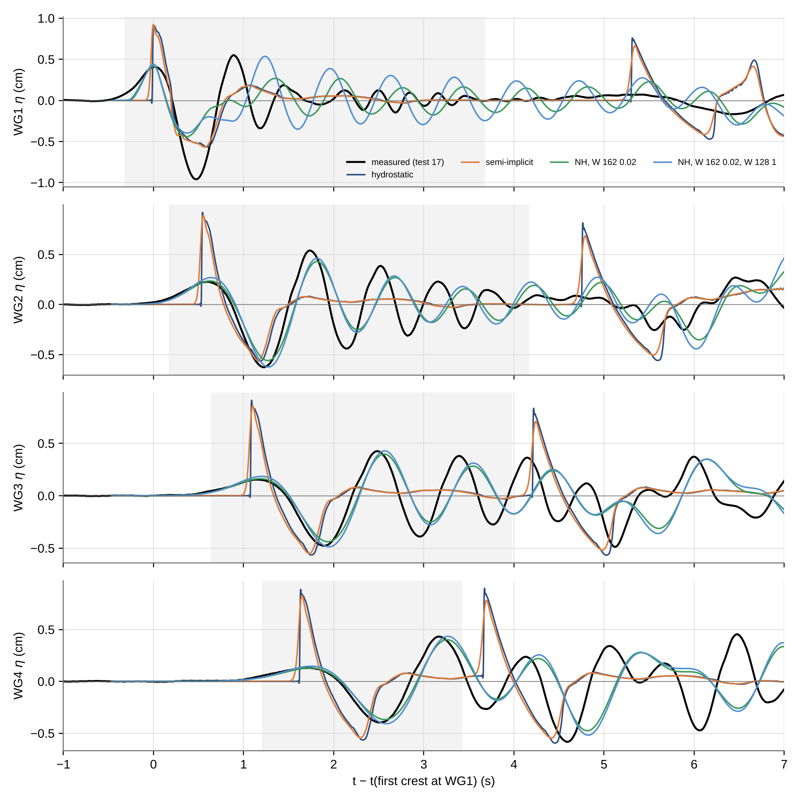

# 28 NTHMP benchmark 4: submarine granular slide on a 35° slope (IRPHE test 17)

The laboratory benchmark 4 of the NTHMP landslide workshop (Grilli et al. 2017; experiments of Viroulet et al. at IRPHE,
Marseille): glass beads released from behind a vertical gate on a 35° slope into 0.33 m of water, a 0.25 m wide flume,
four wave gauges along the flume. 1D SFLOW with the slide layer (W 150).

## Data

`test17_48-68s.txt`: the gauges WG1-WG4 of test 17 (η in cm), 48-68 s of the 120 s record, every 0.01 s (the record is
every 0.005 s). From the benchmark files of the workshop (`test17.txt` and `read_test.m` in `gages.zip`, University of
Delaware, `www1.udel.edu/kirby/landslide`); the full record is in `Dropbox/Claude/Rheology/data/test17.csv`.

## Set-up (from read_test.m and the sketch of the flume)

| | |
|---|---|
| water depth h | 0.330 m |
| slope | 35°, toe at x = 0.6 m (bed z = 0.6 tan 35° − x tan 35°, flat floor beyond) |
| gate | vertical, its foot on the slope 0.207 m above the floor (x = 0.30437 m) |
| slide | the triangle behind the gate: gate height h_gate = √(2 V tan α / w) = 0.0841 m, top z = 0.2911 m (3.9 cm under the surface), 0.120 m long, 0.00505 m³/m (`W 151 0 0.30437 -1 1 0.2911`) |
| bulk density | ρ_s = 0.634 · 2500 + 0.366 · 1000 = 1951 kg/m³ (packing 0.634, glass 2500 kg/m³, pores full of water) |
| gauges | WG1-WG4 at 0.6, 1.6, 2.6, 3.6 m downstream of the gate (x = 0.904, 1.904, 2.904, 3.904 m) |
| end wall | 5.47 m downstream of the gate (x = 5.774 m) |
| basal law | Pouliquen-Forterre, `W 120 3`, `W 123 6 17 12 0.136 0.007` (as 18 slope35) |
| grid | dx 5 mm (1155 cells), 8 s |

The gate release time is not in the record: the time of each run is shifted so that its first crest at WG1 falls on the
measured one (51.96 s); the same shift for all gauges. The metrics run from the arrival at each gauge to the arrival of the
wave reflected at the end wall (√(gh)), at most 4 s (grey bands in the figure).

## Cases

| case | water | keys |
|---|---|---|
| hydro | explicit HLL, hydrostatic | A 210 3, A 220 0 |
| si | semi-implicit, hydrostatic | A 210 11, A 232 0.003 |
| nh | explicit HLL, non-hydrostatic (quadratic pressure) | A 220 2, W 162 0.02 |
| nh_w128 | as nh, bed-normal gravity in the slide friction | W 128 1 |

```bash
cd Validation/rheology
for c in hydro si nh nh_w128; do tools/run_case.sh <REEF3D> <DiveMESH> 28_slide_nthmp_bm4/cases/$c <run>/bm4_$c; done
python3 tools/bm4_eval.py 28_slide_nthmp_bm4/test17_48-68s.txt <out> hydrostatic=<run>/bm4_hydro semi-implicit=<run>/bm4_si \
        "NH, W 162 0.02"=<run>/bm4_nh "NH, W 162 0.02, W 128 1"=<run>/bm4_nh_w128
```

## Results

Gauge max / min (cm) in the window, and the RMS difference to the measurement over the window divided by its measured range:

| | WG1 | WG2 | WG3 | WG4 | runout | run time |
|---|---|---|---|---|---|---|
| measured | 0.55 / −0.96 | 0.54 / −0.63 | 0.43 / −0.48 | 0.43 / −0.40 | | |
| hydrostatic | 0.90 / −0.57, 0.14 | 0.89 / −0.56, 0.20 | 0.91 / −0.56, 0.28 | 0.84 / −0.56, 0.33 | 1.35 m | 22 s |
| semi-implicit | 0.92 / −0.57, 0.13 | 0.89 / −0.56, 0.20 | 0.86 / −0.55, 0.28 | 0.83 / −0.54, 0.33 | 1.36 m | 4.9 s |
| NH, W 162 0.02 | 0.42 / −0.44, 0.16 | 0.43 / −0.56, 0.18 | 0.40 / −0.44, 0.17 | 0.40 / −0.37, 0.08 | 1.38 m | 47 s |
| NH, W 162 0.02, dx 2.5 mm | 0.40 / −0.44, 0.16 | 0.42 / −0.56, 0.18 | 0.39 / −0.44, 0.18 | 0.40 / −0.37, 0.09 | 1.36 m | 204 s |
| NH, W 162 0.02, W 128 1 | 0.54 / −0.40, 0.23 | 0.46 / −0.62, 0.18 | 0.43 / −0.49, 0.18 | 0.43 / −0.41, 0.09 | 1.47 m | 47 s |

- **Hydrostatic water** (explicit and semi-implicit alike): the first crest steepens into a bore of 0.9 cm that does not
  decay, the trough behind it is a single long wave, no dispersive train. Twice the measured crest from WG2 on.
- **Non-hydrostatic water:** the leading crest, the trough and the first two waves of the dispersive train at WG2-WG4
  within 0.05 cm and about 0.1 s; the same on the 2.5 mm grid. The later waves of the train are longer than measured
  (period about 0.9 s against 0.8 s) and fall behind.
- **WG1** (0.6 m from the gate, over the tail of the deposit): the measured trough of −0.96 cm is −0.44 cm in the model.
  The slide passes under this gauge; the depth-averaged slide and the one-layer pressure miss part of the near field.
  After the slide has stopped the model keeps waves of ±0.2 cm at WG1 that are absent in the measurement.
- **W 128 1** (the normal stress with g cos²θ on the slope): a faster slide (1.43 against 1.34 m/s, runout 1.47 m), the
  troughs at WG2 and WG3 as measured, a second crest at WG1 that is too high.
- **W 162** (the filtered transfer of the slide to the water bed): without it the near field is noisy (WG1 0.87 / −0.77 cm,
  spikes) and the slide, pushed by the noise, runs to 2.0 m; the far gauges are still near the measurement (WG4 0.54 /
  −0.49 cm). 0.02 is the smallest value tried. Larger values damp the waves, as the one-layer pressure already does the
  transfer over the water depth: WG2 trough −0.56 / −0.54 / −0.51 / −0.47 / −0.39 cm at 0.02 / 0.05 / 0.1 / 0.2 / 0.5.



## References

- Grilli, S. T., Shelby, M., Kimmoun, O., Dupont, G., Nicolsky, D., Ma, G., Kirby, J. T., Shi, F. (2017). Modeling coastal
  tsunami hazard from submarine mass failures: effect of slide rheology, experimental validation, and case studies off the
  US East Coast. Natural Hazards 86, 353-391.
- Kajiura, K. (1963). The leading wave of a tsunami. Bull. Earthquake Res. Inst. 41, 535-571.
- Macías, J., Escalante, C., Castro, M. J. (2021). Multilayer-HySEA model validation for landslide-generated tsunamis,
  Part 1: Rigid slides. Part 2: Granular slides. Nat. Hazards Earth Syst. Sci. 21, 775-789 and 791-805.
