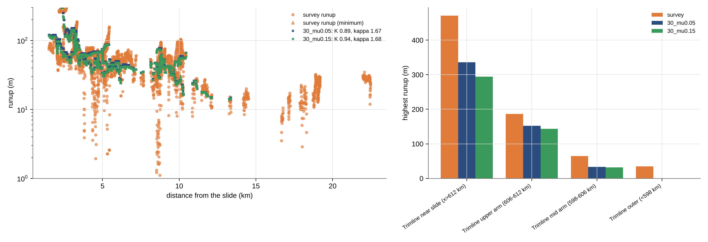
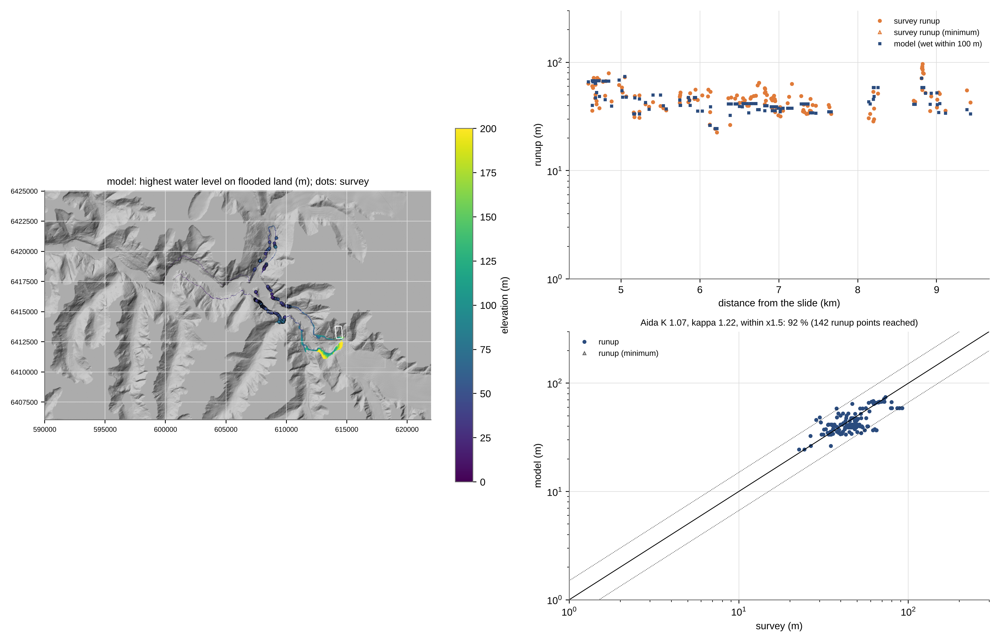
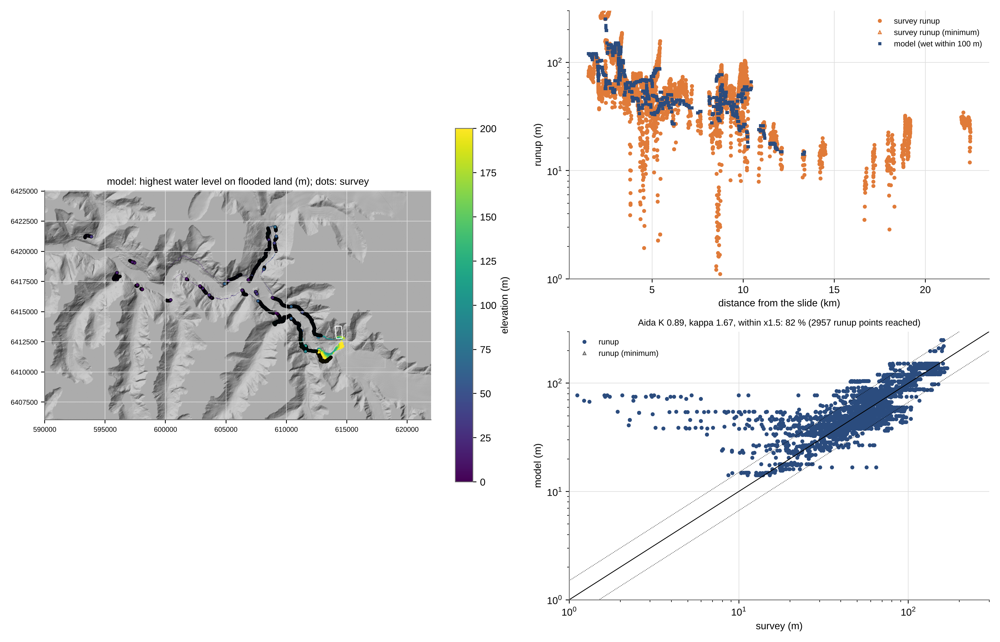

# 30 Tracy Arm landslide tsunami, 10.08.2025 (SFLOW two-layer model W 150, Voellmy)

A rock slide of more than 64 Mm³ fell about 1 km onto South Sawyer Glacier and into Tracy Arm, Alaska. The tsunami
ran up 481 m on the opposite fjord wall, the second highest runup recorded (Shugar et al. 2026, Science 392, eaec3187).

## Data

Shugar et al. supplementary files, Zenodo https://doi.org/10.5281/zenodo.18306727 (download by hand; 2.4 GB):

- `TracyArmMerged_new_water_shoreline_adj.tif`: the merged topo-bathy DEM (5 m, EPSG:26908, NAD83 / UTM 8N), with
  the 2025 shoreline.
- `Aux2_slide_motion/Supplementary_Materials_Slide_Motion_for_Tsunami_Model.m`: the tsunami source of the paper. A
  rotated super-Gaussian of 65 Mm³ (centre 614352 E, 6413280 N, half length 400 m, half width 200 m, 95°, exponent
  10), moved along a prescribed path (1.4 km, peak speed 61 m/s).
- `TracyArmTsunamiFieldSurveyData.csv`: 172 survey points (UTM 8N, relative to the sea level at the tsunami).
  `runup_survey.csv` (this folder) holds the 169 limit points: 166 Runup, 3 "limit or low" as Runup_min.
- `TrimlinePoints.zip`: 4229 trimline points every 10 m (Planet SuperDove, elevations from the TopoBathyDEM; −9999
  where the DEM did not fit). `runup_trimline.csv` (this folder) holds the 4004 valid points, split into sectors by
  easting.
- `JOA_Endicott_G1_TSU1MIN.zip`: the tide gauge in Endicott Arm, 1 min; outside this domain.

## Set-up

    python3 ../tools/slide_mound.py TracyArmMerged_new_water_shoreline_adj.tif . --bbox 589995 6406035 621995 6425035 \
            --dx 25 --mound 614352 6413280 400 200 95 10 65e6 --zmax 1100

- Domain 32 × 19 km (Tracy Arm from its middle to the glaciers), 1280 × 760 cells of 25 m, 2 ranks.
- The bed is the DEM. The 2025 DEM has the scar, so the paper's mound on the scar is the slide: amplitude 195 m, top
  20 - 1044 m (headscarp in the paper about 1025 m).
- W 161 places 65.06 Mm³. W 154 2600 kg/m³ (paper: 2.6 g/cm³), Voellmy ξ 500, C_d 0.005, W 156 1 m.
- Hydrostatic water, 400 s, P 112 1, P 18 2.

## Results (hydrostatic water, Voellmy ξ 500)

| run | cells | time | wall | survey K / κ (within ×1.5) | trimline K / κ | near the slide | upper arm | mid arm |
|---|---|---|---|---|---|---|---|---|
| observed | | | | | | 471 m | 187 m | 65 m |
| μ 0.15, 25 m | 1280 × 760 | 400 s | 67 min | 1.07 / 1.22 (92 %) | 0.94 / 1.68 | 294 m | 143 m | 32 m |
| μ 0.05, 25 m | 1280 × 760 | 400 s | 66 min | 1.03 / 1.23 (93 %) | 0.89 / 1.67 | 336 m | 152 m | 33 m |
| μ 0.15, 10 m (near field only) | 1000 × 900 | 150 s | 60 min | | 0.90 / 1.94 | 329 m | 149 m | |

- The field survey along Tracy Arm (147 points, the NSGL, MidArm and NSI sites) agrees within a factor 1.5 at
  92 - 93 %.
- The trimline and the extreme runup opposite the slide are too low: 294 - 336 m against 471 m, i.e. 0.62 - 0.71 of
  the observed value.
  - Lower friction adds 14 %; the 10 m grid adds 12 %.
  - The rest is the slide: the depth-averaged mound collapses at once (|u| 70 - 87 m/s at its edges in the first
    10 s) and about a third of it spreads east over the front of South Sawyer Glacier instead of into the fjord
    (animation). The paper's rigid block runs 1.4 km south-south-west into the fjord with a peak of 61 m/s at 25 s.
- Next:
  - a release closer to the real wedge (the pre-event surface from ArcticDEM 2015 minus the scar), or a prescribed
    motion of the slide (as Lynett's Celeris source);
  - non-hydrostatic water with the slide layer;
  - the far field (Endicott Arm gauge, the 66 s seiche) with the semi-implicit SFLOW and the slide layer.
- The 10 m near-field case: control.txt with `B 2 1000 900 10` (10 layers in z, enough for SFLOW; DiveMESH needs
  7 s instead of a 139-layer grid). Set up with
  `slide_mound.py <DEM> . --bbox 608370 6408060 618370 6417060 --dx 10 --mound ... --zmax 1100`.

