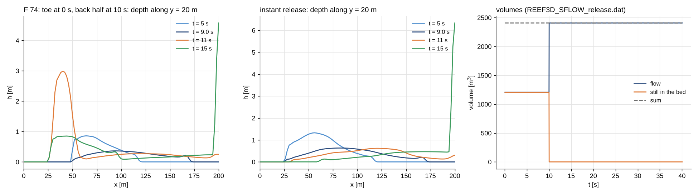

# 34 SFLOW staged release (F 74): a block released in two halves

A check of the staged (retrogressive) release of SFLOW, `F 74 1`.

## Model

`F 74 1` (with `F 73 1`) reads `sflow-release.dat`, a regular grid in the format of `sflow-level.dat`
(`nx ny x0 y0 dx dy`, then nx·ny values, x fastest) with the release time [s] of every cell. Each cell takes the value
of the nearest grid point, so the blocks keep sharp edges. A time ≤ 0 (or < −9000, no data) releases the cell at the start.

- **Before its time** the material of a cell is part of the bed: the bed is raised to the level of F 73 and the cell is
  dry. It acts as intact ground that the flow can run against or over.
- **At its time** (the end of the step that reaches it) the bed drops back by the thickness T and the water column grows
  by T. The surface and the face discharges stay, and the cell is set wet: the wetting of SFLOW (A 243 2) would
  otherwise wet a dry cell only from a higher wet neighbour, and the released block would stay in place. A cell that was
  dry starts at rest.
- **Log:** `REEF3D_SFLOW_Log/REEF3D_SFLOW_release.dat` has the time, the volume of the flow, the volume still in the
  bed and their sum. The screen prints every release (cells, volume, time).
- **Not available with** the slide layer (W 150), sediment (S 10), mesh refinement and multi-block grids (G 1, G 50 1)
  and restarts (I 45 1; the release state is not in the checkpoints yet). These stop with a message.
- **`tools/staged_release.py <case> --blocks N --dt Δt [--dir deg] [--t0 t] [--equal volume|length] [--png]`** writes
  `sflow-release.dat` for a case made by `slide_terrain.py`. It cuts the release area into N bands across the direction
  `--dir` (degrees from east; 90 = the retrogression runs to the north: the first block is the southern toe). The bands
  hold equal volumes (default) or equal widths. Block k is released at t0 + k·Δt.

## Set-up

- A 200 × 40 m plane at 20°, dx 2 m, 2 ranks, 40 s.
- Coulomb material: δ = 15°, ρ = 2000 kg/m³, `W 120 1`.
- The block: x 30–70 m, y 10–30 m, 3 m thick (2400 m³).
  - `staged`: the toe half (x 50–70 m) at the start, the back half (x 30–50 m) at t = 10 s.
  - `instant`: the whole block at the start.
- `python3 make_case.py` writes geo.dat, sflow-level.dat and sflow-release.dat into both cases.

## Results

| | staged |
|---|---|
| F 73 at the start | 1200 m³ in 100 cells (the toe half) |
| in the bed until 10 s | 1200 m³ in 100 cells |
| flow + bed just before / after the release at 10 s | 2407.5908 / 2407.5908 m³ |
| flow + bed over the run | 2407.59 – 2407.96 m³ (0.015 %) |
| run time | 1.6 s |

- The 7.6 m³ above the 2400 m³ of the block are the wetting film of the dry cells (A 244 1e-3 m over 1900 cells).
- The volume changes with the wetted area, as in every SFLOW run. The release itself changes it by nothing.
- Until 10 s the back half stays in place as ground. The toe half runs down the plane alone.
- After 10 s the back half collapses and follows, and both reach the end wall, as the instant block does.
- A first version left the released block standing (no wetting of the dry cells): the cells are now set wet at the release.



## Run

```bash
cd Validation/rheology
python3 34_sflow_staged_release/make_case.py
for c in staged instant; do tools/run_case.sh <REEF3D> <DiveMESH> 34_sflow_staged_release/cases/$c <run>/34_$c "mpirun -np 2"; done
```
