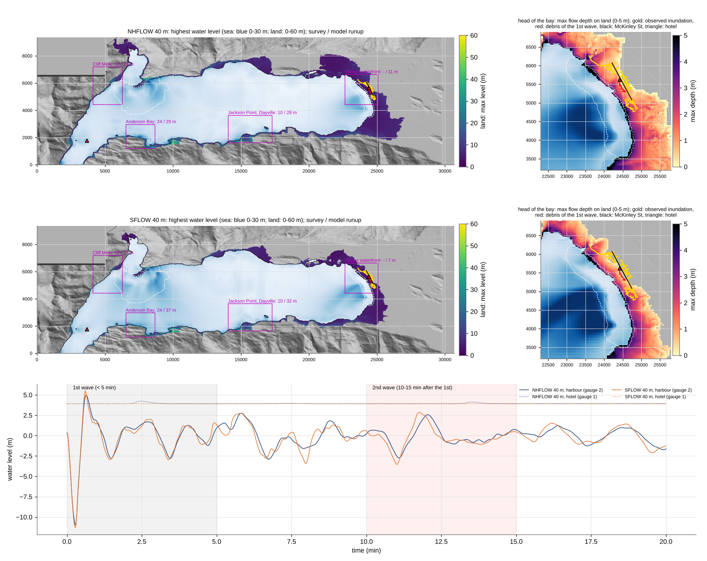
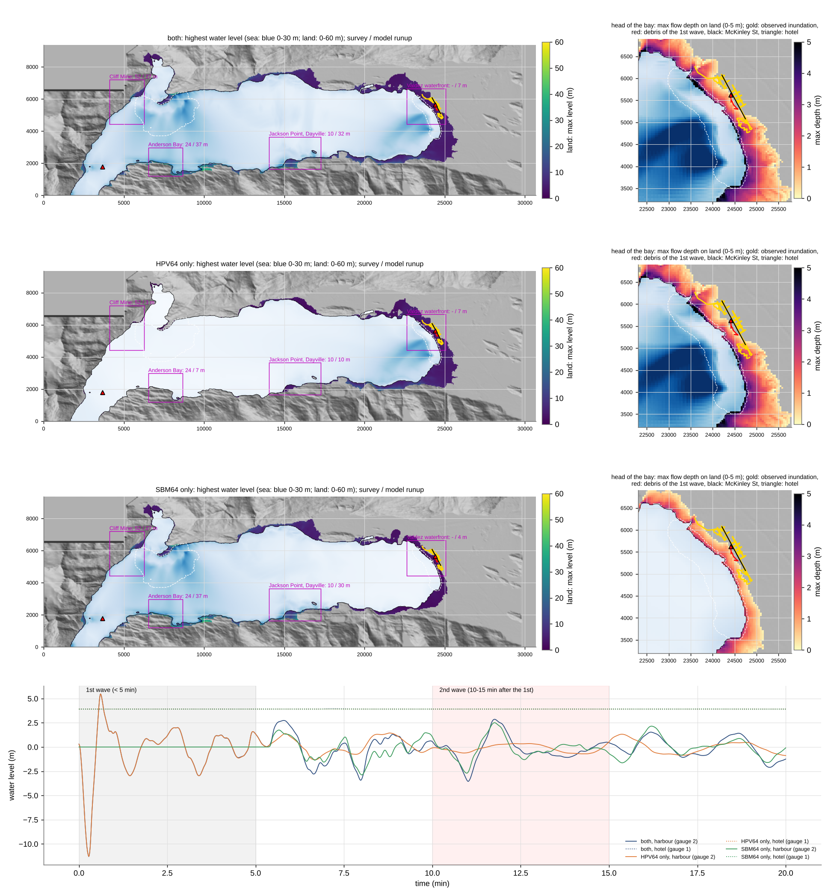

# 36 Port Valdez 1964: two submarine slides, the slide layer under NHFLOW (NTHMP landslide benchmark 7)

During the Mw 9.2 Alaska earthquake of 27 March 1964 the delta front at the old town of Valdez (HPV64) and the moraine
at Shoup Bay (SBM64) slid into Port Valdez. The tsunami destroyed the waterfront: a first wave within 5 minutes, a
second one 10-15 minutes later that put 0.46 m of water into the Valdez Hotel, the inundation reached McKinley Street
(about 300 m inland), the waves ran up 24 m in Anderson Bay and overtopped the Narrows navigation light (on a pedestal
11 m above MLLW). Real-world case of paper 4 (submarine slides, slide layer W 150 under NHFLOW).

## Data

NTHMP landslide benchmark workshop (Galveston 2017), problem 7:
`www1.udel.edu/kirby/landslide/problems/benchmark_7.html`, `benchmark_7_data.zip` (Hans has it in
Dropbox/Claude/Rheology/data/Port Valdez):

- `valdez.bathymetry.long`, `.latg`, `valdez.1964.bathymetry`: the post-earthquake terrain (m above MLLW), 570 × 2316
  nodes on a regular longitude-latitude grid (13.4 × 16.5 m), the surface the slides move on.
- `valdez.HPV_1964`, `valdez.SBM_1964`: the reconstructed thickness of the two slides (Nicolsky et al. 2013).
- Shapefiles: the observed inundation at the head of the bay (`InundationLine`, `InundationLineIslands`), the debris
  line of the first wave (`InundationLineFirstWave`), McKinley Street.

## Set-up

    python3 ../tools/valdez_terrain.py <benchmark_7_data> . --dx 40                 # both slides (the case)
    python3 ../tools/valdez_terrain.py <benchmark_7_data> <dir> --dx 40 --slides hpv  # one slide (hpv or sbm)

- Local coordinates: x = R cos 61.1° (lon − lon_min), y = R (lat − lat_min); the domain is the whole data set,
  30.7 × 9.4 km, 767 × 234 cells of 40 m (block mean of the data nodes). The terrain is clipped at 150 m (the highest
  observed runup is 67 m).
- `geo.dat` is the terrain, `slide-level.dat` (W 161 1) the terrain plus the slide thickness: HPV64 54.8 Mm³ on
  1.8 km², SBM64 248.2 Mm³ on 7.1 km² (the benchmark text gives about 75 Mm³ for HPV64; the grids hold 55 Mm³).
  `reference.npz` holds the terrain, the thicknesses, the observations and the lines for the evaluation.
- Slide (W 150): Coulomb 6° (`W 120 1`, `W 121 6`, the angle the HySEA multilayer model used for HPV64),
  ρ_s = 2000 kg/m³, interface drag C_d 0.005 (HySEA), submergence depth 1 m. Both slides start at t = 0.
- Water: NHFLOW explicit (A 510 2), non-hydrostatic (A 520 2), 5 σ layers, sea level 0 (MLLW), bed friction
  `A 519 1` (log law) with ks 0.012 m (the bottom-layer drag of Manning n ≈ 0.02 at 0.5-1 m depth), 1200 s, frames
  every 4 s (`P 182 4` for the video), maxima `P 112 1` / `P 180 1`, gauges `P 51` (1 Valdez Hotel, 2 off the waterfront,
  3 Narrows light, 4 off Anderson Bay, 5 off Jackson Point, 6 mid-bay), `P 18 2`.
- `sflow/`: the same with SFLOW water (hydrostatic, explicit), Manning n 0.02 (`A 218 1`, `B 50 0.0041`).

## Evaluation

    python3 ../tools/rheo_eval.py valdez . results "NHFLOW 40 m":<run> "SFLOW 40 m":<run sflow>
    python3 ../tools/valdez_video.py <run> . results/36_port_valdez_nhflow40m.mp4 --label "slide layer under NHFLOW, 40 m"

- Runup in a shore stretch: the highest water level over land (terrain > 0) of the cells wet at some time, in a box
  around the place. The boxes of Anderson Bay, Cliff Mine and Jackson Point are placed from the description of the
  benchmark and the shoreline of the data (approximate; the hotel and the light are given by the benchmark).
- The Narrows light: the highest water level within 100 m of the light. The hotel: the largest flow depth of its cell.
- Inundation: the share of the points of the observed inundation line, the first-wave debris line and McKinley St
  that lie in (or next to) a cell that was wet.
- Waves at the waterfront: the maxima above 1 m of gauge 2 (700 m off the waterfront), at least 2 min apart.

## Results (40 m, 1200 s)

| | observed | NHFLOW, both slides | SFLOW, both slides | SFLOW, HPV64 only | SFLOW, SBM64 only |
|---|---|---|---|---|---|
| 1st wave off the waterfront | < 5 min | +5.0 m at 38 s | +5.5 m at 37 s | +5.5 m at 37 s | – |
| 2nd wave off the waterfront | 10-15 min after the 1st | +2.6 m at 12.0 min | +2.9 m at 11.8 min | (0.3 m) | +2.5 m at 11.8 min |
| water in the Valdez Hotel | 0.46 m | 0.56 m | dry (0.9 m within 100 m) | dry (0.5 m within 100 m) | dry (0.8 m within 100 m) |
| Narrows light | > 11 m | 11.8 m | 13.2 m | 1.8 m | 13.2 m |
| runup Anderson Bay | 24 m | 29 m | 37 m | 7 m | 37 m |
| runup Cliff Mine | 52 m (driftwood) | 24 m | 27 m | 3 m | 27 m |
| runup Jackson Point (Dayville) | 9.5 m | 28 m | 32 m | 10 m | 30 m |
| observed inundation line reached | | 91 % | 53 % | 51 % | 26 % |
| McKinley St reached | yes | 100 % | 50 % | 50 % | 0 % |
| flooded land | | 18.2 km² | 12.5 km² | 8.6 km² | 8.8 km² |
| run time (2 cores) | | 2.1 h | 11 min | 11 min | 11 min |

SFLOW without bed friction: hotel 0.47 m, inundation line 94 %, McKinley St 100 %, flooded land 19.9 km², runups as
with friction (Anderson Bay 37 m, light 13.2 m).

- **Both waves at the waterfront and their sources.** The water first draws down 11 m off the waterfront (the
  slide leaves), then a 5-5.5 m wave arrives at 37-38 s: the first wave, from HPV64 alone. The second strong wave
  arrives at 11.8-12 min, from SBM64 alone (the single-slide runs separate them): the wave from the Shoup Bay moraine
  crosses the 20 km of the bay in about 11 min. The eyewitnesses saw the second wave 10-15 min after the first, and
  Wilson & Tørum (1972) suspected that it came from the Shoup Bay side; the model supports that.
- **SBM64 makes the runups in the west of the bay**: Anderson Bay (29-37 m against 24 m) and the Narrows light
  (11.8-13.2 m, overtopped as observed). HPV64 alone gives 7 m and 1.8 m there.
- **Bed friction decides the inundation of the town.** Old Valdez lies 4-6 m above MLLW; the observed inundation line
  runs at 4.7 m (median of the terrain along it). SFLOW with Manning 0.02 (the best value of Nicolsky et al. 2013,
  0.01-0.02) stops at the observed line (53 % of its points reached, McKinley St 50 %); without friction the water
  runs 0.5-1 km further over the flats (94 %, 20 km² flooded).
- **NHFLOW floods further than SFLOW** with the same nominal friction (91 % of the line, 18 km²). Its bed friction
  (A 519 1) acts on the bottom σ layer only; without a turbulence model (A 560 0) nothing carries the bed shear up into
  the layers above, which run on. A k-ε run (A 560 1) tests this (below).
- **Cliff Mine stays low** (24-27 m against 52 m driftwood / 67 m splash) in all runs: a steep shore at 40 m cells,
  the box placement, or a faster SBM64 than Coulomb 6° gives (HySEA used 5° for SBM64 and a heavier slide).
- Jackson Point: the 28-32 m come from a cove at the west end of the box (the cannery site is not given by the
  benchmark); HPV64 alone gives 10 m there (observed 9.5 m).
- SFLOW and NHFLOW agree off the waterfront within 10 % in the first wave and in the time of the second; the slide
  runs the same in both (38 m/s at 10 s, at rest after about 2 min).

Video (not in the repository; `valdez_video.py`, about 2 MB): water level and slide thickness every 4 s, the head of the bay, the
gauges).

## Next

- NHFLOW with k-ε (A 560 1) for the bed shear over the depth (the inundation of the town).
- 20 m cells at the head of the bay (old Valdez: the inundation line, the hotel).
- SBM64: friction 5°, the HySEA density ratio; Cliff Mine.

## References

- Nicolsky, Suleimani, Haeussler, Ryan, Koehler, Combellick & Hansen (2013), Tsunami inundation maps of Port Valdez,
  Alaska. Alaska DGGS Report of Investigation 2013-1.
- Wilson & Tørum (1972), Effects of the tsunamis: an engineering study. In: The Great Alaska Earthquake of 1964,
  Oceanography and Coastal Engineering, National Academy of Sciences.
- Plafker, Kachadoorian, Eckel & Mayo (1969), Effects of the earthquake of March 27, 1964 on various communities.
  USGS Professional Paper 542-G.
- Coulter & Migliaccio (1966), Effects of the earthquake of March 27, 1964 at Valdez, Alaska. USGS Professional Paper
  542-C.
- Kirby et al. (2022), Validation and inter-comparison of models for landslide tsunami generation. Ocean Modelling
  170, 101943.
- Macías et al., HySEA benchmark 7: edanya.uma.es/hysea/benchmarking/nthmp/landslide-generated/bp7
