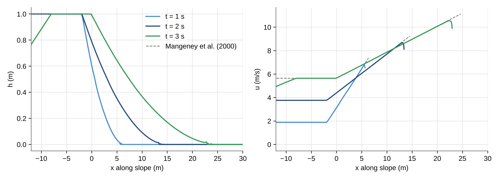
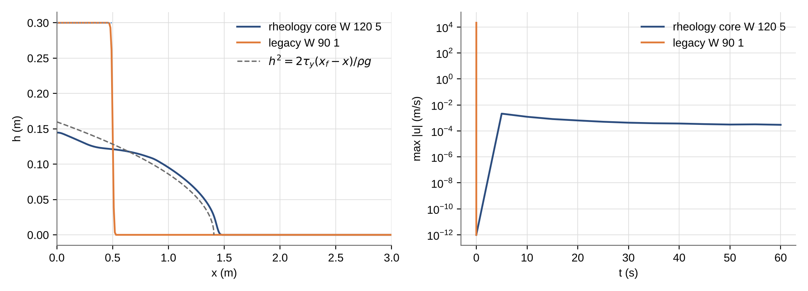
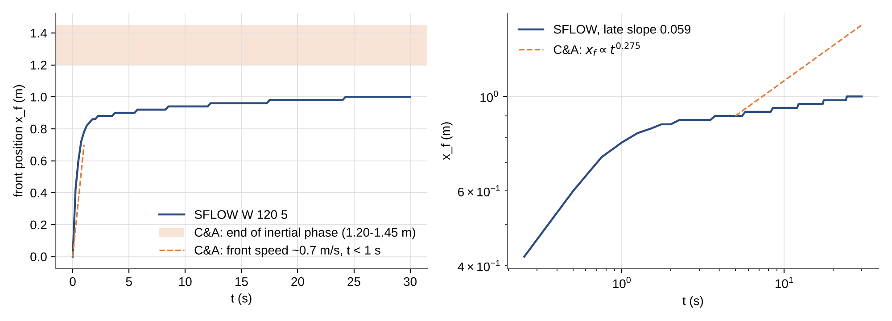
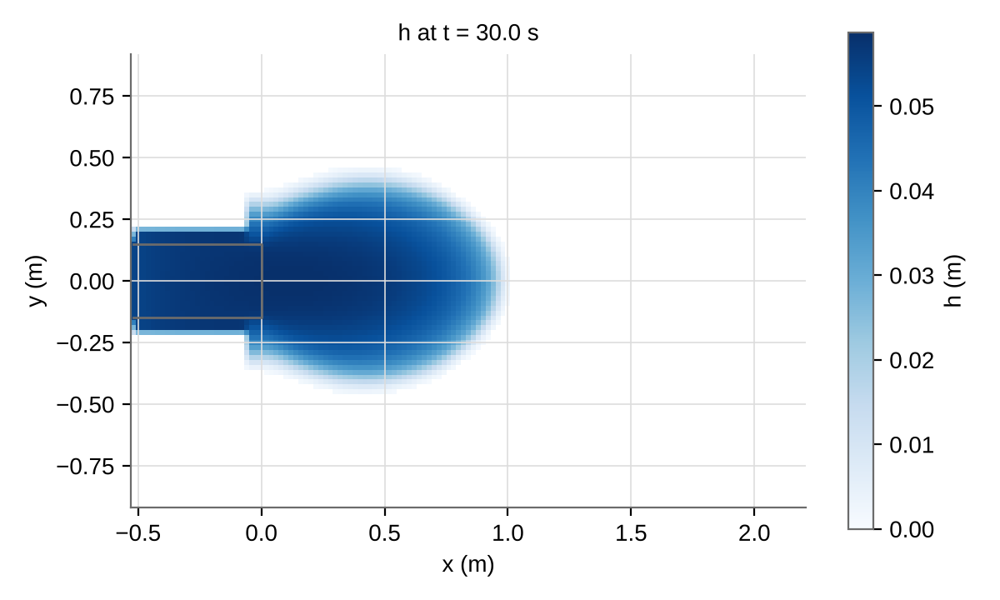
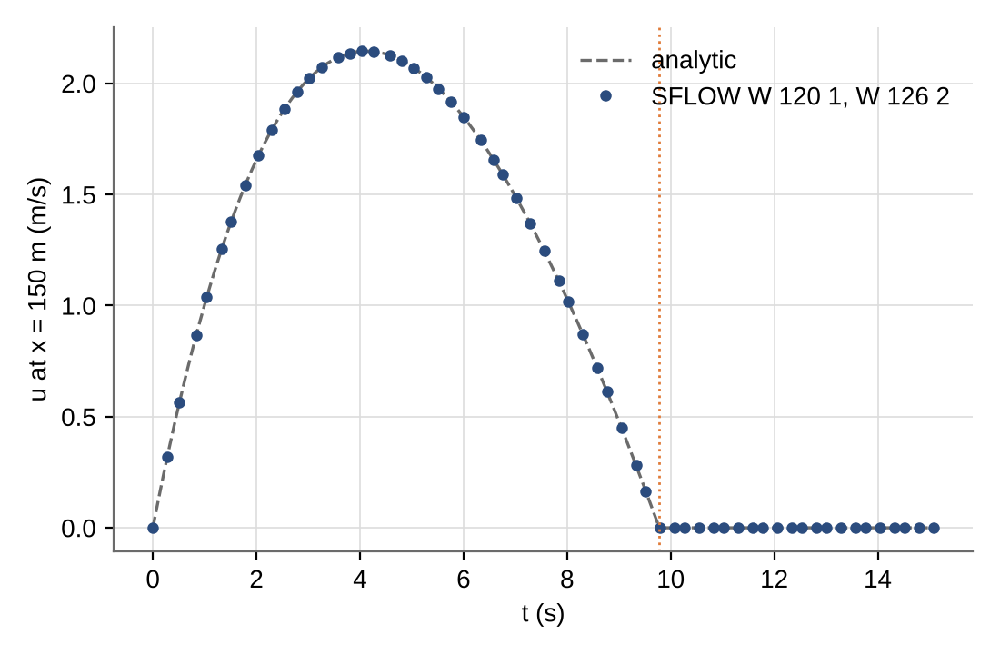
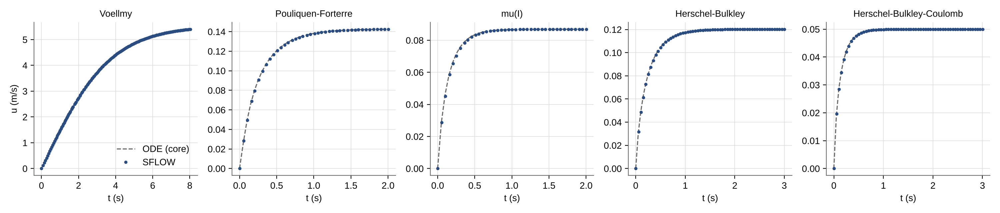
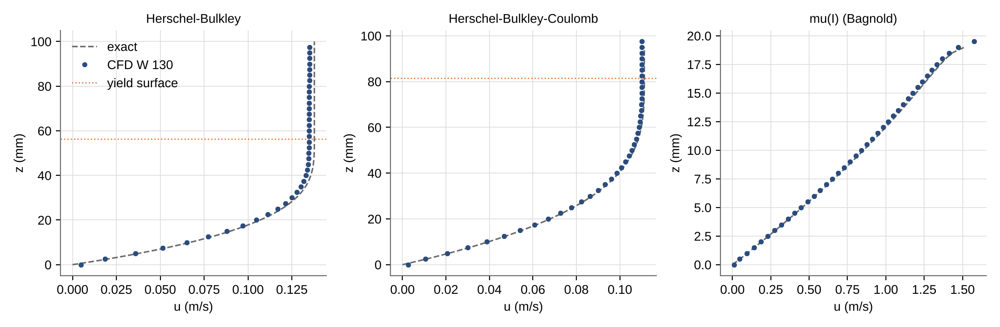
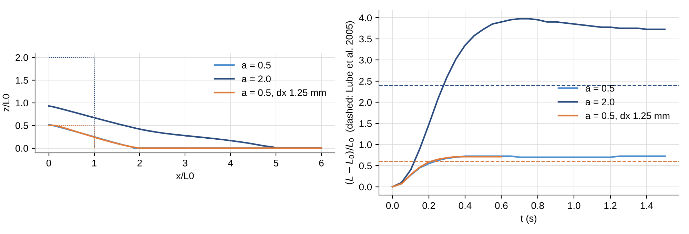
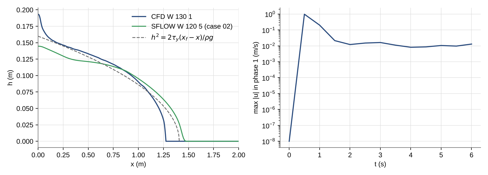
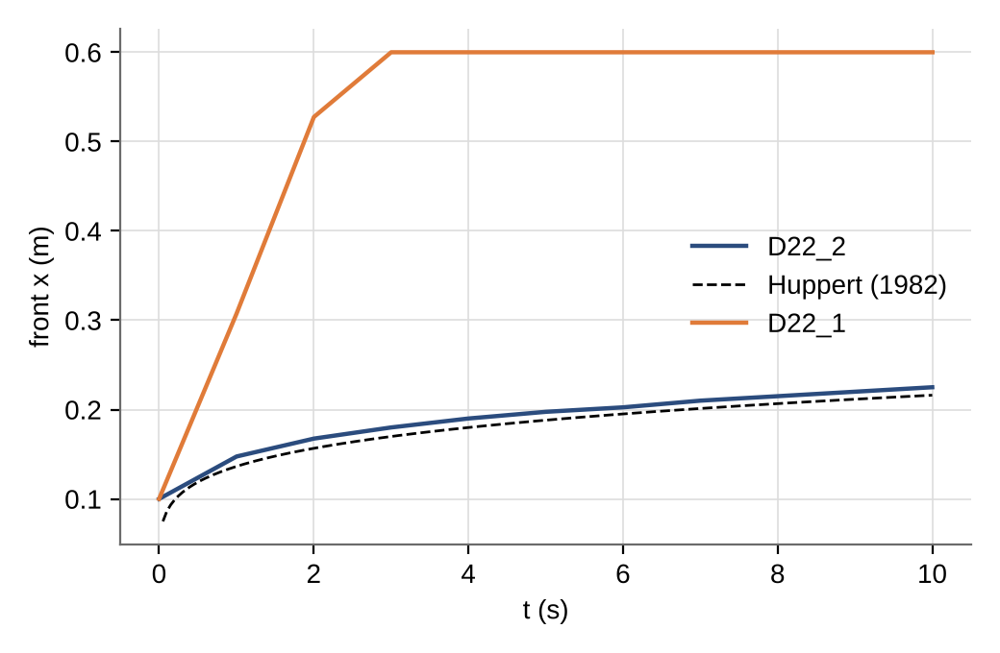

# Rheology validation (rheology core: SFLOW W 120, CFD W 130)

These cases check the rheology core (`src/rheology_core.{h,cpp}`) and its two adapters:

- SFLOW (`src/sflow_rheology_core.{h,cpp}`, W 120 - W 128), cases 01-05. They compare against analytical solutions, an ODE reference with the same closure, and the Carbopol experiments of Cochard & Ancey (2009).
- CFD (`src/rheology_cfd_core.{h,cpp}`, W 130 - W 134), cases 06-09. They compare against exact steady film profiles, the runout of granular column collapses, the arrested viscoplastic deposit of case 02, and (09, Newtonian) the viscous gravity current of Huppert (1982), which checks the no-slip wall.

All cases write the LAGOON store and the VTU/VTP files (`P 18 2`); the evaluation scripts read the VTU/VTP files.

- **Repo:** REEF3D `hans_dev` (SFLOW cases: 1e67465d + the rheology core patch; CFD cases: 9e2e40abe + both rheology patches), DIVEMesh `hans_dev` 2ee2a7e.
- **Build:** Linux sandbox, g++ 13, `make release LTO=0` (`-O3 -march=native`), no HYPRE, Open MPI.
- **Unit test of the core:** `Regression/unit/rheology_core_test.cpp`. All checks pass.

## Model

The flow is a single depth-averaged layer of the rheological material: SFLOW, hydrostatic (`A 220 0`), RK3, HLL.

- **Basal friction.** After the explicit update of each stage, the speed s of every wet cell is solved from
  `s + dt tau_b(s)/(rho h) = |U*|`, which is backward Euler. The direction of U* is kept.
  - The layer stops when `|U*| <= dt tau_static/(rho h)`. This is the yield criterion: a layer below the friction angle stays exactly at rest, and the friction never changes sign.
  - Closed form for Coulomb and Voellmy. Bisection on the stress for Herschel-Bulkley and Herschel-Bulkley-Coulomb (whose plug-flow law gives U(tau) explicitly). Bisection on the speed for the others.
- **Inclined reference plane.** `W 20`/`W 21` act as along-slope gravity (body force h g_x). `W 22` is the gravity normal to the plane. With W 20 = W 21 = 0, the bed slope drives the flow as usual.
- **Pore pressure.** The basal ratio lambda sets the effective normal stress `sigma_n' = (1 - lambda) rho g_n h`.
  - It is constant, or advected (first-order upwind) and relaxed once per step: `lambda_h + (lambda - lambda_h) exp(-pi^2 D dt/(4 h^2))` (Iverson & Denlinger 2001).
  - The friction step uses the ratio at the middle of the step. Using the ratio at the start instead gave a 2.5 % error in case 04.

| key | type | meaning (default) |
|---|---|---|
| W 120 | int | basal law: 0 off, 1 Coulomb, 2 Voellmy, 3 Pouliquen-Forterre μ(h,Fr), 4 μ(I) (Bagnold profile), 5 Herschel-Bulkley plug flow (Bingham n = 1), 6 Herschel-Bulkley-Coulomb (0) |
| W 121 | double | basal friction angle δ [deg] (Coulomb, Voellmy, HBC) (30) |
| W 122 | double | Voellmy ξ [m/s²] (1000) |
| W 123 | 5 × double | Pouliquen-Forterre ζ1 ζ2 ζ3 [deg], β, L [m] (21, 30.7, 22.2, 0.136, 0.00065) |
| W 124 | 5 × double | μ(I): δ_s δ_2 [deg], I0, d [m], φ_s (20.9, 32.76, 0.279, 0.0005, 0.6) |
| W 125 | 3 × double | Herschel-Bulkley τ_y [Pa] (cohesion c for W 120 6), K [Pa sⁿ], n (0, 1, 1) |
| W 126 | int | pore pressure: 0 off, 1 constant ratio, 2 advected and relaxing (0) |
| W 127 | 3 × double | λ (initial or constant), λ_h (value the excess relaxes to), D [m²/s] (0, 0, 0) |
| W 128 | int | bed-normal gravity g cos²θ from the bed slope in the normal stress (0) |

The density of the material is `W 1`. W 90 1 in SFLOW, the legacy explicit Bingham source, still runs when W 120 is 0. W 120 does not yet act in the semi-implicit integrator (`A 210 12/13`); the code prints a note when both are set.

**Settings for fast granular and debris flows.** Every case here sets these two keys:

- `A 531 1.0e6`: switches off the Froude limiter. Its default, Fr ≤ 3, holds back the fronts of fast flows on slopes.
- `A 244 1.0e-5`: the wetting threshold. The default of 1 mm made the front of a dry dam break on a 35° slope lag by about 20 % (frictionless check, t = 2 s). With 1e-5 m the lag is 4 %.

## CFD model (W 130)

The rheological material is phase 1 of the level set; air is phase 2. The adapter returns the kinematic viscosity of phase 1, ν₁ = μ_eff(γ̇, p')/ρ₁, from the local laws of the core:

- γ̇ = √(2 D:D) from the velocities passed to the fluid update (the stage velocities).
- The effective pressure p' = (1 − λ) p, with λ from `W 126 1` / `W 127`.
  - `W 131 2` (default): p is the solved pressure minus the gauge pressure.
  - `W 131 1`: lithostatic ρ₁ (g·n) φ, with n the unit normal of the level set. This is correct only under a flat surface. Next to a steep flank (a column, a slide front) φ is the horizontal distance to the flank, not the overburden, so p is far too low. In the a = 0.5 collapse it gave a runout of 1.08 L0 against 0.85 L0 with the solved pressure.
- The stress acts through the implicit momentum diffusion (`D 20 2`), which has the full 2μD stress with the transpose terms. There are no extra source terms.
- No-slip walls need `D 22 2` (2D only for now, see 07). The default `D 22 1` acts as free slip for viscous flows.
- With W 130 > 0, REEF3D raises N 46 (maximum solver iterations) to at least 2000.
  - The implicit u, v, w systems with viscosity contrasts of 10⁴–10⁷ need about 1000–1500 iterations.
  - With the default cap of 250 they stopped unconverged. The yield surfaces then oscillated and a periodic film jumped to several m/s (2D only: a single periodic column was fine).

| key | type | meaning (default) |
|---|---|---|
| W 130 | int | local law: 1 Herschel-Bulkley (W 125), 2 Herschel-Bulkley-Coulomb (W 125 c K n, W 121 φ), 3 μ(I) (W 124; grain density W 1/φ_s), 4 Coulomb-viscoplastic (W 121 δ) (0) |
| W 131 | int | effective pressure: 2 solved, 1 lithostatic from the level set (2) |
| W 132 | double | Papanastasiou m [s] (1000) |
| W 133 | 2 × double | μ_min, μ_max [Pa s] (μ_min < 0: W 1 W 2; μ_max 1e4) |
| W 134 | double | μ(I) partial regularisation α (≤ 0: none) (1.9) |

The legacy CFD model (W 90, W 95–W 112) still runs when W 130 is 0. Its source terms W 110 2–7 are retired: they stop with a message.

## Running

```bash
cd Validation/rheology
tools/run_case.sh <REEF3D> <DiveMESH> 01_coulomb_dambreak_mangeney/cases/mangeney <run>/mangeney
python3 tools/rheo_eval.py mangeney <run>/mangeney 01_coulomb_dambreak_mangeney/results
python3 tools/rheo_eval.py arrest <run>/hb_core <run>/legacy 02_viscoplastic_arrest/results
python3 tools/rheo_eval.py cochard <run>/cochard 03_cochard_ancey_12deg/results         # 2 ranks: add "mpirun -np 2"
python3 tools/rheo_eval.py pore <run>/layer 04_pore_pressure_layer/results
g++ -O2 -std=c++17 -I../../src tools/uniform_ode.cpp ../../src/rheology_core.cpp -o uniform_ode
python3 tools/rheo_eval.py uniform <run>/u_ ./uniform_ode 05_uniform_layer_laws/results  # runs <run>/u_<case>
```

CFD cases (06: one rank each; 07–09: two ranks):

```bash
tools/run_case.sh <REEF3D> <DiveMESH> 06_cfd_film_profiles/cases/hb <run>/f_hb          # also hbc, muI
python3 tools/rheo_eval.py films <run>/f_ 06_cfd_film_profiles/results
tools/run_case.sh <REEF3D> <DiveMESH> 07_cfd_column_collapse/cases/a05 <run>/c_a05 "mpirun -np 2"   # also a20, a05_fine
python3 tools/rheo_eval.py collapse <run>/c_ 07_cfd_column_collapse/results
tools/run_case.sh <REEF3D> <DiveMESH> 08_cfd_viscoplastic_arrest/cases/hb <run>/a_hb "mpirun -np 2"
python3 tools/rheo_eval.py cfdarrest <run>/a_hb <run>/hb_core 08_cfd_viscoplastic_arrest/results   # <run>/hb_core: case 02
tools/run_case.sh <REEF3D> <DiveMESH> 09_cfd_viscous_current/cases/newt <run>/v_newt "mpirun -np 2"   # add "D 22 1" for the default wall
python3 tools/rheo_eval.py huppert <run>/v_newt 09_cfd_viscous_current/results
```

`rheo_eval.py` reads the free-surface VTP files with `../turbulence/tools/r3read.py` (Python 3, numpy, matplotlib).

## Results

### 01 Coulomb dam break on a 35° incline (Mangeney et al. 2000)

- **Set-up:** h0 = 1 m, reservoir 25 m long, δ = 25°, dx = 5 cm, 1D, slope-aligned frame (W 20 = g sin35°).
- **Reference:** the exact solution `h = (2c0 - x/t + mt/2)²/(9 g_n)`, `u = 2/3 (c0 + x/t + mt)`, with c0 = √(g_n h0) and m = g(sinθ − cosθ tanδ).
- **Error measure:** L1 over the region the solution covers (ahead of the rarefaction from the upstream wall).

| t (s) | L1(h) | L1(u) | front h > 1 mm, SFLOW / exact (m) |
|---|---|---|---|
| 1 | 0.11 % | 0.18 % | 5.65 / 6.35 |
| 2 | 0.14 % | 0.15 % | 13.40 / 14.55 |
| 3 | 0.19 % | 0.15 % | 22.95 / 24.65 |

The thin tail of the front (h < ~2 cm) lags by about 7 %, as it does in the frictionless SFLOW dam break. This comes from the wet/dry front, not the rheology. Serial and 2 ranks give identical results.



### 02 Viscoplastic arrest on a horizontal plane

- **Set-up:** Carbopol 0.30 % (Cochard & Ancey 2009: τ_y = 89 Pa, K = 47.68 Pa sⁿ, n = 0.415), ρ = 1000. Lock 0.5 m × 0.3 m against a wall, 1D, 60 s.
- **Reference:** a deposit that has yielded everywhere satisfies `h² = 2 τ_y (x_f − x)/(ρ g)`. Volume conservation then gives x_f = 1.408 m and h(0) = 0.160 m.

| run | x_f (m) | h(0) (m) | volume (m²) | max \|u\| at 60 s |
|---|---|---|---|---|
| exact (fully yielded) | 1.408 | 0.160 | 0.15 | 0 |
| W 120 5, dx = 1 cm | 1.460 | 0.145 | 0.14997 | 3.0e-4 m/s |
| W 120 5, dx = 5 mm | 1.445 | 0.145 | 0.14997 | 2.9e-4 m/s |
| legacy W 90 1 (explicit 1.5τ_y + 3Ku/h) | — | — | — | emergency stop at step 3 (N 61) |

- **Front:** within 2.6–3.7 % of the fully yielded profile.
- **Wall region:** h(0) is 9 % lower than the analytical value. The part near the wall stops below yield after the dynamic phase, so the deposit is not fully yielded there, and more material reaches the front.
- **Creep:** the front region still creeps at about 1e-4 m/s, with h dh/dx about 15 % above τ_y/(ρg). It slows down slowly and is independent of the grid.



### 03 Carbopol on a 12° incline (Cochard & Ancey 2009)

- **Set-up:** Carbopol 0.30 %, reservoir 0.51 m × 0.30 m with walls, 33 cm deep at the gate, free surface horizontal (43 kg). Gate removed instantly, 2D, dx = 2 cm, 2 ranks, 30 s. dx = 1 cm (10 s) gives the same front to 1 cm. Volume conserved to 0.1 %.
- **Reference:** the paper gives the front only in figures. The text gives a front speed of about 0.7 m/s in the inertial phase (t < 1 s), an end of the inertial phase at 1.20–1.45 m (12°, 0.25–0.40 %), and slow creep afterwards with x_f ∝ t^0.275 to 1.9 m over hours (no arrest).

| | SFLOW | Cochard & Ancey |
|---|---|---|
| mean front speed 0–1 s | 0.78 m/s | ~0.7 m/s (gate opened over 0.8 s) |
| x_f at 2 s / 10 s / 30 s | 0.86 / 0.94 / 1.00 m | 1.20–1.45 m at the end of the inertial phase |
| late regime | x_f ∝ t^0.06, arrests | x_f ∝ t^0.275, creeps for hours |

- **Inertial phase:** the speed matches.
- **Late regime:** the model stops about 25–30 % short and arrests. That is what a Herschel-Bulkley material must do: the deposit thins to the critical depth h_c = τ_y/(ρ g sinθ) = 4.4 cm. 0.043 m³ at h_c covers about 1 m², which is the area the model deposit covers.
- **Why the experiment goes further:** a front at 1.9 m means a mean depth well below h_c. A pure Herschel-Bulkley yield stress can't hold that. Wall slip and thixotropy of Carbopol (not in the model) are the likely reasons, as are the 3D non-shallow reservoir and the gate opening.




### 04 Uniform layer with dissipating pore pressure

- **Set-up:** h = 1 m on 20°, δ = 25°, λ from 0.5 to 0 with T = 4h²/(π²D) = 5 s, 1D, 300 m (speed taken at x = 150 m).
- **Reference:** `u = (g sinθ − g cosθ tanδ (1−λ_h)) t + g cosθ tanδ (λ0 − λ_h) T (1 − e^{−t/T})` until u = 0. After that the layer stays at rest.

| | SFLOW | analytic |
|---|---|---|
| peak speed | 2.1448 m/s | 2.1455 m/s |
| stop | first output at rest 9.80 s | 9.781 s |
| max \|u − u_exact\| | 1e-4 m/s | |

Serial and 2 ranks give identical results.



### 05 Uniform layers, all basal laws

An infinite uniform layer on an incline, starting from rest, compared with `du/dt = g_x − τ_b(u)/(ρh)` integrated with the same closure in steps of 1e-6 s (`tools/uniform_ode.cpp`). The domains are long enough that the walls don't reach the probe.

| law | set-up | steady u, SFLOW / ODE (m/s) | max error / max u |
|---|---|---|---|
| Voellmy | h = 1 m, 30°, δ = 21.8°, ξ = 200 | 5.4004 / 5.3965 (t = 8 s) | 0.13 % |
| Pouliquen-Forterre | h = 5 mm, 25°, glass beads | 0.14247 / 0.14246 | 0.7 % |
| μ(I) | h = 5 mm, 25°, glass beads | 0.08688 / 0.08688 | 2.0 % |
| Herschel-Bulkley | h = 0.1 m, 12°, Carbopol 0.30 % | 0.1202 / 0.1202 | 0.8 % |
| Herschel-Bulkley-Coulomb | h = 0.1 m, 12°, c = 20 Pa, δ = 5.7° | 0.04998 / 0.04998 | 1.2 % |

The largest errors are in the first steps of the acceleration (RK stage weights and output times). The steady states agree to 4–5 digits.



### 06 CFD: steady films on an incline (HB, HBC, μ(I))

- **Set-up:** 2D, periodic in x (4 columns), no-slip bed. The domain is filled with the material up to a slip lid at the film surface (the level set lies above the lid), so there is no air layer.
  - Why no air: REEF3D's momentum diffusion is ∇·(ν(∇u + ∇uᵀ)) with the kinematic viscosity. Air driven by the tilted gravity therefore drags on the film with a stress per unit mass of the order g sinθ H_air, wrong by the density ratio. With an air layer the film was wrong by tens of percent.
- **Inclined frame:** W 20 = g sinθ, W 22 = −g cosθ.
- **References:**
  - HB: the exact plug-flow profile.
  - HBC and μ(I): the exact profile for the solved pressure of the run, τ = ρ g sinθ (h − z), p' = p(z). The solved pressure is zero at the top cell centre instead of the lid, so it is ρ g cosθ dz/2 below hydrostatic. That matters for μ(I) near the surface (τ/p' → μ₂).
  - μ(I) is therefore compared on the lower half of the film.

| law | set-up | max \|u − u_ref\| / max u_ref | steady |
|---|---|---|---|
| Herschel-Bulkley | Carbopol 0.30 %, h = 0.1 m, 12°, 40 cells | 3.5 % (Papanastasiou m = 1000) | 1e-5 per output |
| Herschel-Bulkley-Coulomb | c = 20 Pa, φ = 5.7°, as above | 2.4 % | 1e-3 per output |
| μ(I) (Bagnold) | glass beads, h = 20 mm, 25°, 40 cells, 10 s | 1.6 % (lower half) | 4e-4 per output |



### 07 CFD: granular column collapse (μ(I))

- **Set-up:** 2D, glass beads (W 124 defaults, d = 0.5 mm, ρ = 1500), L0 = 0.1 m against a wall, a = H0/L0 = 0.5 and 2, no-slip bed (`D 22 2`), `F 46 3`, 2 ranks. `a05_fine` is a = 0.5 at dx = 1.25 mm, run to 0.6 s (20 min on 2 ranks).
- **Volume:** the level-set volume correction (`F 46 3`) is needed. Without it the granular area dropped by 17 % in 1.5 s at a = 0.5.
- **Front:** the last point with h > 10 d = 5 mm. The thin tail ahead of it (h > dx/2) moves forward with each refinement and is listed separately.
- **References:** quasi-2D experiments, Lube et al. (2005): (L∞ − L0)/L0 ≈ 1.2a for a < 2.3. Lajeunesse et al. (2005): ≈ a.

Grid series at a = 0.5 (deposit at rest from about 0.35 s):

| dx | front h > 5 mm | tail h > 2 mm | tail h > dx/2 | h(0)/H0 | deposit slope |
|---|---|---|---|---|---|
| 5 mm | 0.60 | 0.60 | 0.60 | 1.07 | 16.5° |
| 2.5 mm (`a05`) | 0.72 | 0.83 | 0.85 | 1.02 | 15.5° |
| 2 mm | 0.72 | 0.86 | 0.88 | 1.02 | 15.6° |
| 1.25 mm (`a05_fine`) | 0.71 | 0.87 | 0.94 | 1.01 | 15.6° |

| case | dx | front (L − L0)/L0 | Lube 1.2a | Lajeunesse ~a |
|---|---|---|---|---|
| a = 0.5 | 2.5 mm | 0.72 | 0.6 | 0.5 |
| a = 2 | 2.5 mm | 3.7 | 2.4 | 2.0 |

- **Grid convergence:** the front (h > 5 mm), the height at the wall and the deposit slope are converged from dx = 2.5 mm (H0/20). Only the tail thinner than about 2 mm (4 grain diameters) still creeps forward with refinement.
- **Against the experiments:** the runout is 20 % (a = 0.5) and 55 % (a = 2) longer than Lube et al., and the deposit slope (15.6°) is below the friction angle δ_s = 20.9°. Not the cause:
  - the μ(I) regularisation (W 134 0), the cap μ_max (1e3–1e5 Pa s), the solver tolerance, the time step, F 45;
  - side-wall friction: the model is 2D. Martin et al. (2017) find it important on slopes from about 10°, but of little effect on a horizontal bed.
  
  Still open: the interface band of the level set (±2.1 dx), which blends granular and air viscosity and density in the thin flowing layer at the surface, and the μ(I) parameters (glass beads of Jop et al. 2006, not the materials of the experiments). The like-for-like next check is Lagrée et al. (2011): a 2D μ(I) Navier-Stokes model against 2D contact dynamics.
- **Effective pressure:** the lithostatic pressure (W 131 1) gives 1.08 at 2.5 mm, because φ under the flank is not the overburden. W 131 2 is the default.
- **Interface currents:** 0.1–0.35 m/s remain in the interface cells and in the air near the toe, not in the bulk.

**Wall boundary of the implicit diffusion (`D 22`).** This case needs `D 22 2`. Two problems of the REEF3D CFD diffusion turned up here; neither is in the rheology:

- `D 22 1` (default) folds the wall ghost cells into the diagonal and acts as free slip for viscous flows. See case 09.
- `D 22 2` is wrong in 3D. A quasi-2D column (2–4 cells in y, symmetry planes) with ν = 0.005–0.05 m²/s stays frozen. With periodic y it runs faster than in 2D and has a spurious v. Water (ν = 1e-6) is unaffected, and D 23 1/2 makes no difference. The wall ghost coefficients of `diff_wallghost` look correct; the cause is not found yet.



### 08 CFD: viscoplastic arrest on a horizontal plane (as 02)

- **Set-up:** Carbopol 0.30 %, lock 0.5 m × 0.3 m, dx = 5 mm, 2 ranks, 6 s, `F 46 3`.

| run | x_f (m) | h(0) (m) | area (m²) |
|---|---|---|---|
| exact (shallow, fully yielded) | 1.408 | 0.160 | 0.15 |
| CFD W 130 1 | 1.27 | 0.193 | 0.150 |
| SFLOW W 120 5 (case 02, 60 s) | 1.46 | 0.145 | 0.150 |

- **Deposit:** the CFD deposit follows the yield profile h² = 2τ_y(x_f − x)/(ρg) between x = 0.1 and 1.1 m. Its front is 10 % short, and there is a meniscus at the wall.
- **Shallow reference:** the analytical profile is the shallow (lubrication) limit. The CFD resolves the vertical structure, and h/L is not small near the wall.
- **Residual velocity:** max |u| in phase 1 stays at about 1e-2 m/s, in the interface cells.



### 09 CFD: viscous gravity current (Newtonian, wall boundary check)

- **Set-up:** the a = 0.5 column of 07 (A = 0.005 m²) as a Newtonian fluid, ν = 0.05 m²/s, ρ = 1500, no rheology (W 130 0), 2D, dx = 2.5 mm, 10 s, 2 ranks.
- **Reference:** the similarity solution of Huppert (1982), x_N = 1.411 (g A³ t/(3ν))^{1/5}. It assumes a point release, so it is approached from above as the current forgets its initial shape.

| D 22 | front at 1 s / 10 s (m) | Huppert (m) | max deviation, t ≥ 1 s |
|---|---|---|---|
| 2 | 0.147 / 0.225 | 0.136 / 0.216 | 8 % (4 % at 10 s) |
| 1 (default) | 0.308 / end of domain (0.6 m) from 3 s | 0.136 / 0.216 | — |

With `D 22 1` the bed acts as free slip, so the current runs off like an inviscid dam break. Area change −1 % in both runs.



## Not covered yet

- Mesh refinement (G 1): the friction step runs in every level's stage. The pore pressure is advected per level and not exchanged between levels.
- Semi-implicit SFLOW (A 210 12/13): no friction step yet.
- Restart from checkpoints: the pore pressure ratio is not in the checkpoints yet and starts again from W 127.
- CFD: three-phase (slide + water + air) with a conservative slide fraction, and pore pressure as a field (step 2).
- CFD: the μ(I) column collapse (07) is grid-converged but runs out 20–55 % further than the quasi-2D experiments. The interface band is still to be checked.
- CFD 3D: the implicit wall diffusion `D 22 2` freezes viscous flows in 3D, and `D 22 1` acts as free slip for them (07, 09). All CFD cases here are 2D.
- CFD: the multiphase level set (F 300 3) uses the adapter, but no case runs it.
- The effective pressure W 131 1 (lithostatic from φ) is only right under flat surfaces.
