# Rheology validation (rheology core: SFLOW W 120, CFD W 130)

These cases check the rheology core (`src/rheology_core.{h,cpp}`), its two adapters and the two-layer slide layer (cases 16-19, below):

- SFLOW (`src/sflow_rheology_core.{h,cpp}`, W 120 - W 129), cases 01-05 (explicit) and 10 (semi-implicit). They compare against analytical solutions, an ODE reference with the same closure, and the Carbopol experiments of Cochard & Ancey (2009).
- CFD (`src/rheology_cfd_core.{h,cpp}`, W 130 - W 134), cases 06-09; the dynamic form of the momentum diffusion (D 24), case 11; the three-phase slide model (`src/rheology_cfd_3phase.{h,cpp}`, W 140 - W 149), cases 12-15. They compare against exact steady film profiles, the runout of granular column collapses, the arrested viscoplastic deposit of case 02, and (09, Newtonian) the viscous gravity current of Huppert (1982), which checks the no-slip wall.

All cases write the LAGOON store and the VTU/VTP files (`P 18 2`); the evaluation scripts read the VTU/VTP files.

- **Repo:** REEF3D `hans_dev` (SFLOW cases: 1e67465d + the rheology core patch; CFD cases: 9e2e40abe + both rheology patches; slide cases 16-19 and the reruns of 01, 02: 360cc5e9e + the slide-layer patch), DIVEMesh `hans_dev` 2ee2a7e.
- **Build:** Linux sandbox, g++ 13, `make release LTO=0` (`-O3 -march=native`), no HYPRE, Open MPI.
- **Unit test of the core:** `Regression/unit/rheology_core_test.cpp`. All checks pass.

## Model

The flow is a single depth-averaged layer of the rheological material: SFLOW, hydrostatic (`A 220 0`), RK3, HLL.

- **Basal friction.** After the explicit update of each stage, the speed s of every wet cell is solved from
  `s + dt tau_b(s)/(rho h) = |U*|`, which is backward Euler. The direction of U* is kept.
  - The layer stops when `|U*| <= dt tau_static/(rho h)`. This is the yield criterion: a layer below the friction angle stays exactly at rest, and the friction never changes sign.
  - Closed form for Coulomb and Voellmy. A bracketed root (Illinois) in the stress for Herschel-Bulkley and Herschel-Bulkley-Coulomb (whose plug-flow law gives U(tau) explicitly), in the speed for the others.
- **Inclined reference plane.** `W 20`/`W 21` act as along-slope gravity (body force h g_x). `W 22` is the gravity normal to the plane. With W 20 = W 21 = 0, the bed slope drives the flow as usual.
- **Pore pressure.** The basal ratio lambda sets the effective normal stress `sigma_n' = (1 - lambda) rho g_n h`.
  - It is constant, or advected (first-order upwind) and relaxed once per step: `lambda_h + (lambda - lambda_h) exp(-pi^2 D dt/(4 h^2))` (Iverson & Denlinger 2001).
  - The friction step uses the ratio at the middle of the step. Using the ratio at the start instead gave a 2.5 % error in case 04.

| key | type | meaning (default) |
|---|---|---|
| W 120 | int | basal law: 0 off, 1 Coulomb, 2 Voellmy, 3 Pouliquen-Forterre μ(h,Fr), 4 μ(I) (Bagnold profile), 5 Herschel-Bulkley plug flow (Bingham n = 1), 6 Herschel-Bulkley-Coulomb (0) |
| W 121 | double | basal friction angle δ [deg] (Coulomb, Voellmy, HBC) (30) |
| W 122 | double | Voellmy ξ [m/s²] (1000) |
| W 123 | 5 × double | Pouliquen-Forterre ζ1 ζ2 ζ3 [deg], β, L [m] (21, 30.7, 22.2, 0.136, 0.00065) |
| W 124 | 5 × double | μ(I): δ_s δ_2 [deg], I0, d [m], φ_s (20.9, 32.76, 0.279, 0.0005, 0.6) |
| W 125 | 3 × double | Herschel-Bulkley τ_y [Pa] (cohesion c for W 120 6), K [Pa sⁿ], n (0, 1, 1) |
| W 126 | int | pore pressure: 0 off, 1 constant ratio, 2 advected and relaxing (0) |
| W 127 | 3 × double | λ (initial or constant), λ_h (value the excess relaxes to), D [m²/s] (0, 0, 0) |
| W 128 | int | bed-normal gravity g cos²θ from the bed slope in the normal stress (0) |
| W 129 | int | semi-implicit SFLOW: extra solves of the η system with the friction of the new level (0) |

The density of the material is `W 1`. W 90 1 in SFLOW, the legacy explicit Bingham source, still runs when W 120 is 0.

**Semi-implicit SFLOW (`A 210 11/12/13`, `sflow_momentum_SI::rheo_friction`).** The friction acts as a factor α = s/U* on the momentum of the cells and of the faces (the faces carry the mass), next to the Manning factor:

- U* is the frictionless estimate of the new speed: the predictor with the full gravity term, `UH* − dt g H ∇η^n`. The factor also multiplies the implicit gravity term, so a face below the static threshold (α = 0) stays at rest whatever η^{n+1} does.
- s comes from the friction of the step in backward-Euler sub-steps, with the constant driving of the step from the speed of its start (`rheo::implicit_speed_sub`): 5 dt γ sub-steps, γ = τ_b(s)/(ρ h s), at most 8; one for Coulomb, where the single step is exact, and none at the steady speed. The semi-implicit steps are long against the relaxation time of the speed (a 5 mm μ(I) layer reaches its steady speed in 0.02 s, the step is 0.04 s); the single backward-Euler step was up to 20 % off during the acceleration.
- The gravity wave Courant number is 2 with W 120 when `A 228` is not given (10 otherwise). The factor comes from η^n; at Courant number 10 the slope relaxes within the step and the yield stress no longer holds the material (the deposit of case 02 ran 25 % too far). `W 129 n` (default 0) solves the η system n more times with the factor of θη^{n+1} + (1−θ)η^n, damped (the mean with the factor of the pass before); with `A 228 -10 / W 129 2` case 02 gives 1.45 m.
- A cell next to a face at rest takes the mean of its new face discharges. Its own momentum otherwise lived on between static faces (2 cm/s in the arrested deposit of case 02 while no mass moved).
- The pore pressure ratio is advected and relaxed after the step with the new momentum.
- **Thin water `A 232`:** below this depth the semi-implicit predictor desingularises the velocity (u → 0 with h). Its default 0.05 m is a field-scale value; for a granular or debris flow it should be about 1 % of the flow depth. With 0.05 m the 1 m deep Coulomb dam break of case 01 built a 5 cm shelf at its front, lagged by 11 % and blew up without the Froude limiter; with 0.01 m it needs no limiter, and its front is 5 % ahead of the exact one at 1 s and within 0.4 % at 3 s.
- Cartesian grids (single grid, multi-block, mesh refinement); curvilinear grids stop with a message. The extra solves of W 129 run on a single grid.

**Settings for fast granular and debris flows.** Every case here sets these two keys:

- `A 531 1.0e6`: switches off the Froude limiter. Its default, Fr ≤ 3, holds back the fronts of fast flows on slopes.
- `A 244 1.0e-5`: the wetting threshold. The default of 1 mm made the front of a dry dam break on a 35° slope lag by about 20 % (frictionless check, t = 2 s). With 1e-5 m the lag is 4 %.

## CFD model (W 130)

The rheological material is phase 1 of the level set; air is phase 2. The adapter returns the kinematic viscosity of phase 1, ν₁ = μ_eff(γ̇, p')/ρ₁, from the local laws of the core:

- γ̇ = √(2 D:D) from the velocities passed to the fluid update (the stage velocities).
- The effective pressure p' = (1 − λ) p, with λ from `W 126 1` / `W 127`.
  - `W 131 2`: p is the solved pressure minus the gauge pressure (the default before 20.11.2026; the cases 06–25 that were run with it set it).
  - `W 131 3` (default with W 130 and W 140): as 2, at least the hydrostatic pressure of the smoothed interface band, ρ₁ (g·n) ∫_{−e}^{φ} H ds, and the material's viscosity over the whole band (φ > −e) instead of the share H (case 07: stops the slump of arrested deposits, and with the side-wall friction the deposit slopes reach the angle of repose). The band viscosity only for a material with a yield stress (not Newtonian or power law, which have no deposit to hold).
  - `W 131 1`: lithostatic ρ₁ (g·n) φ, with n the unit normal of the level set. This is correct only under a flat surface. Next to a steep flank (a column, a slide front) φ is the horizontal distance to the flank, not the overburden, so p is far too low. In the a = 0.5 collapse it gave a runout of 1.08 L0 against 0.85 L0 with the solved pressure.
- The stress acts through the implicit momentum diffusion (`D 20 2`), which has the full 2μD stress with the transpose terms. The only source term is the optional side-wall friction (`W 135`).
- Side-wall friction (`W 135 δ_w b`): two smooth walls at the distance b that the grid does not resolve (2D x–z, or a quasi-2D slice), each with the Coulomb stress tan δ_w p' (Jop, Forterre & Pouliquen 2005). Per unit mass −2 tan δ_w p'/(ρ₁ b) against the in-plane velocity (u, w), in phase 1 only. It is applied after the explicit update of each Runge-Kutta stage as a Coulomb step, u* ← u* max(0, 1 − w Δt F/|u*|): it stops the material instead of reversing it, and holds it where the friction exceeds the driving force. Only in the Runge-Kutta momentum `momentum_rk` (`N 40` 2–6, 12, 13, 22–24, 33, 44; not with PLIC, F 80 4).
- Cells inside direct-forcing solids (`S 10`), the topography and 6DOF bodies take the largest viscosity of their neighbouring material cells (`rheology_cfd_core::viscosity`). The projection solves through the solids, and the pressure there is not that of the material: with the law evaluated there the viscosity of the solid cells grew with their pressure, the pressure with it, and μ(I) runs against an obstacle stopped (case 22).
- W 130 > 0 sets `D 22 2` (no-slip walls in the implicit diffusion). `D 22 1`, the default for water, folds the wall ghost cells into the diagonal and leaves the wall stress to the log law; a viscous material then slips freely along the walls (case 09).
- With W 130 > 0, REEF3D raises N 46 (maximum solver iterations) to at least 2000.
  - The implicit u, v, w systems with viscosity contrasts of 10⁴–10⁷ need about 1000–1500 iterations.
  - With the default cap of 250 they stopped unconverged. The yield surfaces then oscillated and a periodic film jumped to several m/s (2D only: a single periodic column was fine).

| key | type | meaning (default) |
|---|---|---|
| W 130 | int | local law: 1 Herschel-Bulkley (W 125), 2 Herschel-Bulkley-Coulomb (W 125 c K n, W 121 φ), 3 μ(I) (W 124; grain density W 1/φ_s), 4 Coulomb-viscoplastic (W 121 δ) (0) |
| W 131 | int | effective pressure: 2 solved, 3 solved with the interface band (see above), 1 lithostatic from the level set (−1: 3 with W 130 or the three-phase model W 140, else 2) |
| W 132 | double | Papanastasiou m [s] (1000) |
| W 133 | 2 × double | μ_min, μ_max [Pa s] (μ_min < 0: W 1 W 2; μ_max 1e4) |
| W 134 | double | μ(I) partial regularisation α (≤ 0: none) (1.9) |
| W 135 | 2 × double | side-wall friction angle δ_w [deg] and channel width b [m] (0 0: off) |

The legacy CFD model (W 90, W 95–W 112) still runs when W 130 is 0. Its source terms W 110 2–7 are retired: they stop with a message.

**Dynamic form of the diffusion (`D 24`, `src/diff_dynamic.{h,cpp}`).** REEF3D's implicit momentum diffusion is ∇·(ν(∇u+∇uᵀ)) with the kinematic viscosity. Across a density jump the stress is then wrong by the density ratio (case 11: a film under air 92 % too fast). D 24 assembles (1/ρ)∇·(μ(∇u+∇uᵀ)), μ = ρ(ν+ν_t) of the cells, ρ at the velocity node the mean of its two cells, the shear viscosities of the edges the arithmetic (D 24 1) or harmonic (D 24 2) mean of the four cells. Default `D 24 -1`: 2 with W 130 or W 140, else 0 (bitwise the kinematic form). With D 24 the rheology fluid update blends the dynamic viscosities, ρν = ρ₁ν₁H + ρ₂ν₂(1−H). Harmonic: case 11 within 1.1 % (arithmetic 2.2 %), and the explicit cross terms of an air node next to a viscous material stay small (arithmetic: μ of the material over ρ of the air).

| key | type | meaning (default) |
|---|---|---|
| D 24 | int | dynamic form of the implicit diffusion D 20 2: 0 kinematic, 1 arithmetic, 2 harmonic shear viscosities; −1 automatic (−1) |
| W 130 5 | | μ(J) / μ(K) (Boyer et al. 2011, Trulsson et al. 2012): μ = μ_s + (μ₂ − μ_s)/(1 + J₀/K) + J + 5/2 φ_c J^½, J = η_f γ̇/p', K = J + a_K I²; μ_s, μ₂, d from W 124, η_f the water (three-phase) or phase 2 |

## CFD three-phase slide model (W 140)

Slide, water and air (`rheology_cfd_3phase`). Water and air keep the level set; the slide is a volume fraction α_s of the bulk material (grains and pores, bulk density W 141):

- **Transport:** split in the directions (x y z, the next step z y x), flux form with the face velocities of the staggered grid, THINC face values (β = 3.5) and the divergence correction of Weymouth & Yue (2010); sub-steps above Courant number 0.4 per direction. The slide volume is conserved to 1e-11–1e-15 and α_s stays in [0, 1] without clipping (cases 12–15). All boundaries are closed for the slide.
- **Mixture:** ρ = α ρ_s + (1−α)(H ρ_w + (1−H) ρ_a), μ = α μ_s + (1−α) μ_f (W 149 1; W 149 2 harmonic), μ_f = H ρ_w ν_w + (1−H) ρ_a ν_a, μ_s from the core. For ρ and μ α is smoothed by two passes of (¼ ½ ¼) in each direction (a band of about ±2 cells, as the level set). With the sharp α the density jump slide/air in one cell drove interface currents of 1 m/s at the front of the viscous current of case 12.
- **Effective pressure** p' = p − p_hyd − p_e: W 143 1, the drained hydrostatic pore pressure ρ_w g (η_w − z) below the water surface η_w of the column (the highest water cell outside the slide, z + φ). W 143 2 adds the excess pore pressure p_e, advected with the slide and solved implicitly, β (∂p_e/∂t + u·∇p_e) = ∇·(k/η_w ∇p_e) − γ̇ tan ψ, p_e = 0 outside the slide (drained surface), no flux through walls, p_e ≤ p − p_hyd (no tension of the skeleton). Initial p_e = λ₀ (p − p_hyd) after the first step.
- **Interface band** (`W 131 3`, the default with W 140, as W 131 3 of the two-phase model): over the smoothed band (10⁻³ < α_s < 1 after smoothing) p' is at least the buoyant weight of the band above the cell, g Σ (ρ_s − ρ_f) α_s dz, and a slide with a yield stress (μ(I), μ(J), HBC, Coulomb-viscoplastic, HB with τ_y > 0) has its full viscosity there, max(μ_s, μ_f), instead of α μ_s + (1 − α) μ_f. With the share α the light band cells on an inclined surface were weaker than their weight: they flowed down the surface, drove a jet of air along the bed ahead of the toe and carried the thin tail with them (case 31: a wedge below the friction angle advanced 70 mm in 2 s). Not for a Newtonian or power-law slide: it has no deposit to hold, and its full viscosity in the light outer band cells (ρ ≈ 3 kg/m³) made the explicit cross terms of the diffusion blow up. The floor is not applied below the band (α_s = 1): there it held a loose slide at its lithostatic p' against the pore pressure.
- **Dilatancy** (W 145 φ₀ > 0): φ advected with the slide; tan ψ = K₃ (φ − φ_c/(1 + J^½)) (Pailha & Pouliquen 2009, φ_eq of Boyer et al. 2011) is the source of p_e and extra friction of μ(I) or μ(J); dφ/dt = −φ D_v with the dilation D_v = ∇·(k/η_w ∇p_e) the pore fluid that flows in. J takes p' of at least the buoyant weight of one cell (at the slide surface p' → 0 and J → ∞); |tan ψ| ≤ 0.6.

| key | type | meaning (default) |
|---|---|---|
| W 140 | int | three-phase slide model (needs W 130 1–5) (0) |
| W 141 | double | bulk density of the slide ρ_s [kg/m³] (2000) |
| W 142 | double | grain density [kg/m³] (inertial number of μ(I), μ(J)) (2650) |
| W 143 | int | pore pressure: 0 none, 1 drained hydrostatic, 2 hydrostatic + excess p_e (1) |
| W 144 | 3 × double | λ₀, permeability k [m²] (≤ 0: Carman-Kozeny from W 124 d and φ), compressibility β [1/Pa] (0, −1, 1e-6) |
| W 145 | 3 × double | dilatancy φ₀ (≤ 0: off), K₃, φ_c (−1, 4.09, 0.585) |
| W 146 | 2 × double | μ(J) J₀, a_K (0.005, 0) |
| W 147 | 6 × double | slide box xs xe ys ye zs ze (repeatable) |
| W 148 | 6 × double | slide triangle x₁ z₁ x₂ z₂ x₃ z₃, extruded in y (repeatable) |
| W 149 | int | mixture viscosity: 1 arithmetic, 2 harmonic (1) |

Water is W 1/W 2, air W 3/W 4. Output (VTU and LAGOON store): alpha_s, p_eff, p_hyd, p_e, phi_s. The log prints the slide volume, its relative change, min/max of α_s and the clipped volume.

## Running

```bash
cd Validation/rheology
tools/run_case.sh <REEF3D> <DiveMESH> 01_coulomb_dambreak_mangeney/cases/mangeney <run>/mangeney
python3 tools/rheo_eval.py mangeney <run>/mangeney 01_coulomb_dambreak_mangeney/results
python3 tools/rheo_eval.py arrest <run>/hb_core <run>/legacy 02_viscoplastic_arrest/results
python3 tools/rheo_eval.py cochard <run>/cochard 03_cochard_ancey_12deg/results         # 2 ranks: add "mpirun -np 2"
python3 tools/rheo_eval.py pore <run>/layer 04_pore_pressure_layer/results
g++ -O2 -std=c++17 -I../../src tools/uniform_ode.cpp ../../src/rheology_core.cpp -o uniform_ode
python3 tools/rheo_eval.py uniform <run>/u_ ./uniform_ode 05_uniform_layer_laws/results  # runs <run>/u_<case>
for c in mangeney hb_core layer u_voellmy u_pouliquen u_muI u_hb u_hbc; do tools/run_case.sh <REEF3D> <DiveMESH> 10_sflow_semi_implicit/cases/$c <run>/si_$c; done
tools/run_case.sh <REEF3D> <DiveMESH> 10_sflow_semi_implicit/cases/cochard <run>/si_cochard "mpirun -np 2"
python3 tools/rheo_eval.py si <run>/si_ <run>/ 10_sflow_semi_implicit/results   # <run>/mangeney, <run>/hb_core: the explicit runs
python3 tools/rheo_eval.py mangeney <run>/si_mangeney <out>; python3 tools/rheo_eval.py uniform <run>/si_u_ ./uniform_ode <out>   # the tables (pore, arrest, cochard likewise)
```

CFD cases (06, 23, 24 r1: one rank each; 07–09, 20–22, 24 r2x/r2y, 25: two ranks):

```bash
tools/run_case.sh <REEF3D> <DiveMESH> 06_cfd_film_profiles/cases/hb <run>/f_hb          # also hbc, muI
python3 tools/rheo_eval.py films <run>/f_ 06_cfd_film_profiles/results
tools/run_case.sh <REEF3D> <DiveMESH> 07_cfd_column_collapse/cases/a05 <run>/c_a05 "mpirun -np 2"   # also a20, a05_fine
python3 tools/rheo_eval.py collapse <run>/c_ 07_cfd_column_collapse/results
tools/run_case.sh <REEF3D> <DiveMESH> 07_cfd_column_collapse/cases/lagree_a05 <run>/l_lagree_a05 "mpirun -np 2"   # also lagree_a142
python3 tools/rheo_eval.py lagree <run>/l_ 07_cfd_column_collapse/results
tools/run_case.sh <REEF3D> <DiveMESH> 07_cfd_column_collapse/cases/lajeunesse_a2 <run>/lj_a2 "mpirun -np 2"   # also lajeunesse_a05; variants: delete W 135, add W 131 2
python3 tools/rheo_eval.py channel 07_cfd_column_collapse/results "<run>/lj_a05:0.5:a = 0.5" "<run>/lj_a2:2:a = 2"
tools/run_case.sh <REEF3D> <DiveMESH> 08_cfd_viscoplastic_arrest/cases/hb <run>/a_hb "mpirun -np 2"
python3 tools/rheo_eval.py cfdarrest <run>/a_hb <run>/hb_core 08_cfd_viscoplastic_arrest/results   # <run>/hb_core: case 02
tools/run_case.sh <REEF3D> <DiveMESH> 09_cfd_viscous_current/cases/newt <run>/v_newt "mpirun -np 2"   # add "D 22 1" for the default wall
python3 tools/rheo_eval.py huppert <run>/v_newt 09_cfd_viscous_current/results
tools/run_case.sh <REEF3D> <DiveMESH> 20_fornes_quickness_test/cases/cfd_dx4 <run>/q4 "mpirun -np 2"   # also cfd_dx25, cfd_dx4_lift50, cfd_dx4_lift20; sflow: one rank
python3 tools/rheo_eval.py quickness 20_fornes_quickness_test/results <run>/qs "<run>/q4:instant, dx 4 mm" "<run>/q_lift50:lifted at 0.5 m/s"   # <out> <sflow|-> <run>:<label> ...
tools/run_case.sh <REEF3D> <DiveMESH> 21_fornes_huang_sand/cases/muI <run>/h_muI "mpirun -np 2"   # also hbc, muI_gate
python3 tools/rheo_eval.py huang <run>/h_muI <run>/h_hbc <run>/h_muI_gate 21_fornes_huang_sand/huang2011_profiles_digitised.txt 21_fornes_huang_sand/results
tools/run_case.sh <REEF3D> <DiveMESH> 22_fornes_moriguchi_impact/cases/mui45_obstacle_wall <run>/m_mui "mpirun -np 2"   # also hbc45, hbc45_obstacle, mui40_obstacle_wall, ...
python3 tools/rheo_eval.py moriguchi 22_fornes_moriguchi_impact/results "<run>/m_obst:2.3:0.3:HBC" "<run>/m_mui:2.3:0.3:mu(I)"   # <run>:<x of the wall face|->:<wall height|->:<label>; "-": the end of the domain
for c in free b05 b03; do tools/run_case.sh <REEF3D> <DiveMESH> 23_cfd_side_wall_friction/cases/$c <run>/w_$c; done
python3 tools/rheo_eval.py wallfriction <run>/w_free <run>/w_b05 <run>/w_b03 23_cfd_side_wall_friction/results
for c in r1 r2x r2y; do tools/run_case.sh <REEF3D> <DiveMESH> 24_cfd_3d_periodic/cases/$c <run>/p_$c; done   # r2x, r2y: add "mpirun -np 2"
python3 tools/rheo_eval.py periodic3d <run>/p_r1 <run>/p_r2x <run>/p_r2y 24_cfd_3d_periodic/results
tools/run_case.sh <REEF3D> <DiveMESH> 25_cfd_3d_axisymmetric_collapse/cases/a05 <run>/l3_a05 "mpirun -np 2"   # also a2
python3 tools/rheo_eval.py axicollapse 25_cfd_3d_axisymmetric_collapse/results <run>/l3_a05:0.5 <run>/l3_a2:2
python3 tools/slide_terrain.py pre.tif post.tif <case> --bbox xmin ymin xmax ymax --dx 5 --release xmin ymin xmax ymax   # 26: geo.dat, sflow-level.dat, reference.npz
python3 tools/rheo_eval.py terrainslide <run> <case> <out> <name>
python3 tools/fetch_hoydedata.py 4241 pre.tif --bbox 611000 6658000 615500 6662500 --res 5   # 26: Kartverket project DTMs (--list: the projects of a box)
tools/run_case.sh <REEF3D> <DiveMESH> 26_gjerdrum_2020 <run>/g_tau500 "mpirun -np 2"   # after slide_terrain.py (26_gjerdrum_2020/README.md); W 125 250 / 500 / 1000 / 2000 15 0.35
python3 tools/rheo_eval.py terrainseries 26_gjerdrum_2020 26_gjerdrum_2020/results tau250:250:<run>/g_tau250 tau500:500:<run>/g_tau500 tau1000:1000:<run>/g_tau1000 tau2000:2000:<run>/g_tau2000
tools/run_case.sh <REEF3D> <DiveMESH> 27_taan_fiord_2015 <run>/t_mu010 "mpirun -np 2"   # after the set-up of 27_taan_fiord_2015/README.md; W 121 5.7 / 8.5 / 11.3
python3 tools/rheo_eval.py tsunamiseries 27_taan_fiord_2015 27_taan_fiord_2015/runup_albers.csv 27_taan_fiord_2015/results mu0.10:<run>/t_mu010 mu0.15:<run>/t_mu015 mu0.20:<run>/t_mu020
tools/run_case.sh <REEF3D> <DiveMESH> 30_tracy_arm_2025 <run>/ta_mu015 "mpirun -np 2"   # after slide_mound.py (30_tracy_arm_2025/README.md); W 121 8.5 / 2.9
python3 tools/rheo_eval.py tsunamirunup <run>/ta_mu015 30_tracy_arm_2025 30_tracy_arm_2025/runup_survey.csv 30_tracy_arm_2025/results 30_mu015_survey   # also runup_trimline.csv
```

CFD cases 11–15 (`tools/rheo3_eval.py`; 11, 13: one rank, the others two ranks):

```bash
for m in 0 1 2; do tools/run_case.sh <REEF3D> <DiveMESH> 11_cfd_film_air/cases/d24_$m <run>/fa_$m; done
tools/run_case.sh <REEF3D> <DiveMESH> 06_cfd_film_profiles/cases/hb <run>/f_hb
python3 tools/rheo3_eval.py filmair <run>/fa_0 <run>/fa_1 <run>/fa_2 <run>/f_hb 11_cfd_film_air/results
tools/run_case.sh <REEF3D> <DiveMESH> 12_cfd_three_phase_slide/cases/current <run>/tp_current "mpirun -np 2"   # also collapse, collapse_q3d
python3 tools/rheo3_eval.py current <run>/tp_current 12_cfd_three_phase_slide/results
python3 tools/rheo3_eval.py collapse <run>/c_a05_kinematic <run>/c_a05 <run>/tp_collapse 12_cfd_three_phase_slide/results   # 07 a05 with D 24 0 and with the default
tools/run_case.sh <REEF3D> <DiveMESH> 13_cfd_pore_pressure_layer/cases/dz5 <run>/pe_dz5     # also dz25
python3 tools/rheo3_eval.py pelayer <run>/pe_dz5 <run>/pe_dz25 13_cfd_pore_pressure_layer/results
tools/run_case.sh <REEF3D> <DiveMESH> 14_cfd_collapse_in_fluid/cases/loose <run>/r_loose "mpirun -np 2"   # also dense
python3 tools/rheo3_eval.py rondon <run>/r_loose <run>/r_dense 14_cfd_collapse_in_fluid/results
tools/run_case.sh <REEF3D> <DiveMESH> 15_cfd_collapse_into_water/cases/dx10 <run>/rs_10 "mpirun -np 2"   # also dx05
python3 tools/rheo3_eval.py robbe <run>/rs_10 <run>/rs_05 15_cfd_collapse_into_water/results
for c in air_w131_2 air_w131_3 water_w131_2 water_w131_3; do tools/run_case.sh <REEF3D> <DiveMESH> 31_cfd_wedge_at_rest/cases/$c <run>/w_$c "mpirun -np 2"; done
python3 tools/rheo3_eval.py wedge "air, W 131 2=<run>/w_air_w131_2" "air, W 131 3=<run>/w_air_w131_3" "water, W 131 2=<run>/w_water_w131_2" "water, W 131 3=<run>/w_water_w131_3" 31_cfd_wedge_at_rest/results
```

Case 12 `collapse` with `W 131 2` for the comparison: add the line `W 131 2` to its ctrl.txt.

`rheo_eval.py` reads the free-surface VTP files with `../turbulence/tools/r3read.py` (Python 3, numpy, matplotlib).

## Results

### 01 Coulomb dam break on a 35° incline (Mangeney et al. 2000)

- **Set-up:** h0 = 1 m, reservoir 25 m long, δ = 25°, dx = 5 cm, 1D, slope-aligned frame (W 20 = g sin35°).
- **Reference:** the exact solution `h = (2c0 - x/t + mt/2)²/(9 g_n)`, `u = 2/3 (c0 + x/t + mt)`, with c0 = √(g_n h0) and m = g(sinθ − cosθ tanδ).
- **Error measure:** L1 over the region the solution covers (ahead of the rarefaction from the upstream wall).

| t (s) | L1(h) | L1(u) | front h > 1 mm, SFLOW / exact (m) |
|---|---|---|---|
| 1 | 0.11 % | 0.18 % | 5.65 / 6.35 |
| 2 | 0.14 % | 0.15 % | 13.40 / 14.55 |
| 3 | 0.19 % | 0.15 % | 22.95 / 24.65 |

The thin tail of the front (h < ~2 cm) lags by about 7 %, as it does in the frictionless SFLOW dam break. This comes from the wet/dry front, not the rheology. Serial and 2 ranks give identical results.

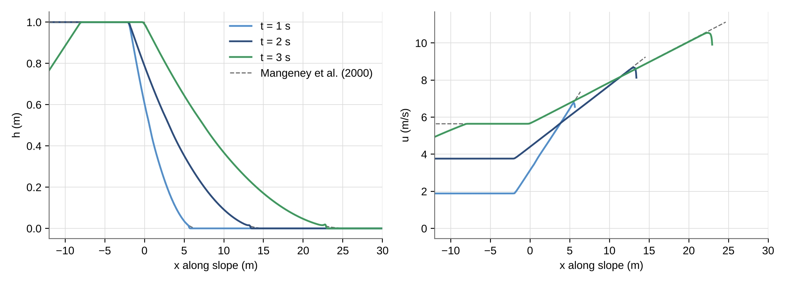

### 02 Viscoplastic arrest on a horizontal plane

- **Set-up:** Carbopol 0.30 % (Cochard & Ancey 2009: τ_y = 89 Pa, K = 47.68 Pa sⁿ, n = 0.415), ρ = 1000. Lock 0.5 m × 0.3 m against a wall, 1D, 60 s.
- **Reference:** a deposit that has yielded everywhere satisfies `h² = 2 τ_y (x_f − x)/(ρ g)`. Volume conservation then gives x_f = 1.408 m and h(0) = 0.160 m.

| run | x_f (m) | h(0) (m) | volume (m²) | max \|u\| at 60 s |
|---|---|---|---|---|
| exact (fully yielded) | 1.408 | 0.160 | 0.15 | 0 |
| W 120 5, dx = 1 cm | 1.460 | 0.145 | 0.14997 | 3.0e-4 m/s |
| W 120 5, dx = 5 mm | 1.445 | 0.145 | 0.14997 | 2.9e-4 m/s |
| legacy W 90 1 (explicit 1.5τ_y + 3Ku/h) | — | — | — | emergency stop at step 3 (N 61) |

- **Front:** within 2.6–3.7 % of the fully yielded profile.
- **Wall region:** h(0) is 9 % lower than the analytical value. The part near the wall stops below yield after the dynamic phase, so the deposit is not fully yielded there, and more material reaches the front.
- **Creep:** the front region still creeps at about 1e-4 m/s, with h dh/dx about 15 % above τ_y/(ρg). It slows down slowly and is independent of the grid.

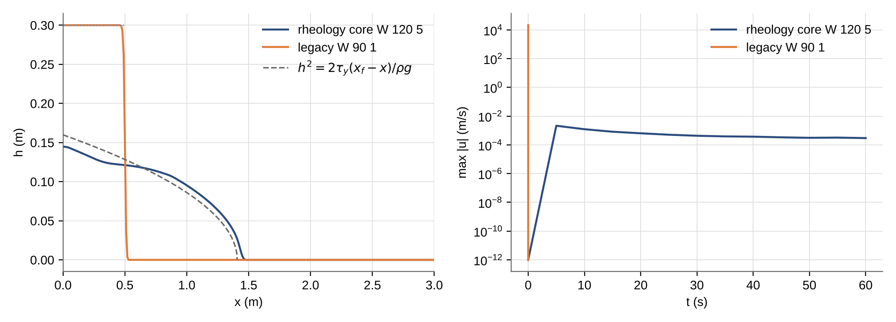

### 03 Carbopol on a 12° incline (Cochard & Ancey 2009)

- **Set-up:** Carbopol 0.30 %, reservoir 0.51 m × 0.30 m with walls, 33 cm deep at the gate, free surface horizontal (43 kg). Gate removed instantly, 2D, dx = 2 cm, 2 ranks, 30 s. dx = 1 cm (10 s) gives the same front to 1 cm. Volume conserved to 0.1 %.
- **Reference:** the paper gives the front only in figures. The text gives a front speed of about 0.7 m/s in the inertial phase (t < 1 s), an end of the inertial phase at 1.20–1.45 m (12°, 0.25–0.40 %), and slow creep afterwards with x_f ∝ t^0.275 to 1.9 m over hours (no arrest).

| | SFLOW | Cochard & Ancey |
|---|---|---|
| mean front speed 0–1 s | 0.78 m/s | ~0.7 m/s (gate opened over 0.8 s) |
| x_f at 2 s / 10 s / 30 s | 0.86 / 0.94 / 1.00 m | 1.20–1.45 m at the end of the inertial phase |
| late regime | x_f ∝ t^0.06, arrests | x_f ∝ t^0.275, creeps for hours |

- **Inertial phase:** the speed matches.
- **Late regime:** the model stops about 25–30 % short and arrests. That is what a Herschel-Bulkley material must do: the deposit thins to the critical depth h_c = τ_y/(ρ g sinθ) = 4.4 cm. 0.043 m³ at h_c covers about 1 m², which is the area the model deposit covers.
- **Why the experiment goes further:** a front at 1.9 m means a mean depth well below h_c. A pure Herschel-Bulkley yield stress can't hold that. Wall slip and thixotropy of Carbopol (not in the model) are the likely reasons, as are the 3D non-shallow reservoir and the gate opening.

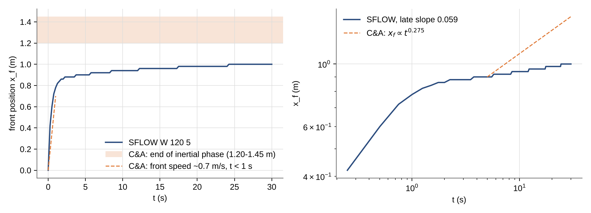
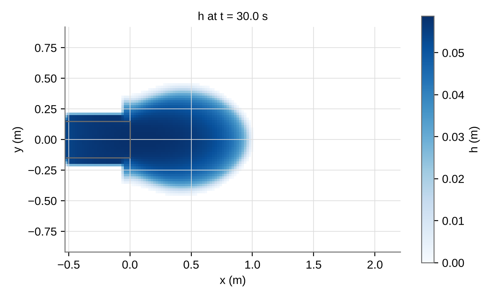

### 04 Uniform layer with dissipating pore pressure

- **Set-up:** h = 1 m on 20°, δ = 25°, λ from 0.5 to 0 with T = 4h²/(π²D) = 5 s, 1D, 300 m (speed taken at x = 150 m).
- **Reference:** `u = (g sinθ − g cosθ tanδ (1−λ_h)) t + g cosθ tanδ (λ0 − λ_h) T (1 − e^{−t/T})` until u = 0. After that the layer stays at rest.

| | SFLOW | analytic |
|---|---|---|
| peak speed | 2.1448 m/s | 2.1455 m/s |
| stop | first output at rest 9.80 s | 9.781 s |
| max \|u − u_exact\| | 1e-4 m/s | |

Serial and 2 ranks give identical results.

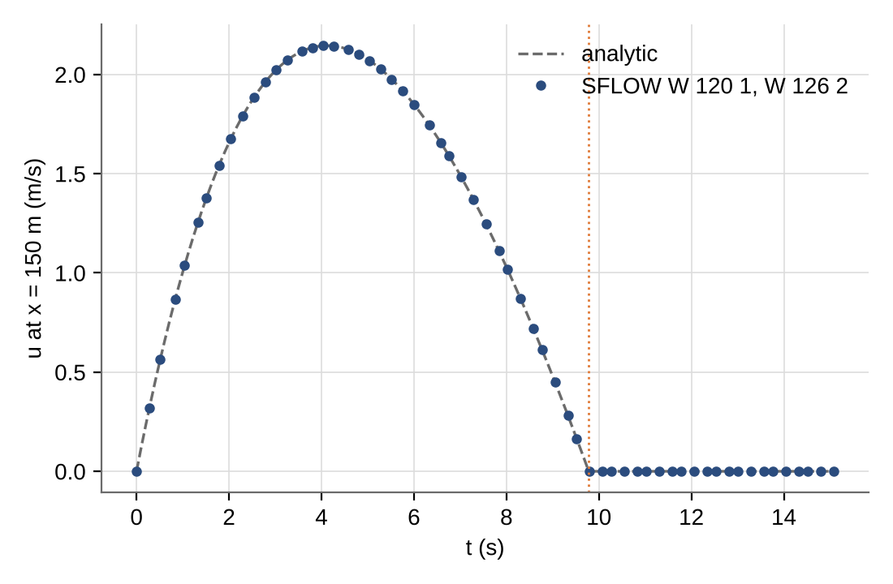

### 05 Uniform layers, all basal laws

An infinite uniform layer on an incline, starting from rest, compared with `du/dt = g_x − τ_b(u)/(ρh)` integrated with the same closure in steps of 1e-6 s (`tools/uniform_ode.cpp`). The domains are long enough that the walls don't reach the probe.

| law | set-up | steady u, SFLOW / ODE (m/s) | max error / max u |
|---|---|---|---|
| Voellmy | h = 1 m, 30°, δ = 21.8°, ξ = 200 | 5.4004 / 5.3965 (t = 8 s) | 0.13 % |
| Pouliquen-Forterre | h = 5 mm, 25°, glass beads | 0.14247 / 0.14246 | 0.7 % |
| μ(I) | h = 5 mm, 25°, glass beads | 0.08688 / 0.08688 | 2.0 % |
| Herschel-Bulkley | h = 0.1 m, 12°, Carbopol 0.30 % | 0.1202 / 0.1202 | 0.8 % |
| Herschel-Bulkley-Coulomb | h = 0.1 m, 12°, c = 20 Pa, δ = 5.7° | 0.04998 / 0.04998 | 1.2 % |

The largest errors are in the first steps of the acceleration (RK stage weights and output times). The steady states agree to 4–5 digits.

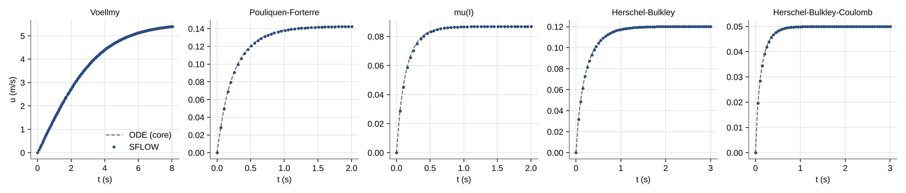

### 06 CFD: steady films on an incline (HB, HBC, μ(I))

- **Set-up:** 2D, periodic in x (4 columns), no-slip bed. The domain is filled with the material up to a slip lid at the film surface (the level set lies above the lid), so there is no air layer.
  - Why no air: REEF3D's momentum diffusion is ∇·(ν(∇u + ∇uᵀ)) with the kinematic viscosity. Air driven by the tilted gravity therefore drags on the film with a stress per unit mass of the order g sinθ H_air, wrong by the density ratio. With an air layer the film was wrong by tens of percent.
- **Inclined frame:** W 20 = g sinθ, W 22 = −g cosθ.
- **References:**
  - HB: the exact plug-flow profile.
  - HBC and μ(I): the exact profile for the solved pressure of the run, τ = ρ g sinθ (h − z), p' = p(z). The solved pressure is zero at the top cell centre instead of the lid, so it is ρ g cosθ dz/2 below hydrostatic. That matters for μ(I) near the surface (τ/p' → μ₂).
  - μ(I) is therefore compared on the lower half of the film.

| law | set-up | max \|u − u_ref\| / max u_ref | steady |
|---|---|---|---|
| Herschel-Bulkley | Carbopol 0.30 %, h = 0.1 m, 12°, 40 cells | 3.5 % (Papanastasiou m = 1000) | 1e-5 per output |
| Herschel-Bulkley-Coulomb | c = 20 Pa, φ = 5.7°, as above | 2.4 % | 1e-3 per output |
| μ(I) (Bagnold) | glass beads, h = 20 mm, 25°, 40 cells, 10 s | 1.6 % (lower half) | 4e-4 per output |

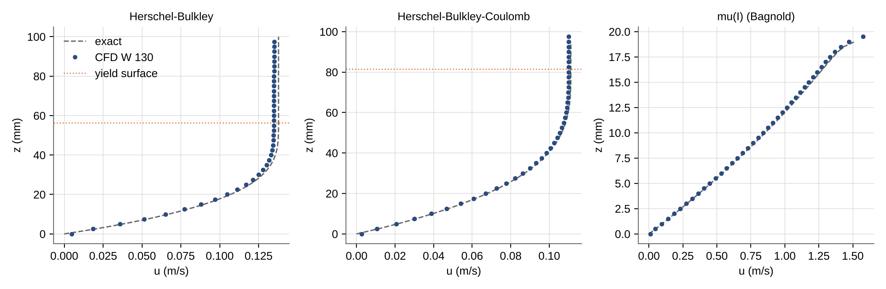

### 07 CFD: granular column collapse (μ(I))

- **Set-up:** 2D, glass beads (W 124 defaults, d = 0.5 mm, ρ = 1500), L0 = 0.1 m against a wall, a = H0/L0 = 0.5 and 2, no-slip bed (`D 22 2`), `F 46 3`, 2 ranks. `a05_fine` is a = 0.5 at dx = 1.25 mm, run to 0.6 s (20 min on 2 ranks).
- **Volume:** the level-set volume correction (`F 46 3`) is needed. Without it the granular area dropped by 17 % in 1.5 s at a = 0.5.
- **Front:** the last point with h > 10 d = 5 mm. The thin tail ahead of it (h > dx/2) moves forward with each refinement and is listed separately.
- **References:** quasi-2D experiments, Lube et al. (2005): (L∞ − L0)/L0 ≈ 1.2a for a < 2.3. Lajeunesse et al. (2005): ≈ a.

Grid series at a = 0.5 (deposit at rest from about 0.35 s):

| dx | front h > 5 mm | tail h > 2 mm | tail h > dx/2 | h(0)/H0 | deposit slope |
|---|---|---|---|---|---|
| 5 mm | 0.60 | 0.60 | 0.60 | 1.07 | 16.5° |
| 2.5 mm (`a05`) | 0.72 | 0.83 | 0.85 | 1.02 | 15.5° |
| 2 mm | 0.72 | 0.86 | 0.88 | 1.02 | 15.6° |
| 1.25 mm (`a05_fine`) | 0.71 | 0.87 | 0.94 | 1.01 | 15.6° |

| case | dx | front (L − L0)/L0 | Lube 1.2a | Lajeunesse ~a |
|---|---|---|---|---|
| a = 0.5 | 2.5 mm | 0.72 | 0.6 | 0.5 |
| a = 2 | 2.5 mm | 3.7 | 2.4 | 2.0 |

- **Grid convergence:** the front (h > 5 mm), the height at the wall and the deposit slope are converged from dx = 2.5 mm (H0/20). Only the tail thinner than about 2 mm (4 grain diameters) still creeps forward with refinement.
- **Against the experiments:** the runout is 20 % (a = 0.5) and 55 % (a = 2) longer than Lube et al., and the deposit slope (15.6°) is below the friction angle δ_s = 20.9°. Not the cause: the μ(I) regularisation (W 134 0), the cap μ_max (1e3–1e6 Pa s), the solver tolerance, the time step, F 45. The cause is the missing side-wall friction of the quasi-2D channels: the model reproduces the 2D benchmark of Lagrée et al. (2011) below, and their 2D contact dynamics (no side walls either) also run out about twice as far as the channel experiments (2.5a against Lube's 1.2a). Martin et al. (2017) find the side-wall friction important on slopes from about 10° and of less effect on a horizontal bed. Confirmed with the measured wall friction of the channel experiments (`W 135`, below): +15 % at a = 2, slopes up to the angle of repose. These cases (`a05`, `a20`, `a05_fine`) keep `W 131 2`.

**2D benchmark: Lagrée, Staron & Popinet (2011)** (`lagree_a05`, `lagree_a142`). Their parameters: μ_s = 0.32, Δμ = 0.28, I0 = 0.4 (`W 124 17.745 30.964 0.4 0.00122 1.0`), d = L0/82 (estimated from their contact-dynamics column of 3407 grains at a = 0.5, packing 0.8; the paper gives no d), a slip wall behind the column (`C 11 3`), no-slip bed, L0 = 0.1 m, dx = 2.5 mm (L0/40; theirs L0/32), 1.5 s, 2 ranks (3–5 min). References: their 2D Navier-Stokes μ(I) runs (VOF, Gerris) fit (L∞ − L0)/L0 = 2.2a and H∞/L0 = a (a ≤ 0.5), 0.67a^0.4 (0.5 < a < 6); their contact dynamics 2.5a. Their front is the edge of the material, here the tail h > dx/2.

| a | (L∞ − L0)/L0: tail / h > 5 mm | NS 2.2a | CD 2.5a | H∞/L0 | Lagrée |
|---|---|---|---|---|---|
| 0.5 | 0.90 / 0.83 (kinematic diffusion D 24 0: 0.98) | 1.10 | 1.25 | 0.456 (D 24 0: 0.481) | 0.50 |
| 1.42 | 3.10 / 2.95 (D 24 0: 3.20) | 3.12 | 3.55 | 0.705 (D 24 0: 0.738) | 0.77 |

- The runout of a = 1.42 equals the Navier-Stokes law (−1 %); a = 0.5 is 18 % (D 24 0: 11 %) short of it. The fit is linear over a ≲ 7 and least certain at its small-a end.
- **Slump after the arrest (W 131 2):** H∞ falls by 8 % between 0.6 and 2.5 s (a = 0.5, 1 rank: 0.0488 → 0.0449 m) while the toe stays; the bulk moves at 1–4e-3 m/s and the height approaches its end value slowly. The cause is the interface band: on the air side of the inclined surface (−e < φ < 0) a thin layer flows downslope at 0.14 m/s with a wall-jet profile and carries the level set. The band is a heavy mixture (density H ρ₁ + (1 − H) ρ₂) whose viscosity was blended by H: its strength H μ_s p′ is below its weight's downslope pull where H < tan θ/μ_s, and p′ of the band is about the air pressure. Not the cause: the viscosity cap (μ_max 1e4 – 1e6 Pa s the same), the μ(I) regularisation (W 134 0 the same), the air viscosity (W 4 × 100: 0.0483 → 0.0450 m), the lithostatic pressure W 131 1 (worse: 0.0477 → 0.0355 m, the toe advances), a floor on p′ alone.
- **`W 131 3`:** p′ at least the hydrostatic pressure of the smoothed band, ρ₁ (g·n) ∫_{−e}^{φ} H ds (≤ ρ₁ (g·n) e), and the material's viscosity over the whole band (φ > −e) instead of H times it (`fluid_update_rheology`, with D 24). The band then has the strength μ_s p′ against its weight and holds below the friction angle.

  | a = 0.5, 1 rank | H∞ at 0.6 / 1.0 / 1.5 / 2.0 / 2.5 s (m) | bulk max \|u\| at 1.5 s | band max \|u\| at 1.5 s |
  |---|---|---|---|
  | W 131 2 | 0.0488 / 0.0467 / 0.0456 / 0.0451 / 0.0449 | 3.6e-3 m/s | 0.28 m/s |
  | W 131 3 | 0.0494 / 0.0495 / 0.0494 / – / – | 2.7e-4 m/s | 0.025 m/s |

  Against the Lagrée et al. benchmark (dx 2.5 mm): a = 0.5 runout (tail) 0.825 (W 131 2: 0.90; NS 1.10), H∞/L0 0.494 (0.456; 0.50); a = 1.42 runout 3.05 (3.10; 3.12), H∞/L0 0.74 (0.705; 0.771). The heights improve, the runout of a = 0.5 falls by 8 %. The film of case 06 is unchanged (2.82 % against 2.81 %). Both options approach each other as the band (2 F 45 dx) shrinks with the grid; `W 131 3` is recommended for deposits and long runs, the default stays `W 131 2` for now.

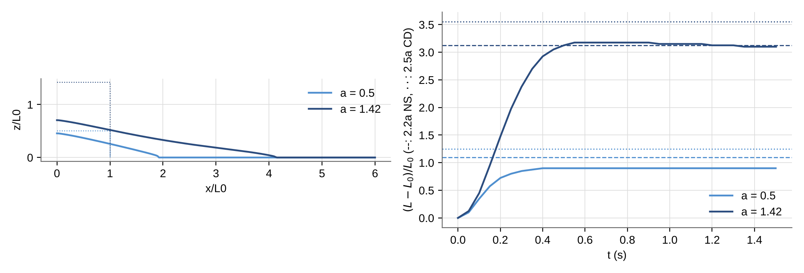

- **Effective pressure:** the lithostatic pressure (W 131 1) gives 1.08 at 2.5 mm, because φ under the flank is not the overburden. The runs above use `W 131 2`; the default is now `W 131 3` (channel experiments below).
- **Interface currents:** 0.1–0.35 m/s remain in the interface cells and in the air near the toe, not in the bulk.

**Channel experiments: side-wall friction and the interface band** (`lajeunesse_a05`, `lajeunesse_a2`). The quasi-2D experiments ran between glass walls, which the 2D model did not have. Lajeunesse, Monnier & Homsy (2005) measured them: glass beads d = 1.15 mm, angle of repose 22°, wall friction on glass 11°, gap 45 mm. The cases use their beads (`W 124 22 33.5 0.279 0.00115 0.62`, ρ = 1550) and walls (`W 135 11 0.045`), L0 = 0.1 m, dx = 2.5 mm, 1 s, 2 ranks (2–6 min each).
- **References:** Lube et al. (2005): (L∞ − L0)/L0 = 1.2 a (a < 2.3), 1.9 a^⅔ (a > 2.3), duration 3 (2H0/g)^½. Lajeunesse et al. (2005): linear in a for a ≲ 3, prefactor about 1 (narrower gap than Lube). 2D contact dynamics without walls (Staron & Hinch 2005): 2.5 a, H∞/L0 = a (a < 1), 0.65 a^0.35. Deposit slopes: Balmforth & Kerswell (2005) 18–23° in their wide slot (between the wall and the internal friction angle), the internal friction angle in their narrow slot.

| a | walls `W 135` | `W 131` | (L∞ − L0)/L0, h > 2 / 5 mm | Lube 1.2a | H∞/L0 | slope | at rest |
|---|---|---|---|---|---|---|---|
| 0.5 | no | 2 | 0.70 / 0.65 | 0.60 | 0.515 | 16.8° | 0.3 s |
| 0.5 | 11° | 2 | 0.65 / 0.60 | | 0.521 | 17.8° | |
| 0.5 | no | 3 | 0.65 / 0.60 | | 0.504 | 18.6° | |
| 0.5 | 11° | 3 | **0.575 / 0.525** | | 0.505 | **20.8°** | 0.2 s |
| 2 | no | 2 | 3.50 / 3.40 | 2.40 | 0.971 | 12.1° | 0.5 s |
| 2 | 11° | 2 | 2.93 / 2.80 | | 1.131 | 17.5° | |
| 2 | no | 3 | 3.48 / 3.40 | | 0.991 | 12.4° | |
| 2 | 11° | 3 | **2.75 / 2.70** | | 1.152 | **17.6°** | 0.4 s |

- **Runout:** the side walls bring a = 2 from +46 % to +15 % of Lube et al. and a = 0.5 from +17 % to −4 % (h > 2 mm; Lajeunesse's narrower gap: about a, i.e. +15 % and +37 %). Without walls the model runs out like 2D contact dynamics in shape but at 1.4–1.75 a, below its 2.5 a. The remaining excess at a = 2 is within the spread of the experiments (Lube 1.2 a, Lajeunesse about a for the same beads in different gaps); the a^⅔ regime is not reached at a = 2.
- **Deposit slope:** the side walls steepen the flank most (a = 2: 12° → 17.5°); `W 131 3` adds the rest at a = 0.5 (17.8° → 20.8°, the angle of repose of the beads is 22°). Without both the band slumps (`W 131 2`: H∞ at the wall falls after the arrest, 0.1152 → 0.1131 m from 0.6 to 1.0 s at a = 2; with `W 131 3` 0.1158 → 0.1152 m). The low slopes of the earlier runs (15.6° against 20.9°) came from the missing walls and the slumping band, not from μ(I).
- **Height:** with walls H∞/L0 = 1.15 at a = 2, above the 2D contact dynamics without walls (0.83) and the model without walls (0.97–0.99): the walls hold the column back. Lajeunesse et al. give H∞ ∝ a^⅓ without a prefactor.
- **Duration:** the front stops after 2–2.5 (2H0/g)^½ (Lube: 3).
- **Decision:** `W 131 3` is the default with W 130 from 20.11.2026 (band viscosity only with a yield stress). It holds deposits (case 07 a = 0.5: H∞ constant, bulk 13 times slower; case 31 wedge at rest), gives the measured slopes with the walls, and keeps the Lagrée runout at a = 1.42 (−2 %); at a = 0.5 it shortens the Lagrée runout by 8 %.

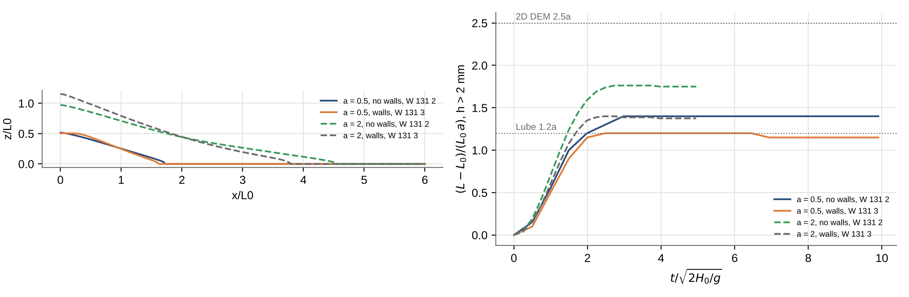

**Wall boundary and 3D implicit diffusion.** Two problems of the REEF3D CFD diffusion turned up here; neither is in the rheology. Both are fixed:

- `D 22 1` (default) folds the wall ghost cells into the diagonal and acts as free slip for viscous flows (case 09). W 130 now sets `D 22 2`.
- 3D viscous flows were wrong (not `D 22 2` itself). A quasi-2D column (2–4 cells in y, symmetry planes) with ν = 0.005–0.05 m²/s stayed frozen; with periodic y it ran 4 times faster than in 2D. The cause: the cross terms ∂/∂x(ν ∂u/∂z) and ∂/∂y(ν ∂v/∂z) of the 3D w diffusion (`idiff2_FSw`, also `idiff2_CNw`, `idiff2_PLICw`) took u(i,j,k+1) and v(i,j,k+1) from the field of the start of the step (`a->u`, `a->v`) and u(i,j,k), v(i,j,k) from the stage. In RK stages 2 and 3 that is a spurious stress of the order ν Δu_stage/dz², large for viscous materials and invisible for water. The 2D version was right. Fixed: the quasi-2D column (Newtonian ν = 0.05, 2 cells in y, symmetry planes or periodic) now equals the 2D run to the printed digits (front 0.10 L0 at 0.2 s, max u 0.087–0.093 m/s). With periodic y a spurious v of 3e-3 m/s remained: the corner exchange (`gcparacox`) set the ghost cells of the periodic direction under the bed from the neighbouring ghost cell, and the w diffusion of the v equation read w(i,j+1,k−1) there. The periodic copy now runs again after the corner exchange: v 3e-6 m/s (water: 3e-8, before 4e-5 after one step). The μ(I) collapse a = 0.5 at dx = 2.5 mm with 2 cells in y and symmetry planes gives the 2D deposit to the printed digits (front h > 5 mm 0.72 L0, h > 2 mm 0.83 L0, h(0) 0.0512 m at 0.6 s; 5 min on 2 ranks). The wall ghost coefficients (`diff_wallghost`) were checked face by face: free slip c1 = 1 on the symmetry planes, no slip c1 = −1 at the bed and the walls, 0 for the normal component.

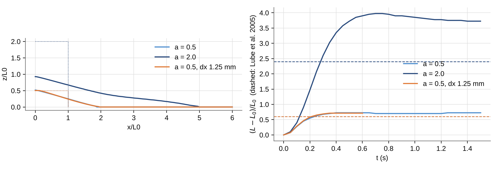

### 08 CFD: viscoplastic arrest on a horizontal plane (as 02)

- **Set-up:** Carbopol 0.30 %, lock 0.5 m × 0.3 m, dx = 5 mm, 2 ranks, 6 s, `F 46 3`.

| run | x_f (m) | h(0) (m) | area (m²) |
|---|---|---|---|
| exact (shallow, fully yielded) | 1.408 | 0.160 | 0.15 |
| CFD W 130 1 | 1.27 | 0.193 | 0.150 |
| SFLOW W 120 5 (case 02, 60 s) | 1.46 | 0.145 | 0.150 |

- **Deposit:** the CFD deposit follows the yield profile h² = 2τ_y(x_f − x)/(ρg) between x = 0.1 and 1.1 m. Its front is 10 % short, and there is a meniscus at the wall.
- **Shallow reference:** the analytical profile is the shallow (lubrication) limit. The CFD resolves the vertical structure, and h/L is not small near the wall.
- **Residual velocity:** max |u| in phase 1 stays at about 1e-2 m/s, in the interface cells.

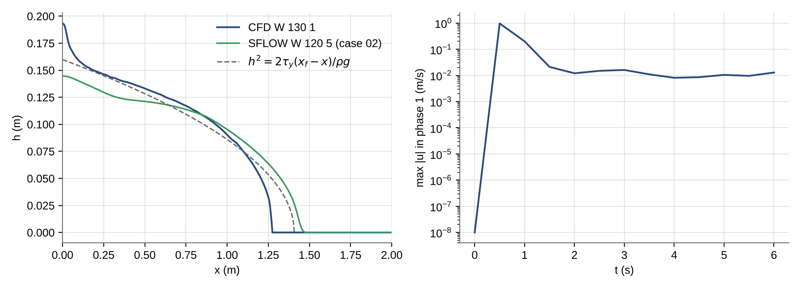

### 09 CFD: viscous gravity current (Newtonian, wall boundary check)

- **Set-up:** the a = 0.5 column of 07 (A = 0.005 m²) as a Newtonian fluid, ν = 0.05 m²/s, ρ = 1500, no rheology (W 130 0), 2D, dx = 2.5 mm, 10 s, 2 ranks.
- **Reference:** the similarity solution of Huppert (1982), x_N = 1.411 (g A³ t/(3ν))^{1/5}. It assumes a point release, so it is approached from above as the current forgets its initial shape.

| D 22 | front at 1 s / 10 s (m) | Huppert (m) | max deviation, t ≥ 1 s |
|---|---|---|---|
| 2 | 0.147 / 0.225 | 0.136 / 0.216 | 8 % (4 % at 10 s) |
| 1 (default) | 0.308 / end of domain (0.6 m) from 3 s | 0.136 / 0.216 | — |

With `D 22 1` the bed acts as free slip, so the current runs off like an inviscid dam break. Area change −1 % in both runs.

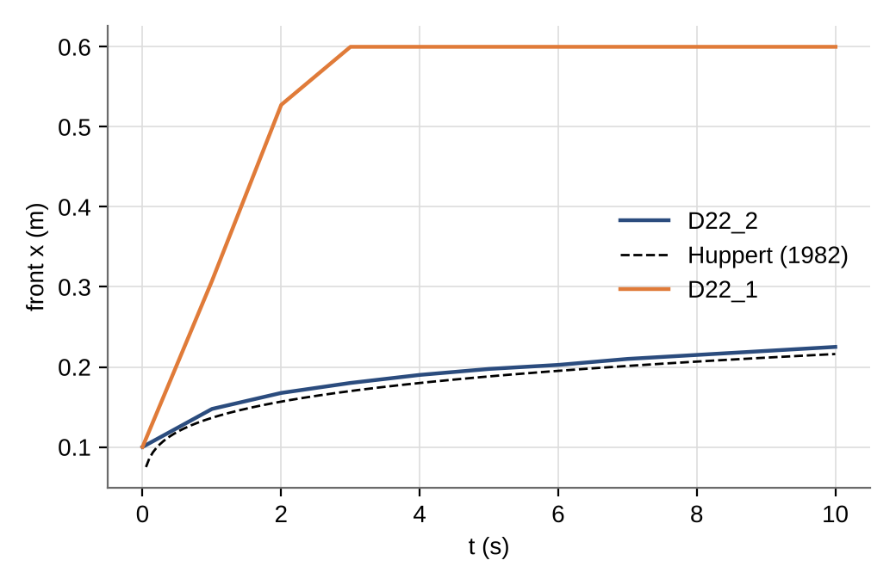

### 10 SFLOW semi-implicit (A 210 11): cases 01–05 again

- **Set-up:** the controls of 01–05 with `A 210 11` (one-step predictor) and the semi-implicit defaults (θ = 0.55, N 47 0.5; with W 120 the gravity wave Courant number 2), `A 232` about 1 % of the flow depth (01, 04: 0.01 m; 02, 03: 3 mm; 05: 1 % of each layer). The 1D cases keep `A 531 1.0e6`; the 2D release of 03 needs `A 531 20` (without the limiter the first steps over the dry bed blew up).
- **References:** as 01–05, and the explicit runs.

| case | semi-implicit | explicit (01–05) | steps SI / explicit |
|---|---|---|---|
| 01 Coulomb dam break, L1(h) at 1 / 2 / 3 s | 0.32 / 0.39 / 0.45 % | 0.11 / 0.14 / 0.19 % | 1424 / 1201 |
| 01 L1(u) at 1 / 2 / 3 s | 0.81 / 0.32 / 0.18 % | 0.18 / 0.15 / 0.15 % | |
| 01 front h > 1 mm at 1 / 2 / 3 s (exact 6.3 / 14.55 / 24.65 m) | 6.65 / 14.7 / 24.55 m | 5.65 / 13.40 / 22.95 m | |
| 02 Carbopol arrest: x_f, h(0), max \|u\| at 60 s | 1.44 m, 0.144 m, 2.1e-4 m/s | 1.46 m, 0.145 m, 3.0e-4 m/s | 3797 / 18066 |
| 03 Cochard & Ancey (2D, 2 ranks): front at 1 / 2 / 30 s | 0.78 / 0.86 / 1.00 m | 0.78 / 0.86 / 1.00 m | 887 / 6030 |
| 04 pore pressure: peak speed (exact 2.1455 m/s), max \|u − u_exact\| | 2.1438 m/s, 0.002 m/s | 2.1448 m/s, 1e-4 m/s | 49 / 169 |
| 05 uniform layers: steady u, all laws | ODE to 4 digits | ODE to 4–5 digits | 42–153 / 165–449 |
| 05 max error / max u during the acceleration | 0.3–1.5 % | 0.13–2 % | |

- **Front:** better than the explicit one; the explicit HLL front lags 7 % in its thin tail.
- **Arrest and transients:** equal to the explicit runs. With the gravity wave Courant number 10 and one solve the deposit of 02 ran to 1.81 m and h(0) fell to 0.11 m; the single backward-Euler friction step gave up to 20 % during the accelerations of 05.
- **Time steps:** the semi-implicit step pays off in slow and arrested flows (02: 5 times fewer steps, 03: 7 times; 03 runs in 36 s on 2 ranks). The fast dam break of 01 is limited by the flow Courant number in both.
- **Pore pressure:** the stop of 04 shows in the outputs 0.4 s late, the step is 0.5–0.65 s there (Courant number 2 in a 1 m layer on 1 m cells).

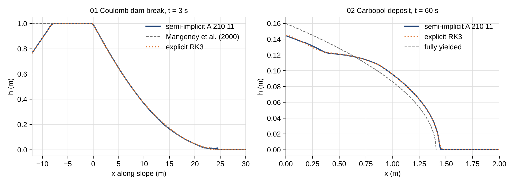

### 11 CFD: Herschel-Bulkley film under air (dynamic diffusion D 24)

- **Set-up:** the HB film of 06 (Carbopol 0.30 %, h = 0.1 m, 12°, 40 cells, periodic) with 2 cm of air above it (8 cells) and a no-slip lid, 5 s, one rank. W 20/W 22 tilt the gravity of both phases.
- **Reference:** the exact single-layer profile. The air stress on the film (ρ_a g sinθ H_a and μ_a u/H_a) is below 1e-3 of the basal stress.

| D 24 | max \|u − u_exact\| / u_s | surface speed (exact 0.1378 m/s) | change per output at 5 s | air max (m/s) |
|---|---|---|---|---|
| 0 (kinematic, as before) | 92 % | 0.264 | 1.3e-2 | 3.6 |
| 1 (arithmetic shear viscosity) | 2.2 % | 0.1351 | 1.2e-5 | 3.1 |
| 2 (harmonic, default with W 130) | 1.1 % | 0.1388 | 1.1e-5 | 3.7 |
| 2, no air (case 06 hb) | 1.1 % | 0.1387 | | |

- The kinematic form gives the film the stress of the air per unit mass of the film: it ran at twice the speed and was not steady. The air itself is accelerated by the tilted gravity (to 3–4 m/s at the lid flow); that is the same in all runs.
- D 24 0 reproduces the binary before the patch to the printed digits. 59 CFD regression cases (30 2D, 29 3D, `quick`, 2 ranks at most) are bitwise identical with the default D 24 −1 (water: 0).
- The μ(I) collapse of 07 (a = 0.5, 2.5 mm) with D 24 2: runout 0.725 L0 (kinematic 0.725 L0 in this run, 0.72 in 07), h(0)/H0 0.97 (1.04). The runout did not get worse; it did not get better either: the overprediction of 07 is not the kinematic diffusion.

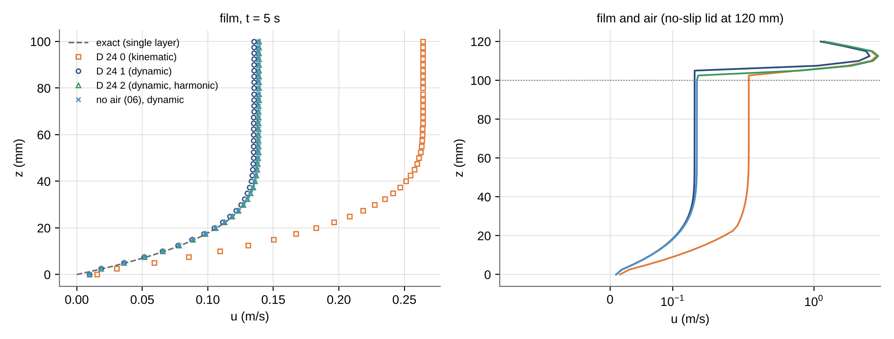

### 12 CFD three-phase: transport and mixture (viscous current, μ(I) collapse)

- **Set-up:** the cases 09 and 07 as a slide (W 140, α_s from a box W 147) in air (the level set below the domain), W 143 0, D 24 2 (automatic), 2 ranks. 09: Newtonian W 130 1 with K = 75 Pa s (ν = 0.05 m²/s), ρ_s = 1500, 10 s. 07: μ(I) as in 07, grain density W 142 2500, 1.5 s. `collapse_q3d`: the μ(I) collapse with 2 cells in y and slip side walls, 0.6 s.

| | three-phase | two-phase level set | reference |
|---|---|---|---|
| viscous current: front at 1 s / 10 s | 0.145 / 0.220 m | 0.147 / 0.225 m (09) | Huppert (1982) 0.136 / 0.215 m |
| viscous current: max deviation from Huppert, t ≥ 1 s | 7 % | 8 % | |
| slide volume, max relative change | 4e-12 (current), 2e-14 (collapse) | 1 % (level set, F 46 3) | |
| μ(I) collapse a = 0.5: front at 0.5 s | 0.725 L0 | 0.725 L0 | Lube et al. 0.6 L0 |
| μ(I) collapse: front at 1.5 s | 0.725 L0, at rest from 0.5 s (`W 131 2`: 0.90 L0, creeping) | 0.725 L0 (at rest from 0.45 s) | |
| μ(I) collapse: h(0)/H0 at 1.5 s, max \|u\| in the slide | 0.995, 1e-3 m/s (`W 131 2`: 0.94, 0.13 m/s) | 0.97 | |
| quasi-3D collapse (2 cells in y) at 0.6 s | front, h(0), max \|u\| as 2D to the printed digits, \|v\| < 1e-6 m/s | | |

- **Transport:** α_s stays in [0, 1] without clipping; the volume is conserved to round-off and the solver tolerance of the projection.
- **The thin tail crept with `W 131 2`** (fixed by the band treatment, `W 131 3`, the default with W 140; case 31). The bulk deposit of the collapse equals the two-phase one up to x = 1.5 L0, but the tail thinner than about 4 cells moves on at 0.1–0.2 L0/s after the collapse has stopped. Cause: interface currents in the air at the toe. A wall jet of 0.6 m/s runs along the bed ahead of the toe, driven by an overpressure of about 10 Pa in the band where the smoothed slide density meets the air: the pressure gradient that the yield stress holds inside the slide acts on the light band cells. The two-phase level set has the same jet (0.5 m/s), and its deposit stops; the conservative α_s is carried by it. With `W 131 3` the deposit is at rest from 0.5 s (1e-3 m/s), the tail does not move, and the air at the toe slows down to 0.09 m/s at 1.5 s.
- **Interface currents:** 0.4–0.9 m/s in the air next to the slide surface, up to 0.1 m/s in interface cells of the slide (the current itself moves at 5 mm/s at 10 s); level set 0.2–0.5 m/s. A flat slide layer at rest (case 13) stays at rest (2e-8 m/s).
- Ruled out as the cause of the currents (W 131 2): the arithmetic shear viscosity (harmonic D 24 2 is the default now; arithmetic 2.6 m/s at 0.3 s, harmonic 2.0), the sharpness of α (smoothing over ±2 cells: 1.1 → 0.88 m/s at 0.3 s, kept). A balanced-force gravity (p − ρ g·x as in interFoam's p_rgh) does not help here: on the staggered grid with the face density the mean of its two cells it is the same discretisation. The cause is the strength of the band (case 31).

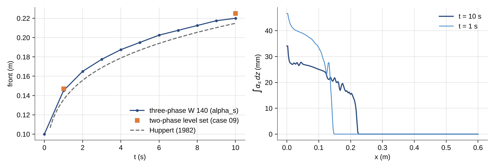
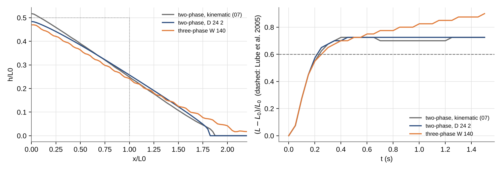

### 13 CFD three-phase: pore pressure of a layer at rest

- **Set-up:** a slide layer h = 0.1 m (ρ_s = 2000, HBC c = 0, φ = 30°, at rest on a horizontal bed) under 5 cm of water and air, periodic in x, W 143 2, λ₀ = 0.5, k = 1e-9 m², β = 1.2337e-3 1/Pa: D = k/(η_w β) = 8.1e-4 m²/s, T = 4h²/(π²D) = 5 s (as SFLOW case 04), 10 s, dz = 5 and 2.5 mm, one rank.
- **Reference:** level 1: p − p_hyd = (ρ_s − ρ_w) g (h − z). Level 2: the series solution of ∂p/∂t = D ∂²p/∂z² for p(z,0) = λ₀ (ρ_s − ρ_w) g (h − z), p(h) = 0, ∂p/∂z(0) = 0.

| dz | p − p_hyd, max error | p_e at z = 10 mm, t = T (series 144.5 Pa) | max \|p_e − series\| / p₀ |
|---|---|---|---|
| 5 mm | 0.14 % (`W 131 3`: 0.56 %, the floor in the band at the surface) | 149.9 Pa | 1.2 % |
| 2.5 mm | 0.10 % | 147.4 Pa | 0.61 % |

- The drained boundary p_e = 0 sits at the first cell outside the slide, half a cell above the surface: the run lies between the series for h and for h + dz/2 and converges with first order.
- The initial excess is taken after the first step (λ₀ times the solved p − p_hyd of the layer at rest).

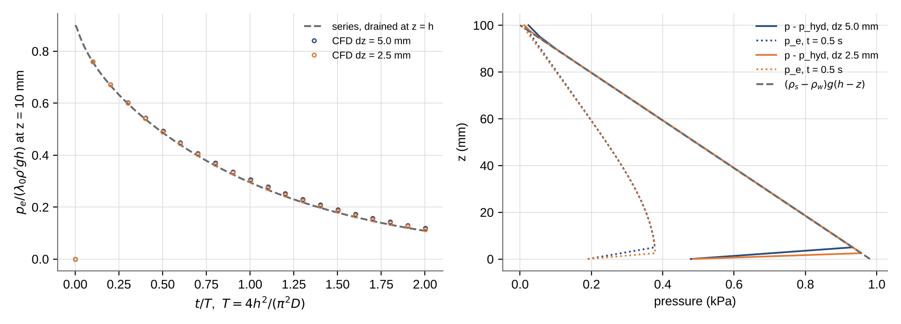

### 14 CFD three-phase: granular collapse in a viscous fluid, loose and dense (Rondon, Pouliquen & Aussillous 2011)

- **Set-up:** glass beads d = 0.225 mm, ρ_p = 2500, in a water-Ucon mixture (ρ = 1000, ν = 1.2e-5 m²/s), as Rauter (2021): loose φ₀ = 0.55, L0 = 6 cm, H0 = 4.8 cm (ρ_s = 1825); dense φ₀ = 0.60, H0 = 4.2 cm (ρ_s = 1900). Fluid to 9 cm, air above, 25 × 10.6 cm, dx = 2 mm, 2 ranks, 30 s. μ(J) W 130 5 with μ₁ = 0.34, μ₂ = 0.74, J₀ = 0.005 (Rauter 2021), φ_c = 0.585, K₃ = 4.09, k Carman-Kozeny (5e-11 m²), β = 1e-7 1/Pa (quasi-static drainage), W 143 2, λ₀ = 0.
- **Reference:** Rondon et al. (abstract and figures, no tables): the loose column flows fast with positive pore pressure below it; the dense one flows more slowly, with negative pore pressure, and runs out about half as far; the dense collapse takes more than 30 s (Rauter 2021, whose two-phase model gives about 10 s for dense).

`W 131 3` (the default with W 140), and in brackets `W 131 2`:

| | loose φ₀ = 0.55 | dense φ₀ = 0.60 |
|---|---|---|
| p_e at the bed, x = 2 cm | +176 Pa (0.25–2.5 s), then 0 (+176 Pa) | −105 Pa, −10 Pa at 30 s (−185 Pa) |
| 95 % of the final runout reached | 4.5 s | 16 s |
| front − L0 at 30 s | 0.094 m = 1.57 L0, at rest (0.134 m, creeping) | 0.054 m = 0.90 L0 (0.110 m, creeping) |
| runout dense / loose | 0.57 (0.82) | |
| h(0)/H0 at 30 s | 0.63 (0.52) | 0.94 (0.70) |
| max speed in the slide (outputs every 0.5 / 1 s) | 0.08 m/s | 0.013 m/s |

- **Right:** the sign of the excess pore pressure (contracting loose, dilating dense), its magnitude (loose: about the buoyant overburden at the sensor, a fluidised base), the time scales (loose a few seconds, dense tens of seconds, set by the drainage), the runout of the dense column about half that of the loose one (0.57), and its much higher deposit.
- With `W 131 2` both deposits crept at the toe after the collapse (the tail creep of case 12) and the runout ratio was 0.82.
- Not compared: the front against time and the deposit shapes of the experiment (figures only). The dense collapse of the experiment takes more than 30 s; here 95 % of the runout is reached at 16 s, with p_e still −10 Pa at 30 s.
- Without the floor of p' in J (one cell of buoyant weight) the dilation of the surface cells (p' → 0, J → ∞) sucked the loose column to −2400 Pa; without the cap p_e ≤ p − p_hyd the contraction drove p_e to five times the overburden.

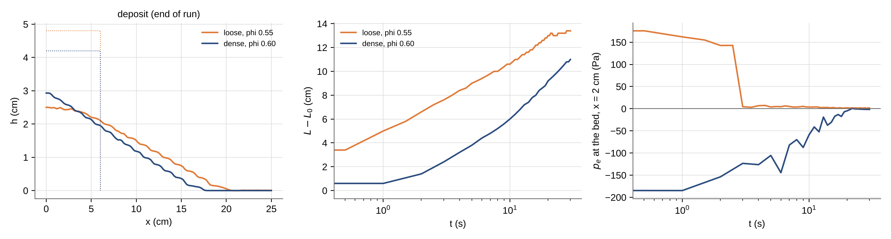

### 15 CFD three-phase: granular column collapsing into water (Robbe-Saule et al. 2021)

- **Set-up:** dry 5 mm glass beads (φ = 0.64, ρ_s = 1600, μ(I) of 07 with d = 5 mm), column H0 = 41 cm, L0 = 16.5 cm (a = 2.5, V = 10.2 dm³ over 15 cm width) on a step of h0 = 5 cm, released at once into water 5 cm deep; 2D, 1.8 m long (closed end), dx = 10 and 5 mm, W 143 1, 1.5 s, 2 ranks.
- **Reference:** Robbe-Saule et al. (2021) JFM: A_m ≈ 2.15 (V − 0.15)^0.58 = 8.25 cm at a = 2.5 (5 mm beads), the peak of A(t) at about 0.64 s, the leading wave separates from the granular front at about 0.5 s, wave speed 1.15 m/s ≈ √(g(h0 + A_m)), collapse over by about 1 s.

`W 131 3` (the default with W 140), in brackets `W 131 2`:

| | dx 10 mm | dx 5 mm | experiment |
|---|---|---|---|
| max amplitude ahead of the slide | 11.6 cm at 0.40 s (13.2 cm at 0.36 s) | 12.6 cm at 0.50 s (13.2 cm at 0.36 s) | 8.25 cm at 0.64 s |
| amplitude at 0.64 s | 7.7 cm (8.7 cm) | 10.6 cm (10.2 cm) | 8.25 cm |
| crest speed 0.5–1 s | 1.21 m/s (1.18) | 1.12 m/s (1.31) | 1.15 m/s |
| granular front (h > 5 mm) at 1 s | 0.51 m (0.95 m) | 0.74 m (1.13 m) | (deposit within the wave generation zone) |
| slide volume, max relative change | 3e-14 | 4e-13 | |

- The crest speed agrees; the maximum amplitude is 40–50 % too high and comes too early, on both grids. With the band treatment the slide runs out less far under water (0.5–0.7 m at 1 s instead of 1 m) and the amplitude falls by 5–12 %.
- The slide displaces water with its bulk volume (grains and pores), and its pores stay dry: in the experiment water fills the pores of the beads during the collapse (an imbibition front, with trapped air), so the grains displace about φ = 0.64 of the bulk volume. With A ∝ V^0.58 that alone accounts for a factor 1.3. The gate is lifted in the experiment and released at once here.
- The slide still runs out far under water: the dry bulk density 1600 below water and no added friction from the pore water.
- Not done: the submarine slide of Heinrich (1992); the data are available only in figures of the paper.

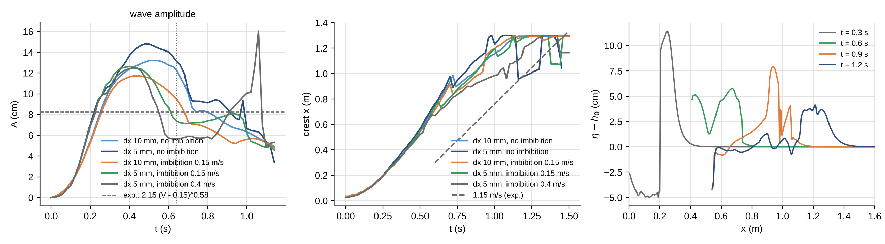
### 31 CFD three-phase: a granular wedge at rest (the interface band, W 131)

- **Set-up:** a μ(I) wedge (glass beads as 07, ρ_s = 1500, W 142 2500) with a 15° surface, 0.3 m long and 80 mm high (triangle W 148), on a horizontal bed in air, and the same under water (surface at 0.13 m, W 143 1); 0.4 × 0.15 m, dx 2.5 mm, 2 s, 2 ranks. `W 131 2` and `W 131 3`.
- **Reference:** the surface is below the friction angle of the beads (20.9°): the wedge must stay at rest.

| | max \|u\| fluid, 1–2 s | max \|u\| slide (α_s > 0.5), 1–2 s | toe moved in 2 s | slide volume |
|---|---|---|---|---|
| air, `W 131 2` | 0.81 m/s | 0.20 m/s | 70 mm | 1e-14 |
| air, `W 131 3` | 0.050 m/s | 8e-4 m/s | 0 | 5e-15 |
| water, `W 131 2` | 0.11 m/s | 0.043 m/s | 17.5 mm | 1e-14 |
| water, `W 131 3` | 0.005 m/s | 3e-4 m/s | 0 | 7e-15 |

- With `W 131 2` the band on the inclined surface flows down as a thin gravity current and drives a jet along the bed ahead of the toe (in air 0.6–0.8 m/s, as in cases 12 and 14). With `W 131 3` the wedge stays at rest.
- Tried and not enough: the p' floor alone (the toe moved 68 mm), the full viscosity only where α_s > 0.1 (23 mm), the full viscosity only where the band's stress is below its yield stress (68 mm: the slumping band cells flow, so they stay weak). The full viscosity over the whole band is needed; for a slide without a yield stress it is not applied (see the model section).

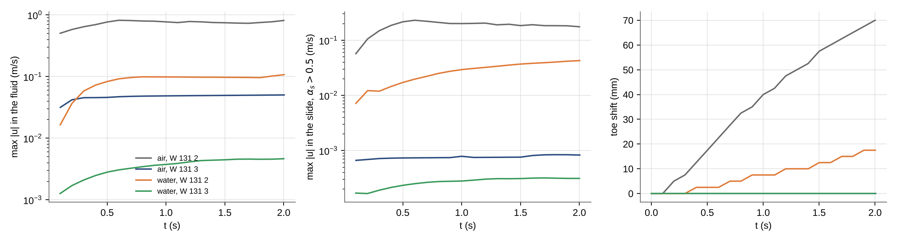

### 20 CFD: quickness test of sensitive clay (Fornes et al., IAHR 2017)

- **Set-up:** the quickness test of Thakur & Degago (2012) as simulated by Fornes et al. (2017): a cylinder of remoulded Heimdal clay (c_ur = 0.2 kPa), H 120 mm, D 100 mm, released at once on a smooth plane (and lifted, below). Herschel-Bulkley with the best-estimate parameters of the paper (from the correlations of Grue 2015, no viscometer test of the sample): τ_y = 200 Pa, K = 15 Pa sⁿ, n = 0.35, ρ = 2000 kg/m³ (`W 130 1`, `W 125 200 15 0.35`). 3D quarter domain 0.2 × 0.2 × 0.15 m with two symmetry planes (`C 11 3`, `C 13 3`), level-set cylinder `F 59`, no-slip bed, dynamic diffusion (`D 24 2`, the default with W 130), 2 ranks. dx = 4 mm (4 min) and 2.5 mm (15 min to 0.3 s).
- **References:** the measured deposit, H 40 mm and D 237 mm (Thakur & Degago 2012; the cylinder was lifted slowly and unevenly, the deposit is not quite round). The static shallow pile that has yielded everywhere, h² = 2τ_y(R − r)/(ρg): H 47 mm, D 218 mm. Fornes et al. (2017): the runout matched, the height was lower than measured.
- **SFLOW:** the same material as a depth-averaged layer (`W 120 5`, Herschel-Bulkley plug flow), dx 2 mm, explicit.

| run | H (mm) | D (mm) |
|---|---|---|
| measured | 40 | 237 |
| CFD dx 4 mm (x axis / diagonal) | 29.1 | 232 / 226 |
| CFD dx 2.5 mm (x axis / diagonal) | 28.9 | 235 / 233 |
| SFLOW W 120 5 | 24.5 | 292 |
| static fully yielded | 47.2 | 218 |

- **Diameter:** within 1–2 % of the measurement, converged in the grid. The deposit stops at 0.24 s (bulk velocities 4e-3 m/s after it, no creep of the height between 0.24 and 0.6 s). The asymmetry Fornes et al. saw is gone (axis and diagonal within 1 % at 2.5 mm).
- **Height:** 28 % below the measurement, as in Fornes et al. The deposit has the measured shape: a central disc with a step at r ≈ 55 mm and a steep rim of 15 mm at the edge. The yield stress is a correlation estimate.
- **Yield stress:** dx 4 mm, K and n kept (runs of 2–4 min):

  | τ_y (Pa) | H (mm) | D (mm) | static fully yielded H / D (mm) |
  |---|---|---|---|
  | 200 | 29.1 | 232 | 47 / 218 |
  | 300 | 45.2 | 192 | 54 / 201 |
  | 400 | 61.9 | 168 | 58 / 190 |

  No single yield stress gives both measured values: 200 Pa gives the diameter, about 260 Pa the height (with D 210 mm). The model deposit is more sensitive to τ_y than the static pile, because the flow stops earlier and keeps more of the column's height in the centre.
- **Lifted cylinder:** the cylinder as a 6DOF body lifted at a constant speed (`X 10 1`, `X 11 0 0 2 0 0 0`, `X 240 1` with `6DOF_motion-0.dat`, quarter tube `floating.stl`, `X 180 1`; `tools/quickness_tube_stl.py`, `tools/motion_file.py`), τ_y = 200 Pa, dx 4 mm, domain 0.288 m high, the lift stops when the tube's lower edge is 0.13 m above the plane (`cfd_dx4_lift50`: 0.5 m/s, 54 min with other runs on the machine; `cfd_dx4_lift20`: 0.2 m/s, set up, not run). The lift speed of the experiment is not documented (Lube et al. lifted their granular columns at about 2 m/s). The inner wall of the tube is one cell (4 mm) outside the clay: at r = 50 mm the cells next to the body lost 16 % of the clay at the start; with the gap the volume of the clay ends within 0.2 % of the column (`F 46 3`).

  | release | H (mm) | D (mm) (x axis / diagonal) |
  |---|---|---|
  | measured | 40 | 237 |
  | instant | 29.1 | 232 / 226 |
  | lifted at 0.5 m/s | 34.2 | 216 / 215 |

  The lift raises the height by 5 mm and shortens the diameter by 7 %; the deposit stays round. A first series with the tube reaching through the closed top of the 0.15 m high domain gave H 43 / 61 mm and D 208 / 184 mm at 0.5 / 0.2 m/s: once the tube reached the top, the air inside it could only be replaced through the clay under its edge, and the trapped air held the clay back (see case 21). As with the yield stress, the release changes H and D in opposite directions.
- **SFLOW:** 23 % too far. The column (H/R = 2.4) is far from shallow; the hydrostatic layer accelerates too fast at the start. The depth-averaged model is not meant for this release; it is here to show the difference.

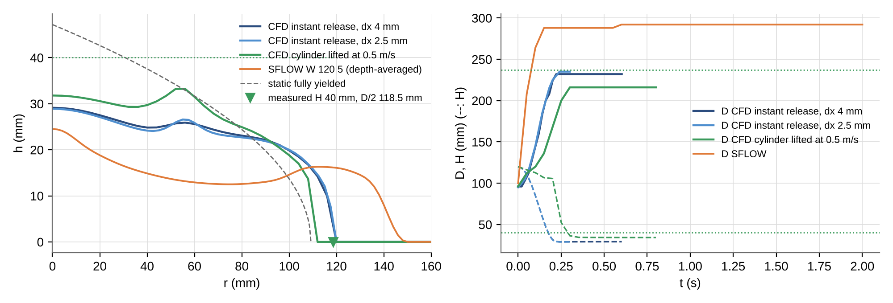

### 21 CFD: dry sand dam break (Huang et al. 2011; Fornes, Geofaredagen 2017)

- **Set-up:** as Fornes (2017): dry sand 0.32 × 0.20 m against the left wall of a box 0.95 × 0.35 m, ρ = 1458, ρ_s = 2700 (φ_s 0.54), d = 0.24 mm, 2D, dx = 2.5 mm, 1 s, 2 ranks (23–25 min). Two of his rheologies: μ(I) with μ_s 0.7, μ_2 1.0, I0 0.3 (`W 130 3`, `W 124 34.99 45.0 0.3 0.00024 0.54`), and Herschel-Bulkley-Coulomb φ 35°, c 0.1 Pa, K 15, n 0.35 (`W 130 2`).
- **Reference:** the measured free surfaces at 0.1–0.5 s, digitised from slide 14 of Fornes (2017) (`huang2011_profiles_digitised.txt`; the five curves are not separated) and the toe positions (h > 2 mm) read from them. Fornes's 2017 simulations ran to the end of the box (0.95 m) with all rheologies.

| toe (m) at t = | 0.1 s | 0.2 s | 0.3 s | 0.4 s | 0.5 s | end (1 s) |
|---|---|---|---|---|---|---|
| Huang et al. (2011) | 0.37 | 0.41 | 0.475 | 0.51 | 0.51 | |
| μ(I) `W 130 3` | 0.34 | 0.41 | 0.49 | 0.53 | 0.54 | 0.535 |
| HBC `W 130 2` | 0.33 | 0.39 | 0.455 | 0.49 | 0.495 | 0.495 |

- **Runout:** μ(I) +5 %, HBC −3 % against the measured final toe; the deposit stops at 0.4–0.5 s as measured. The upper left corner (x < 0.2 m) stays at rest, as in the experiment.
- **Start:** both are 3–4 cm behind at 0.1 s. A release by a gate can only delay the front, and the measured front at 0.1 s is ahead of the instant release; the lag is not the release. Likely candidates: the time origin of the photographs, and the first collapse of the corner, which a continuum with the yield criterion μ_s p holds back.
- **Gate (`muI_gate`):** the gate as a 6DOF box (`X 110`, 7.5 mm thick, up to z = 0.21 m) lifted at 1 m/s until its lower edge is at 0.22 m (`X 240 1`, `6DOF_motion-0.dat` from `tools/motion_file.py`; the lift speed of the experiment is not documented), μ(I), domain 0.5 m high, 0.6 s, 2 ranks (59 min with other runs on the machine).

  | toe (m) at t = | 0.1 s | 0.2 s | 0.3 s | 0.4 s | 0.5 s | 0.6 s |
  |---|---|---|---|---|---|---|
  | Huang et al. (2011) | 0.37 | 0.41 | 0.475 | 0.51 | 0.51 | |
  | μ(I), instant release | 0.34 | 0.41 | 0.49 | 0.53 | 0.54 | 0.545 |
  | μ(I), gate lifted at 1 m/s | 0.327 | 0.365 | 0.423 | 0.475 | 0.51 | 0.52 |

  The gate delays the front by about 0.05–0.1 s and ends the runout at 0.52 m (+2 % against the measurement, instant release +7 %). A first run with the gate reaching through the closed top of the domain (gate up to 0.25 m, domain 0.35 m high) held the sand behind the open gate: once the gate reached the top, the air on its two sides could only be exchanged through the opening under it, which the sand filled; the trapped air held the sand back. Keep lifted bodies below the top of the domain (`tools/motion_file.py` stops the lift at a given height).
- **Shape:** the model deposit is up to 2 cm thicker between x = 0.35 and 0.45 m; its slope (29.6° for μ(I)) is below μ_s = 35°, as in case 07.

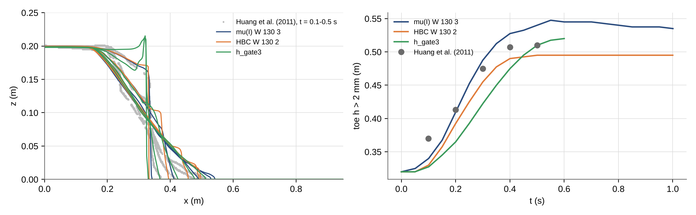

### 22 CFD: granular flow down a 45° flume onto a wall (Moriguchi et al. 2009; Fornes et al., MekIT 2017)

- **Set-up as Fornes et al. (2017):** dry Toyoura sand, ρ = 1379 kg/m³, a body 0.5 × 0.3 m at the upper end of a flume inclined at 45° (gravity rotated, `W 20 6.937`, `W 22 −6.937`), HBC φ 30°, c = 1 Pa, K = 1, n = 1 (`W 130 2`, `W 121 30`, `W 125 1 1 1`). 2D, dx = 5 mm, 2 s, 2 ranks. Two ends: the end wall at x = 2.3 m as in Fornes (`hbc45`, 38 min) and a 0.3 m high obstacle at x = 2.3 m that the flow can overtop (`hbc45_obstacle`, DIVEMesh `S 10`, 48 min).
- **Set-up of the experiment:** 50 kg of sand, a sand-coated (rough) bed and smooth side walls (as described by later papers). With a flume 0.3 m wide the 2D body of Fornes holds 62 kg; the μ(I) runs use 0.5 × 0.242 m (50 kg). μ(I) `W 130 3`, `W 124 35 43 0.3 0.0002 0.52` (μ_s = tan 35°, the friction angle of Moriguchi's own simulation; d = 0.2 mm), or μ_s = tan 40° (`W 124 40 48 …`). Side walls `W 135 20 0.3` (δ_w = 20°, an estimate for a smooth wall; b = 0.3 m).
- **Reference:** the measured time series are not openly available (Moriguchi et al. 2009, Acta Geotechnica 4, 57–71). Quoted from later papers: contact at 0.7–0.8 s after release, peak forces 564–710 N/m at 45°, then a decay to a residual static load. The flume width is given as 0.3 m in one source and inferred as 0.1 m in another.
- **Force:** the pressure (minus its value at the top of the domain) on the face just upstream of the wall, positive part, integrated over the obstacle height, per metre width.

| run | contact (s) | F at 1.2 s (N/m) | peak or end (N/m) | case |
|---|---|---|---|---|
| experiment (quoted) | 0.7–0.8 | | peak 564–710 | |
| HBC, end wall, 62 kg | 0.80 | 1112 | peak 1152 at 1.44 s, 1090 at 2 s | `hbc45` |
| HBC, 0.3 m obstacle, 62 kg | 0.80 | 1449 | peak 1610 at 1.24 s, 891 at 2 s | `hbc45_obstacle` |
| μ(I) 35°, 50 kg, no side walls, before the solid fix | 0.84 | 1107 | blew up at 1.72 s | `mui45_obstacle` |
| μ(I) 35°, 50 kg, walls, before the solid fix | 0.88 | 622 | blew up at 1.94 s | |
| μ(I) 40°, 50 kg, walls, before the solid fix (stable: the pile stays below the crest) | 1.06 | 94 | 1647 at 2 s, rising | `mui40_obstacle_wall` (58 min) |
| μ(I) 35°, 50 kg, walls, before the fix, μ_max 1e3, dx 5 / 10 mm | 0.88 / 0.92 | 361 / 366 | 1179 / 679 at 2 s, rising | |
| **μ(I) 35°, 50 kg, walls, dx 5 mm** | 0.88 | 261 | 481 at 2 s, rising | `mui45_obstacle_wall` (3 h with other runs on the machine) |
| **the same, dx 10 mm** | 0.92 | 232 | 445 at 2 s, rising | `mui45_obstacle_wall_dx10` (5 min) |

- **Arrival:** μ(I) 35° arrives 0.04 s after HBC (0.84 s), the side walls add 0.04 s: 0.08 s after the quoted 0.7–0.8 s. μ_s = tan 40° arrives 0.3 s late.
- **Force:** the 50 kg body, μ(I) and the side walls bring the force at 1.2 s from 1449 to 232–261 N/m and at 2 s to 445–481 N/m, below the quoted peaks (564–710 N/m). The model force has no impact peak: it rises over 1 s, since the pile behind the obstacle keeps growing (below the crest at 2 s). The quoted decay to a residual load needs the sand to leave the obstacle; the obstacle width and the force normalisation of the experiment are not known here.
- **Stability (fixed):** μ(I) runs against the obstacle stopped (N 61) when the pile reached the crest. The cells of the obstacle (`S 10`) had the level set extended into them, the μ(I) law with the pressure of the projection, which solves through the solid, and their viscosity grew with that pressure (0.3–1.4 MPa) and the pressure with the viscosity. The solid cells now take the viscosity of their neighbouring material cells (`rheology_cfd_core`). With it the runs hold the default cap (μ_max 1e4 Pa s); the end wall of the domain never had the problem (3 kPa at the foot of the wall, against 0.9 MPa at the obstacle before the fix). `X 49 1`, `N 47 0.15` and `D 32 1` (faces in the solid closed: the growth slowed to 15 kPa at 0.98 s but went on) did not help; `W 133 −1 1000` did, but changed the force (361 against 261 N/m at 1.2 s) and its grid convergence.
- **Grid:** dx 5 and 10 mm agree within 8–12 % over the whole impact (167/132 N/m at 1.0 s, 261/232 at 1.2 s, 391/337 at 1.5 s, 481/445 at 2 s); with the lowered cap they differed by 74 % at 2 s.
- **Data:** the flume is 1.8 m long and 0.3 m wide, the load cell at its end (Frontiers in Earth Science 2023, research-square preprint rs-1821754). The measured force curves are published only as figures (e.g. Frontiers 2023, Fig. 11, 45–65°); digitising them is the next step.

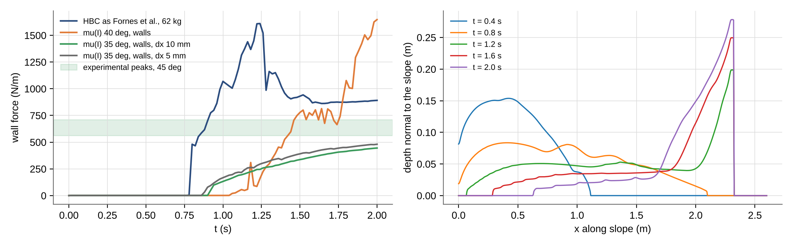

### 23 CFD: side-wall friction W 135 (verification)

- **Set-up:** a μ(I) layer h = 0.05 m (`W 124 20.9 32.76 0.279 0.0005 0.6`, ρ 1500), 2D, periodic in x, on a free-slip bed (symmetry plane `C 15 3`) inclined at 25°, air above, dx = 2.5 mm, 0.3 s, 1 rank (3 s each). Side walls `W 135 20 b` with b = 0.05 m and 0.03 m, and none.
- **Reference:** the depth-integrated momentum of the uniform layer, with its lithostatic pressure: the mean velocity g (sin θ − tan δ_w cos θ h/b) t (0.91 m/s² for b = 0.05 m), or rest when tan δ_w cos θ h/b > sin θ (b = 0.03 m).

| run | mean u at 0.3 s (m/s) | exact (m/s) |
|---|---|---|
| no wall friction | 1.2471 | 1.2471 |
| b = 0.05 m | 0.2733 | 0.2737 |
| b = 0.03 m | 0.034 (bulk 8e-4) | 0 |

- **Accelerating layer:** the mean velocity within 0.1 %. The top 1–2 cells move faster, dragged by the air, which accelerates freely along the periodic slope (an artefact of the test). The rest of the layer moves as a plug at 0.255 m/s (7 % below the mean): it carries the friction of the deeper, higher pressures.
- **Held layer:** the bulk stays at 8e-4 m/s; the mean is raised by the same top cells.
- A first form, an implicit drag with the regularised rate F/max(|u|, 1e-4 m/s) as the VRANS drag, gave the mean 3 % too high and let the held layer creep at 2e-3 m/s; the Coulomb step replaced it.

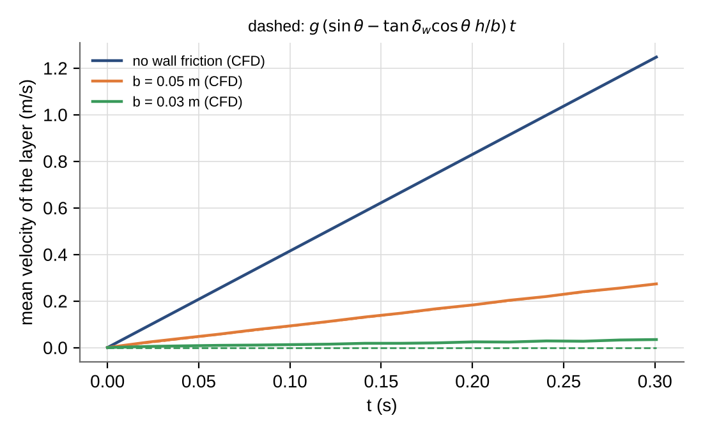

### 24 CFD: 3D periodic μ(I) film on one and two ranks

- **Set-up:** the μ(I) film of case 06 (25°, 20 mm under a slip lid, `W 124 20.9 32.76 0.279 0.0005 0.6`) in 3D, periodic in x and y (`C 21 1`, `C 22 1`), 8 × 8 × 40 cells, dx 0.5 mm, 2 s. One rank (`r1`), and two ranks split across the periodic boundary in x (`r2x`: DIVEMesh `M 20 3`, `M 30 2 1 1`) and in y (`r2y`: `M 30 1 2 1`). 2 s (the film is still accelerating; case 06 runs 10 s).
- **Checks:** the three runs against each other; the 3D film against the 2D film of case 06 at the same time; v and the horizontal variation, which must vanish.

| run | u(h/2) at 2 s (m/s) | max \|u − u_r1\|, lower half | max \|v\| | horizontal spread of u, lower half |
|---|---|---|---|---|
| 1 rank | 0.60176 | – | 3e-10 | 1e-7 |
| 2 ranks, x | 0.60174 | 1.7e-5 | 2e-10 | 1e-7 |
| 2 ranks, y | 0.60174 | 1.2e-5 | 8e-10 | 1e-7 |
| 2D (case 06) | 0.59855 | | | |

- The split runs equal the serial run within the solver tolerance; v stays at round-off on both periodic boundaries across ranks. The 3D film runs 0.5 % ahead of the 2D film (max difference 3.2e-3 m/s in the lower half). In the upper half (p′ → 0 under the lid, as in case 06) the runs differ by up to 8e-4 m/s and u varies by 2.6e-3 m/s horizontally next to the lid.

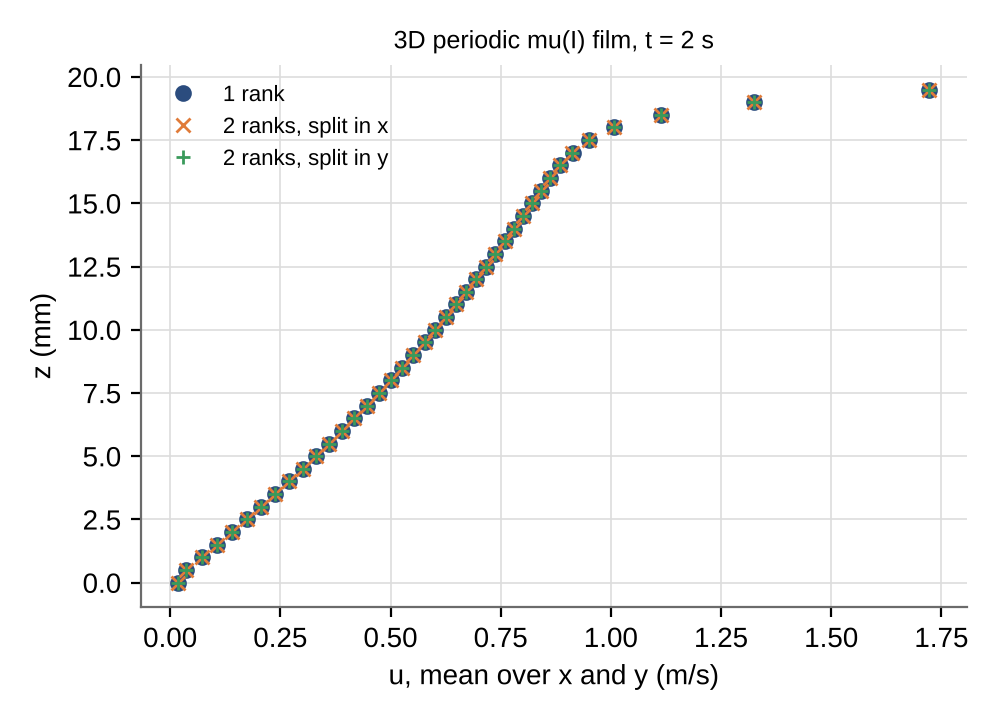

### 25 CFD: 3D axisymmetric collapse of a granular column (Lube, Huppert, Sparks & Hallworth 2004)

- **Set-up:** a quarter of a sand column, r0 = 0.05 m, a = h0/r0 = 0.5 and 2, on a no-slip plane, two symmetry planes (`C 11 3`, `C 13 3`), level-set cylinder `F 59`, released at once (Lube et al. lifted the cylinder at about 2 m/s). μ(I) for their sand (ρ_s 2600, d 0.32 mm, angle of repose 30°): `W 124 30 40 0.3 0.00032 0.6`, ρ = 1560 kg/m³ (estimated; the paper gives no flow parameters). dx = 2 mm (r0/25) for a = 0.5 (60 k cells, 16 min), 4 mm (r0/12.5) for a = 2 (74 k cells, 17 min), 2 ranks, with other runs on the machine. No side walls: the 2D channel comparisons of case 07 lacked the wall friction; this one does not.
- **Reference:** Lube et al. (2004): (r∞ − r0)/r0 = 1.24 a (a < 1.7), 1.6 a^½ (a > 1.7); h∞/r0 = a (a < 1.7, an undisturbed top for a < 1), 0.88 a^⅙ (1.7 < a < 10); t_stop = 3 (h0/g)^½. Independent of the base and nearly of the material.

| run | (r∞ − r0)/r0, x axis / diagonal | Lube | h∞/r0 | Lube | t_stop (s) | Lube |
|---|---|---|---|---|---|---|
| a = 0.5, `W 131 2` | 0.44 / 0.47 | 0.62 | 0.517 | 0.50 | 0.24 | 0.15 |
| a = 0.5, `W 131 3` | 0.40 / 0.36 | | 0.515 | | 0.14 | |
| a = 2, `W 131 2` | 1.48 / 1.49 | 2.26 | 0.664 | 0.988 | 0.26 | 0.30 |
| a = 2, `W 131 3` | 1.40 / 1.49 | | 0.772 | | 0.52 | |
| a = 2, `W 131 3`, μ_s = tan 20.9° (Jop's glass beads) | 1.72 / 1.83 | | 0.568 | | > 0.58 | |

- **3D:** the deposits are round (axis and diagonal within 0.01–0.09 r0) and the volume holds (0.7 %). The 3D solver runs; the symmetry planes and the level-set column work.
- **Against Lube et al.:** 25–35 % short in runout; at a = 2 also too low in the centre (−22 to −33 %). The a = 0.5 deposit is a cone, not the measured frustum with an undisturbed top: the surface slumps below the friction angle, the same artefact as in case 07, reduced but not removed by `W 131 3` at these grids. A lower friction (μ_s = tan 20.9°) gives more runout but a still lower centre: no friction fits both, as in the quickness test (20). The grids are coarse (r0/12.5 for a = 2; case 07 matched Lagrée et al. at L0/40); the thin edge of the deposit is not resolved. Next: a = 2 at dx 2 mm (8 times the cells, several hours on 2 ranks).

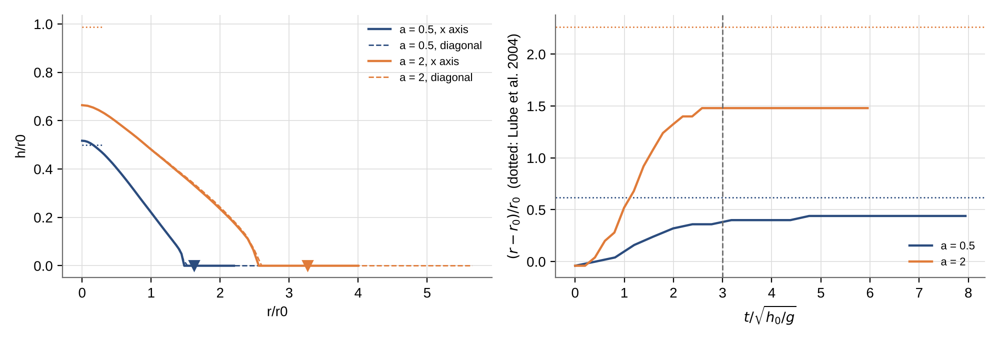

### 26 Real landslides on terrain (SFLOW): Gjerdrum 2020

- **Tools:** `tools/slide_terrain.py` makes an SFLOW landslide case from two DEMs of the event (before / after, GeoTIFF, same projected coordinates): the bed for DIVEMesh (`geo.dat`, `G 10 1`; the pre-event terrain, in the release area the post-event sliding surface), the initial level of the slide (`sflow-level.dat`, the pre-event terrain in the release area, read with the new SFLOW key `F 73 1`), and `reference.npz` (post − pre on the grid, the release mask). `rheo_eval.py terrainslide` compares the deposit of the run with the DEM difference: volumes, deposit area, overlap (IoU, hit rate), runout from the release centre, the front over time, maps.
- **F 73 1** (SFLOW): the initial free-surface level from `sflow-level.dat` (`nx ny x0 y0 dx dy`, then nx·ny levels, x fastest, < −9000 no data), bilinear, where it lies above the bed; the log prints the cells and the volume above the bed.
- **Check:** an idealised valley (3 × 2 km, 10 m cells, a release of 1.27 Mm³ from the DEM difference): F 73 puts 1.264 Mm³ above the bed, HB `W 120 5`, 300 s in 97 s on 2 ranks; the evaluator runs end to end.
- **Planned cases:** Gjerdrum 2020 (quick clay, 1.35 Mm³ mobilised, 0.47 Mm³ left on the sliding surface, 0.93 Mm³ deposited over 0.26 km², runout about 2 km in two branches, Tistilbekken and Tangeelva; Kartverket LiDAR 19.04.2020 and 08.01.2021, 0.25 m; NGU report 2021/023), Taan Fiord 2015, Tafjord 1934.
- **Gjerdrum 2020** (`26_gjerdrum_2020`, details there): Kartverket projects 4241 (19.04.2020) and 5001 (08.01.2021)
  at 5 m (`tools/fetch_hoydedata.py`), 580 × 460 cells, release 0.938 Mm³ from the DEM difference (F 73 places
  0.934 Mm³), Herschel-Bulkley K 15 Pa s^0.35, instant release, 600 s. tau_y 0.25 / 0.5 / 1 / 2 kPa: runout
  2030 (east boundary) / 1960 / 1500 / 820 m against 1590 m, IoU 0.55 / 0.56 / 0.50 / 0.33; 1 kPa fills Tistilbekken
  (0.41 against 0.39 Mm³), 0.5 kPa the east valley (0.57 against 0.61 Mm³): no single tau_y gives both branches with
  the instant release (the event was retrogressive). `rheo_eval.py terrainslide` / `terrainseries`: deposit patches
  of at least 1000 m², volumes of the branches from `regions.json`.

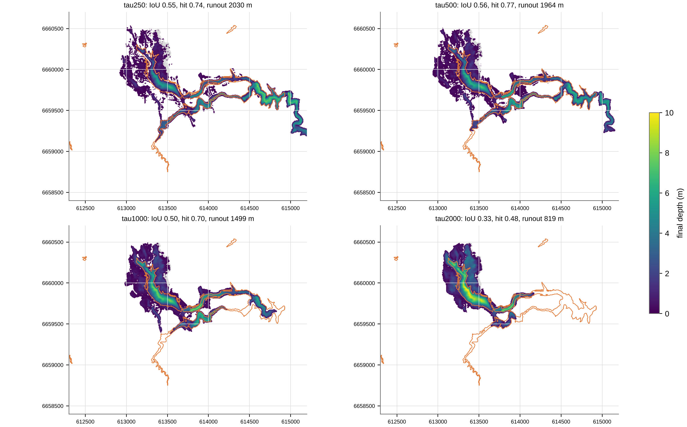

## Two-layer landslide: slide layer under the SFLOW and NHFLOW water (W 150), cases 16-19, 28, 29 and 32

A depth-averaged slide layer (h_s, h_s u_s) under the water (`src/slide2D.{h,cpp}`, `src/slide2D_flux.cpp`). The water
is the SFLOW water and sees the bed z_b + h_s; the slide sees the water pressure and the drag of the water.

- **Slide:** ∂h_s/∂t + ∇·(h_s u_s) = 0 and
  ∂(h_s u_s)/∂t + ∇·(h_s u_s u_s) + g'∇(h_s²/2) = −g' h_s ∇z_b − r·sub·g h_s ∇η + h_s g_s − τ_b/ρ_s + τ_i/ρ_s,
  with g' = (1 − r·sub) g, r = ρ_w/ρ_s, sub = min(1, h_w/W 156) (0 subaerial, 1 submerged) and g_s the along-slope gravity
  W 20/W 21 (inclined frame, the slide alone). Where dry (sub = 0) this is the single-layer flow with the full gravity; under
  water at rest it is the flow with the reduced gravity (1 − r) g.
- **Basal friction:** the laws of the core (W 120 - W 128, as the SFLOW adapter) with the buoyant normal stress
  σ_n' = (1 − λ)(ρ_s − sub·ρ_w) g_n h_s, as a backward-Euler step after each stage (yield criterion as in W 120).
- **Interface drag:** τ_i = ρ_w C_d |u_w − u_s|(u_w − u_s) (W 155): on the slide a backward-Euler relaxation to the water
  velocity, on the water a source of its momentum (b->F, b->G, as the Manning term) with a linearised implicit factor.
- **Water:** the bed of the water is z_b + h_s (`b->bed`); `sflow_eta::depth_update` keeps the water column WL and moves the
  surface with the bed. The water volume is not changed by the moving bed (only by the wet/dry film A 244, as always).
- **Numerics of the slide:** finite volumes on the SFLOW slice: MUSCL (minmod) of h_s, z_b + h_s, u_s with the hydrostatic
  reconstruction (Audusse et al. 2004, second-order form), HLL with the face g'; SSP-RK2 sub-steps with the slide CFL W 157
  inside the water step (the water step from SFLOW, at most W 159 slide steps per water step). No transport across a face
  between two cells at rest (held by the friction or dry): the HLL dissipation moved material out of a deposit at rest
  (the front of 16 arrest crept to 1.60 m instead of 1.46 m). Walls at the domain boundaries and solids.
- **Water surface over the sub-steps:** the water column is held (the water moves in its own step), so the surface seen by
  the slide is η_w = η^n + h_s − h_s^n: a slide that thickens lifts the water above it within the step. With the surface
  itself frozen over the step, the long semi-implicit steps (19 dambreak, 25 slide steps per water step) drove a grid-scale
  two-layer mode unstable (L1 7 % at 4 s on the fine grid, growing); the explicit results change by less than 0.1 % L1.
- **Order per water step:** the water step with the bed of t^n (and the drag on the water with the slide of t^n), then the
  slide over the step with the water of t^{n+1} (η, h_w, u_w), then the bed z_b + h_s(t^{n+1}) and depth_update.
- **Filtered transfer (W 162 a > 0):** the water sees z_b + h_f instead of z_b + h_s, with h_f − ∇·(D∇h_f) = h_s and
  D = a d² (d the still water depth over z_b, F 60): a conservative low-pass filter of the slide under the water with the
  response 1/(1 + a(kd)²), against 1/cosh(kd) of the potential-flow transfer from a moving bed to the surface (Kajiura
  1963; a = 0.5 matches for small kd). D at a face is the smaller of the two cells (no filter across a shoreline, none
  where dry). Solved with the SFLOW BiCGStab from h_f of the step before (up to 20000 iterations: D/dx² reaches 1e5 in
  deep water).
- **Non-hydrostatic water (A 220 2):** the bed condition of the quadratic pressure takes the moving bed,
  w_b = ∂z_b/∂t − u·∇d with ∂z_b/∂t = (bed^{n+1} − bed^n)/Δt of the water step; the pressure is off (hydrostatic) in the
  cells next to a face with a bed slope above 1:2. Use it with W 162: 0.02 when the slide is about as long as the water is
  deep (case 28), 0.5 in deep water (18 dambreak, the slide 10 m long under 20 m).
- **NHFLOW (A 10 5, case 29):** the same slide layer under the σ-grid water. Per water step: the slide over the step with
  the water of t^n (the surface η, the velocity of the bottom layer), then the bed z_b + h_s (or z_b + h_f with W 162),
  depth = wd − bed and η = WL − depth (the water column kept, the σ grid follows at the next sigma update); then the
  NHFLOW step. The bed moves with w_b = ∂z_b/∂t: in the kinematic bed condition of the fluxes (w_b = −u·∇d + ∂z_b/∂t)
  and in the continuity of the bed node of the pressure projection (A 520 1, 2). The slide sees the hydrostatic water
  pressure −r·sub·g h_s∇η. Without w_b in the projection the multi-layer pressure holds each lift of the surface in
  place (benchmark 4: WG1 3.4 / −1.6 cm). The explicit NHFLOW (A 510 2/3), A 520 0, 1, 2, one Cartesian grid, MPI;
  stops with a message with the semi-implicit NHFLOW, S 10, curvilinear, refined and multi-block grids. The interface
  drag W 155 acts on the bottom layer of the water (thickness Δσ_0 h_w), point-implicit as the bed friction
  (`nhflow_bcmom`), with the velocity of that layer on the slide side. Log `REEF3D_NHFLOW_Log/REEF3D_NHFLOW_slide.dat`,
  the slide fields in the NHFLOW FSF VTP and the LAGOON store.
- **Available with:** the explicit HLL water (A 210 2/3) and the semi-implicit water (A 210 11/12/13, case 19), hydrostatic
  (A 220 0) or with the quadratic non-hydrostatic pressure (A 220 2, explicit water, case 28), one Cartesian grid, 1D and
  2D, MPI. The semi-implicit step keeps the water column of the end of the step before (`si_restore`) and takes the moved
  bed through `depth_update`, as with sediment; the drag on the water enters with the other sources of its stage. It stops
  with a message with S 10, curvilinear, refined and multi-block grids and A 220 1, 3, 4 and above.
- **Output:** `slide_h`, `slide_velocity`, `slide_lambda` in the SFLOW FSF VTP / LAGOON store (P 18); the bed VTP shows
  z_b + h_s; the log `REEF3D_SFLOW_Log/REEF3D_SFLOW_slide.dat` (time, dt, sub-steps, volumes of slide and water, h_max, |u|_max, extent);
  the slide state is in the checkpoints (P 48).

| key | type | meaning (default) |
|---|---|---|
| W 150 | int | slide layer: 0 off, 1 on (0) |
| W 151 | 5 × double, several | box xs xe ys ye z_top: the material between the bed and z_top |
| W 152 | 5 × double, several | box xs xe ys ye d: a layer of the thickness d over the bed |
| W 153 | 5 × double, several | semi-ellipsoid xc yc Lx Ly T: thickness T √(1 − r²), Lx, Ly the horizontal axes |
| W 154 | double | bulk density of the slide ρ_s [kg/m³] (2000); must be larger than W 1 |
| W 155 | double | interface drag coefficient C_d (0); SFLOW and NHFLOW (the bottom water layer) |
| W 156 | double | water depth [m] over which the slide becomes fully submerged (0.01) |
| W 157 | double | CFL of the slide sub-steps (0.4) |
| W 158 | double | slide depth threshold [m], dry below (1e-5) |
| W 159 | int | at most this many slide steps per water step; 1: the water step limited by the slide (100) |
| W 160 | 2 × double | initial slide velocity u v [m/s] (0 0) |
| W 162 | double | filtered transfer of the slide to the water bed, D = a d² (0 off; 0.02 - 0.5 with A 220 2, see above) |

The basal law is W 120 - W 128 (with W 150 they act on the slide, not on the water; W 90 likewise). The 1D cases set y
ranges of the boxes that cover the grid.

Running (both grids, the single-layer cases 01 and 02 for the comparison, figures and JSON):

```bash
cd Validation/rheology
tools/run_slide_cases.sh <REEF3D> <DiveMESH> <run> <run>/results     # REEF3D_MPIRUN="mpirun --oversubscribe" with fewer than 2 cores
```

Run times below: Linux sandbox, 2 cores, the 2D cases on 2 ranks.

### 27 SFLOW two-layer slide: Taan Fiord landslide tsunami 2015

The 72.6 Mm³ rock slide at Tyndall Glacier on the Cannon et al. (2017) terrain (IFSAR, pre-event bathymetry, inferred
slip surface; new key W 161 1: the initial slide top from slide-level.dat). 30 m cells, 670 × 747, hydrostatic water,
Voellmy ξ 500, 900 s. Compared with the runup survey of Lynett et al. (2025, 294 points):

- μ 0.10: 193 m at the 193 m mark, Aida K 1.03, κ 1.32, 87 % within a factor 1.5.
- μ 0.15: K 1.12, κ 1.32.
- μ 0.20: K 1.22, κ 1.33.
- The peaks along the upper fjord (60 - 110 m) stay at 35 - 50 m at every friction.

Details in 27_taan_fiord_2015/README.md.

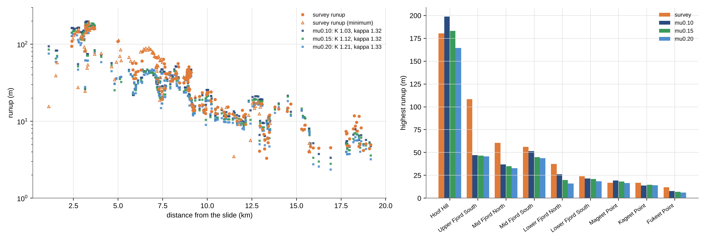

### 30 SFLOW two-layer slide: Tracy Arm landslide tsunami 2025

The paper's tsunami source (Shugar et al. 2026: a 65 Mm³ super-Gaussian mound, 195 m thick, new tools/slide_mound.py)
on the 2025 topo-bathy DEM, 25 m cells, hydrostatic water, Voellmy ξ 500, 400 s.

- Field survey along Tracy Arm (147 points): Aida K 1.03 - 1.07, κ 1.22 - 1.23.
- Trimline (3591 points): K 0.89 - 0.94, κ 1.67 - 1.68.
- Opposite the slide: 294 - 336 m against 471 m (10 m cells: 329 m). The depth-averaged mound collapses at once, and
  about a third of it spreads over the glacier front instead of into the fjord.

Details in 30_tracy_arm_2025/README.md.

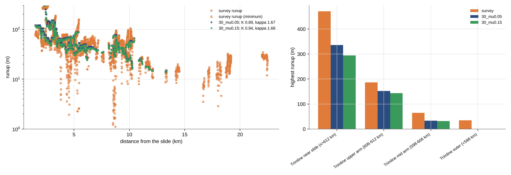

### 16 Slide alone: the single-layer cases 01 and 02 through the slide layer

No water (F 60 −1, the A 244 film only), the slide set with W 151, W 159 1 (the step of the slide, as the single-layer runs).

| case | grid | slide layer | single layer (W 120) | reference | run time |
|---|---|---|---|---|---|
| 01 Mangeney, L1(h) at 1 / 2 / 3 s | dx 5 cm | 0.13 / 0.16 / 0.20 % | 0.11 / 0.14 / 0.19 % | exact | 3 s |
| | dx 2.5 cm | 0.06 / 0.08 / 0.11 % | | | 13 s |
| 01 front h > 1 mm at 3 s | dx 5 / 2.5 cm | 23.00 / 23.43 m | 23.00 m (22.95 m before the SFLOW cleanups 08-17) | 24.65 m | |
| 02 arrest: x_f, h(0), max \|u\| at 60 s | dx 1 cm | 1.460 m, 0.146 m, 3.9e-5 m/s | 1.460 m, 0.145 m, 3.0e-4 m/s | 1.408 m, 0.160 m (fully yielded) | 17 s |
| | dx 5 mm | 1.455 m, 0.146 m, 7.0e-5 m/s | | | 75 s |

- The slide layer reproduces the single-layer runs: the profiles differ by at most 1 cm (the second-order MUSCL against WENO),
  the fronts by one cell. Volume to 5e-15.
- The arrested deposit creeps 4-8 times slower than the single-layer one. In both, the creeping cells are the ones still
  5-40 % above the yield stress (h ∂η/∂x against τ_y/ρg): slow Herschel-Bulkley creep towards the yield profile, not a
  numerical leak. The single-layer SFLOW already has no mass flux into dry cells; the slide layer needs the rule for faces
  between cells at rest to get the same (without it the slide's front crept to 1.60 m). Tested: the same rule in the
  single-layer model changes its front by 1 cm and not its creep.

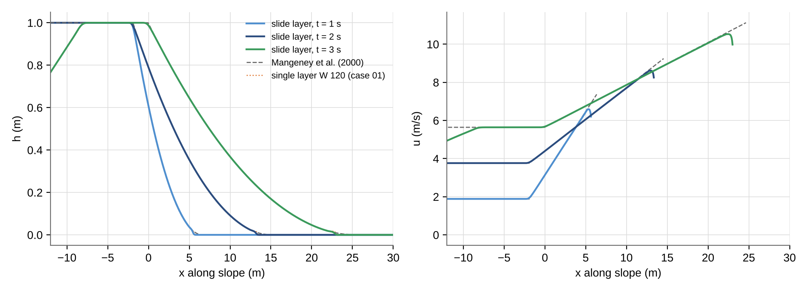
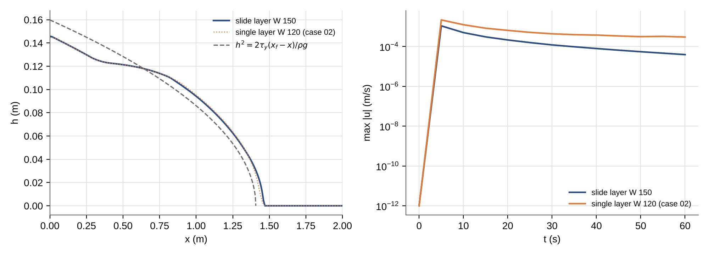

### 17 Moving bed: lake at rest over a slide at rest, subaerial slide into a lake (2D, 2 ranks)

Basin 20 m × 4 m, flat bed with a 1:4 slope from x = 12 m and a wedge across y = 3-4 m (x = 6-12 m), still water level 1.0 m,
ρ_s = 2000 kg/m³.

- **rest:** the slide fills the basin to z = 0.3 m (W 151) under the water, no friction (W 121 0), 20 s: both layers must stay at rest.
- **subaerial:** a 2 m × 2 m × 0.3 m slide on the slope at x = 15-17 m (partly above the water), Coulomb 10° on the 14° slope, C_d 0.005, 15 s.

| | dx 10 cm (8000 cells) | dx 5 cm (32 000 cells) |
|---|---|---|
| rest: max \|u\| water / slide | 4.8e-6 / 1.1e-7 m/s | 5.5e-5 / 1.1e-6 m/s |
| rest: max \|η − η0\| | 6.0e-8 m | 4.6e-7 m |
| rest: volume error slide / water | 3e-14 / 0 | 4e-14 / 0 |
| subaerial: volume error slide / water | 9e-15 / 1.4e-5 | 3e-14 / 1.3e-5 |
| subaerial: η max / min, slide max \|u\| | 0.31 / −0.12 m, 2.11 m/s | 0.33 / −0.13 m, 2.22 m/s |
| run time rest / subaerial | 25 / 23 s | 184 / 167 s |

- **rest:** the water velocities are those of SFLOW alone over the same bed (no slide layer, dx 10 cm: 4.4e-6 m/s, η 5.8e-8 m):
  the spurious velocities of the shorelines on the slope. The slide picks up 1e-7 m/s from them; no friction holds it.
- **subaerial:** the water volume changes only through the wet/dry film (the film A 244 1e-4 m of the cells the moving
  shoreline dries and wets; 0 in the rest case and in 18). 1 and 2 ranks agree to 3e-14 m for the first second (SFLOW alone
  is not bitwise the same on 1 and 2 ranks in 2D either); later the wet/dry decisions amplify the round-off: the deposit
  agrees to 0.44 mm (0.15 %), the water surface at single shoreline points that are wet in one run and dry in the other.

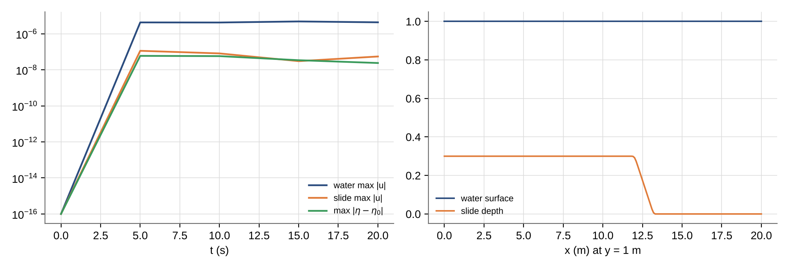
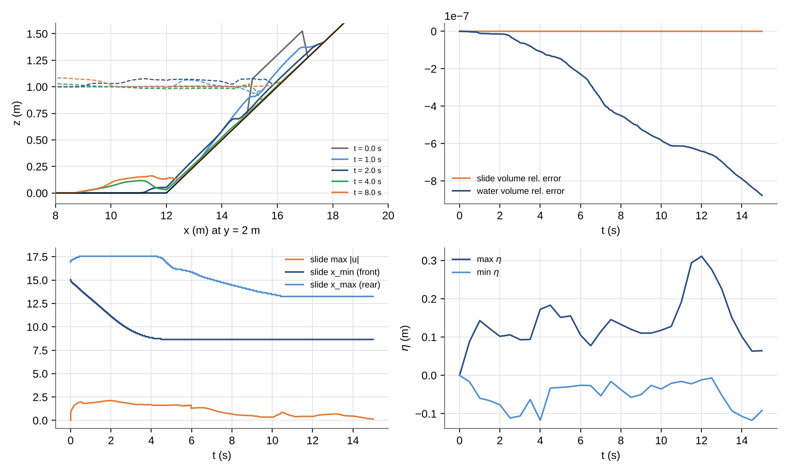

### 18 Submarine slides (1D)

- **dambreak:** a 1 m × 10 m slide against the wall under 20 m of water, flat bed, no friction, ρ_s = 2000 kg/m³, 4 s.
  Reference: the Ritter solution with the reduced gravity g' = (1 − r) g = 4.914 m/s² (exact in the limit of deep water).
- **slope35:** a granular slide on a 35° slope into 0.33 m of water (similar to the IRPHE experiments of Grilli et al. 2017,
  NTHMP benchmark 4: glass beads, ρ_s = 1951 kg/m³, a triangle of 0.1 m × 0.07 m, 5 cm under the surface), Pouliquen-Forterre
  (W 123 6 17 12 0.136 0.007, the angles of Macías et al. 2021), gauges at x = 1, 2, 3, 4 m, 5 s. The benchmark itself, with
  its geometry and the measured gauges, is case 28.

| | dx 5 cm / 2.5 mm | dx 2.5 cm / 1.25 mm |
|---|---|---|
| dambreak: L1(h) against Ritter at 1 / 2 / 3 / 4 s | 1.1 / 0.50 / 0.36 / 0.33 % | 0.55 / 0.33 / 0.30 / 0.30 % |
| dambreak: front h > 1 mm at 4 s (Ritter 27.74 m) | 25.55 m | 25.88 m |
| dambreak: volume error slide / water | 4e-15 / 0 | 5e-15 / 0 |
| slope35: gauge max (cm) x = 1 / 2 / 3 / 4 m | 0.63 / 0.63 / 0.65 / 0.65 | 0.65 / 0.67 / 0.65 / 0.66 |
| slope35: gauge min (cm) | −0.42 / −0.41 / −0.41 / −0.41 | −0.43 / −0.41 / −0.41 / −0.42 |
| slope35: runout, slide max \|u\| | 1.29 m, 1.26 m/s | 1.29 m, 1.28 m/s |
| run time dambreak / slope35 | 7 / 11 s | 28 / 48 s |

- **dambreak:** the slide follows the reduced-gravity solution to 0.3 %; the thin tail lags as in 01 (wet/dry front). The water
  above moves the surface by ±1.3 cm (the volume the slide shifts, carried away at √(g h_w)); the residual
  departure from Ritter is the coupling to the finite water depth. 1 and 2 ranks give bitwise the same result.
- **slope35:** the hydrostatic water makes shock-like leading crests (no dispersion); with the non-hydrostatic water
  (A 220 2, W 162 0.02) 0.29 / 0.32 / 0.29 / 0.28 cm and −0.48 / −0.39 / −0.30 / −0.25 cm, a dispersive train (case 28).
- **dambreak, non-hydrostatic water:** with A 220 2 and W 162 0.5 the slide follows Ritter as hydrostatic (L1 1.1 / 0.48 /
  0.30 / 0.28 %) and the surface moves by ±5 mm (hydrostatic ±1.3 cm: the deep water does not see the short slide);
  163 s against 7 s (the filter in 20 m of water on 5 cm cells). Cases `dambreak_nh` and `slope35_nh`. With W 162 0.02 the surface
  is noisy at ±3-8 cm and L1 grows to 4.5 % at 4 s: the grid-scale part of the slide front reaches the one-layer pressure,
  which cannot spread it in kd ≫ 1.

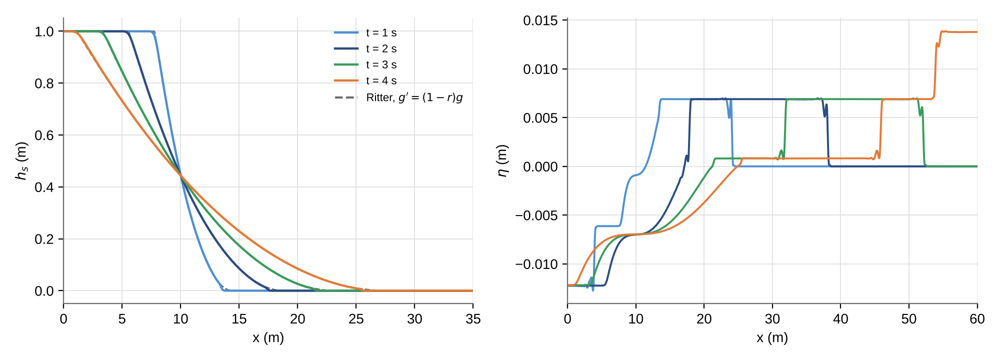
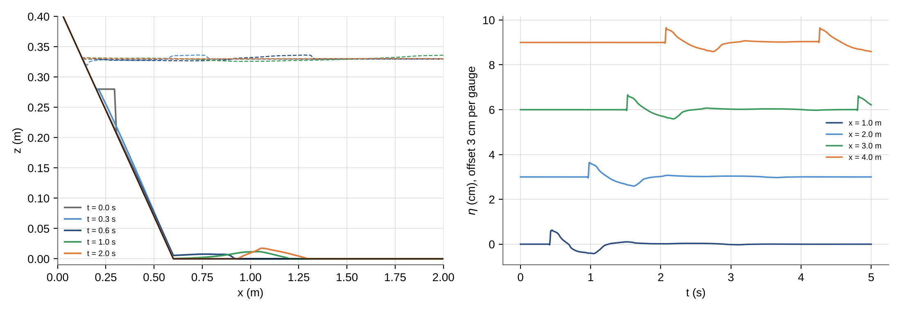

### 19 Semi-implicit water (A 210 11): the cases 17 and 18 again

The controls of 17 and 18 with `A 210 11` (one-step predictor, θ 0.55, N 47 0.5 by default) and `A 232` about 1 % of the
water depth (1 cm, 18 dambreak 5 cm, 18 slope35 3 mm). The slide sub-steps (W 159 100) carry the slide CFL; the water step
is that of the semi-implicit SFLOW. Figures in the results folder of `run_slide_cases.sh` (`grid*/19_si`).

| | explicit (17, 18) | semi-implicit, dx as 17/18 | semi-implicit, fine |
|---|---|---|---|
| water steps rest / subaerial / dambreak / slope35 | 2622 / 2473 / 2804 / 4623 | 263 / 487 / 114 / 908 | 525 / 1103 / 226 / 1816 |
| run time rest / subaerial / dambreak / slope35 | 25 / 23 / 6.9 / 11 s | 2.8 / 3.9 / 0.4 / 2.3 s | 25 / 32 / 1.5 / 8.6 s |
| rest: max \|u\| water / slide, max \|η − η0\| | 4.8e-6 / 1.1e-7 m/s, 6e-8 m | 3e-16 / 2e-15 m/s, 2e-16 m | 2e-15 / 3e-15 m/s, 2e-16 m |
| subaerial: η max / min, slide max \|u\| | 0.31 / −0.12 m, 2.11 m/s | 0.34 / −0.12 m, 2.10 m/s | 0.34 / −0.13 m, 2.21 m/s |
| subaerial: water volume | 9e-7 (wet/dry film) | 2e-10 | 0 |
| dambreak: L1(h) against Ritter at 1 / 2 / 3 / 4 s | 1.1 / 0.50 / 0.36 / 0.33 % | 1.5 / 0.70 / 0.47 / 0.38 % | 0.78 / 0.41 / 0.33 / 0.31 % |
| slope35: gauge max (cm) x = 1 / 2 / 3 / 4 m | 0.63 / 0.63 / 0.65 / 0.65 | 0.62 / 0.60 / 0.58 / 0.56 | 0.64 / 0.62 / 0.61 / 0.59 |
| slope35: runout | 1.29 m | 1.29 m | 1.29 m |

- **Volumes and rest:** the slide to 1e-14; the water exact (no wet/dry film losses: the semi-implicit step keeps the
  water column); the lake at rest over the slide at rest stays at rest to round-off, better than the explicit HLL.
- **Steps:** 5-25 times fewer water steps; the slide keeps its own CFL (up to 4 sub-steps per water step here, 25 in
  dambreak).
- **Waves:** the semi-implicit step damps the short leading crests of slope35 with distance (θ = 0.55 at gravity Courant
  numbers of 5-10: 0.56 against 0.65 cm at 4 m); the subaerial impact wave is 10 % higher than explicit on both grids.
  For the wave field near the slide the explicit step stays the reference; for long runs (fjords, deposits) the
  semi-implicit one.

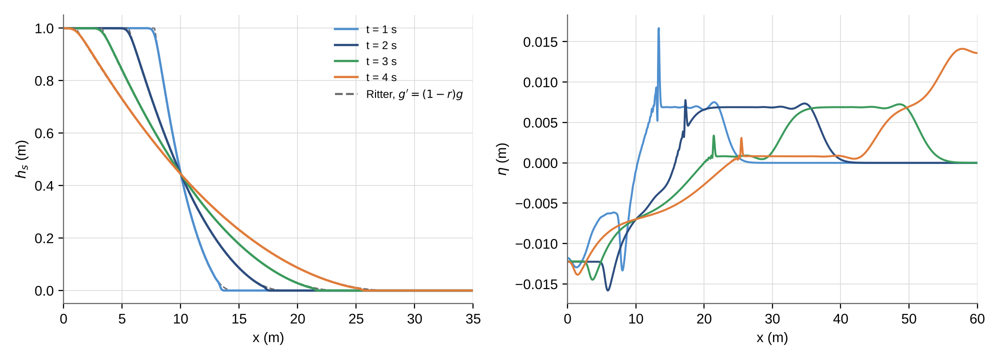
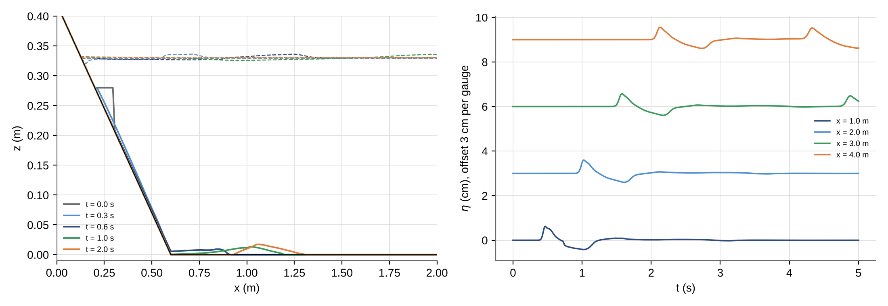
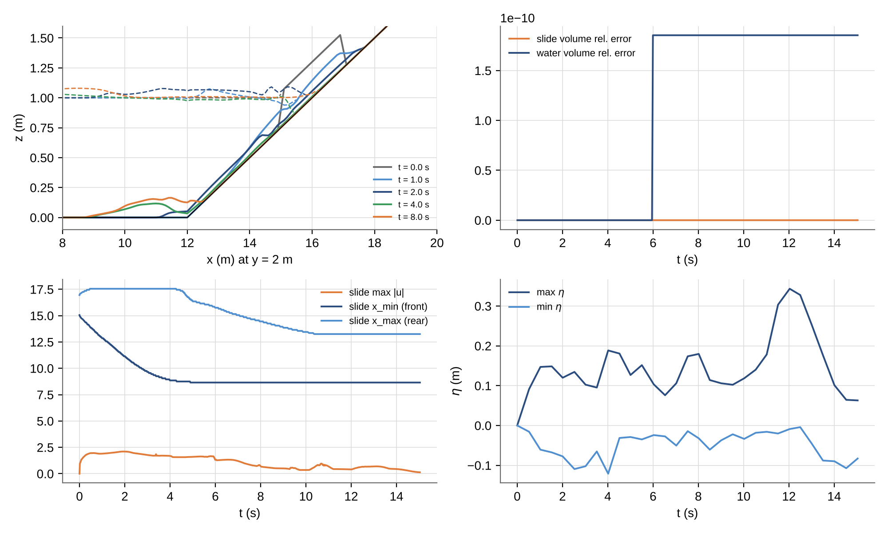

### 28 NTHMP benchmark 4: submarine granular slide on 35° (IRPHE test 17, Grilli et al. 2017)

Glass beads (ρ_s 1951 kg/m³, 0.00505 m³/m) released from behind a vertical gate on a 35° slope into 0.33 m of water;
the measured gauges WG1-WG4 at 0.6 / 1.6 / 2.6 / 3.6 m from the gate (`test17_48-68s.txt`). Geometry from the benchmark
script `read_test.m`; details, the data source and all runs in 28_slide_nthmp_bm4/README.md. Times aligned on the first
crest at WG1 (the release time is not in the record). Gauge max / min (cm) up to the wave reflected at the end wall:

| | WG1 | WG2 | WG3 | WG4 |
|---|---|---|---|---|
| measured | 0.55 / −0.96 | 0.54 / −0.63 | 0.43 / −0.48 | 0.43 / −0.40 |
| hydrostatic (explicit; semi-implicit within 0.05 cm) | 0.90 / −0.57 | 0.89 / −0.56 | 0.91 / −0.56 | 0.84 / −0.56 |
| non-hydrostatic, A 220 2, W 162 0.02 | 0.42 / −0.44 | 0.43 / −0.56 | 0.40 / −0.44 | 0.40 / −0.37 |
| as above, W 128 1 | 0.54 / −0.40 | 0.46 / −0.62 | 0.43 / −0.49 | 0.43 / −0.41 |

- The hydrostatic water makes a bore of twice the measured crest and no dispersive train; the non-hydrostatic water gives
  the leading crest, the trough and the first waves of the train at WG2-WG4 (same on the 2.5 mm grid); the later waves of
  the train are too long. At WG1, over the slide, the measured trough is twice that of the model.

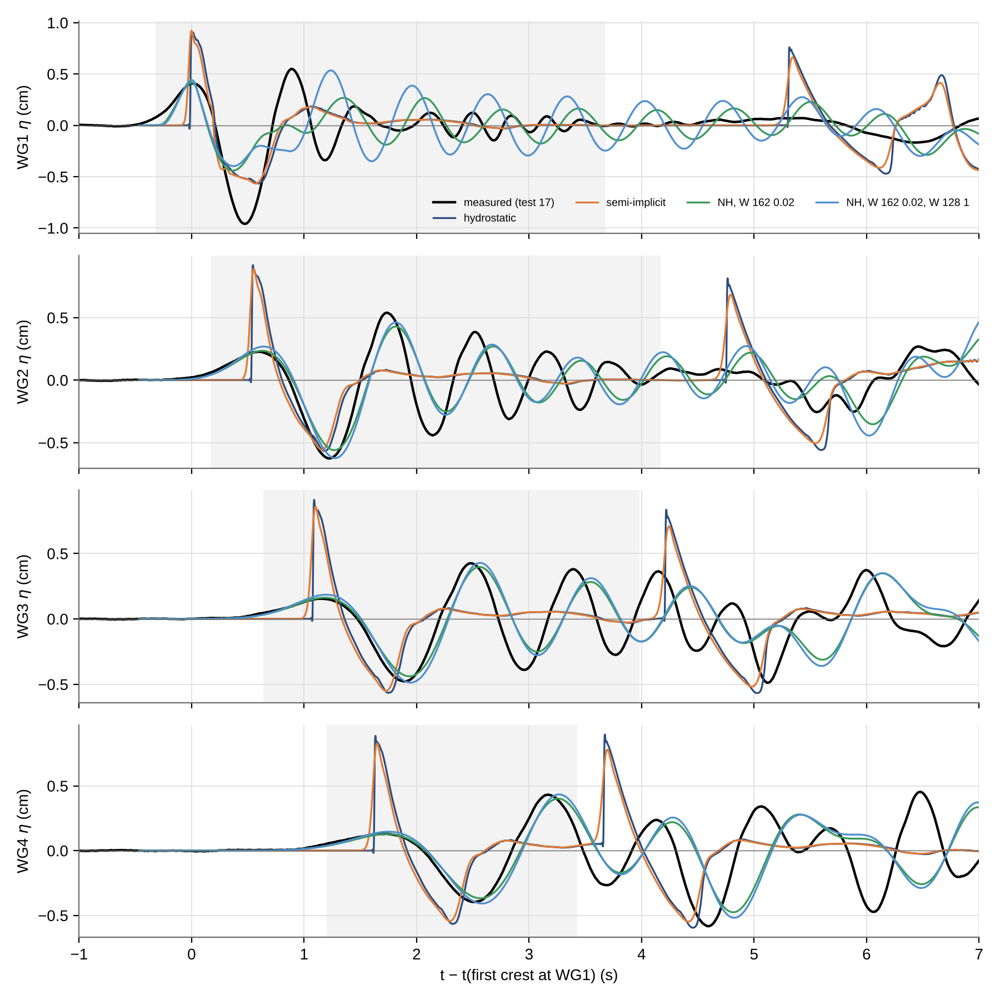

### 29 Slide layer under NHFLOW (A 10 5): 18 dambreak and benchmark 4 again

1D x-z, explicit NHFLOW (A 510 2), σ grid with 10 layers; the controls of 18 dambreak (dx 5 cm, 20 m of water) and of
case 28 (dx 5 mm, the 35° slope with its shoreline), hydrostatic (A 520 0) and non-hydrostatic (A 520 2), and a layer at
rest. 1 rank (2 ranks for benchmark 4: within 1.5e-9 m of 1 rank).

| | hydrostatic | non-hydrostatic |
|---|---|---|
| dambreak: L1(h) against Ritter at 1 / 2 / 3 / 4 s | 1.1 / 0.51 / 0.36 / 0.33 % | 1.1 / 0.50 / 0.32 / 0.24 % (W 162 0.05) |
| dambreak: surface min / max | −1.2 / +1.4 cm | −0.85 / +0.45 cm |
| dambreak: run time | 30 s | 112 s |
| benchmark 4, WG1 max / min (cm) (measured 0.55 / −0.96) | 0.89 / −0.61 | 0.32 / −0.74 |
| WG2 (measured 0.54 / −0.63) | 0.87 / −0.61 | 0.50 / −0.60 |
| WG3 (measured 0.43 / −0.48) | 0.84 / −0.61 | 0.49 / −0.48 |
| WG4 (measured 0.43 / −0.40) | 0.83 / −0.61 | 0.48 / −0.40 |
| RMS difference / measured range WG1 - WG4 | 0.13 / 0.20 / 0.28 / 0.34 | 0.12 / 0.13 / 0.08 / 0.04 |
| benchmark 4: run time | 81 s | 177 s (W 162 0.02) |

- **Hydrostatic NHFLOW** is the hydrostatic SFLOW again (dambreak L1 within 0.01 %, the benchmark 4 bore of 0.9 cm).
- **Non-hydrostatic NHFLOW, benchmark 4:** the leading crest, the trough and the dispersive train at WG3 and WG4 in
  phase with the measurement (RMS 4-8 % of the range, SFLOW with the one-layer pressure 7-17 %); at WG1, over the slide,
  the trough −0.74 cm against −0.96 cm (SFLOW −0.44). Layers and filter (WG1 min, RMS WG1 / WG4): 5 layers −0.72, 0.13 /
  0.03; 10 layers −0.85, 0.19 / 0.04; 20 layers −0.81, 0.23 / 0.02; 10 layers with W 162 0.02 −0.74, 0.12 / 0.04. Without
  the filter short waves (period about 0.3 s) leave the slide and grow with the number of layers (WG1 up to 1.1 cm with
  20 layers); W 162 0.02 removes them.
- **Non-hydrostatic NHFLOW, dambreak:** without the filter the surface over the slide carries grid-scale waves of
  ±0.5 cm and the slide departs from Ritter by 2.2 / 1.0 / 0.72 / 0.56 %; W 162 0.05 makes both smooth (the table).
- **w_b in the projection:** without it benchmark 4 gives WG1 3.4 / −1.6 cm and the dambreak surface ±3 cm.
- **Checkpoints:** the slide state (and h_f of W 162) is in the NHFLOW checkpoints; benchmark 4 to 2 s restarted from
  step 1000 (I 45 1000) gives the slide log and the gauges of the uninterrupted run bitwise. The slide log is continued
  from its size at the checkpoint (SFLOW and NHFLOW).
- **rest_slope:** a 2 cm layer over the slope and the floor (Coulomb 45°) under 0.33 m of water: it settles at the
  shoreline in the first 0.06 s (|u| up to 1.6 cm/s, h +1.2 mm), then rests; the surface within 0.05 mm, volumes exact.

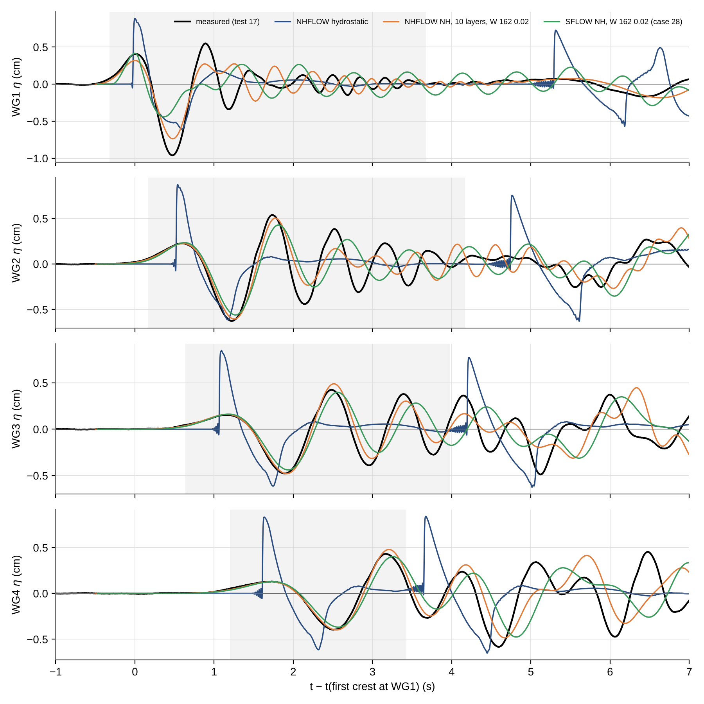
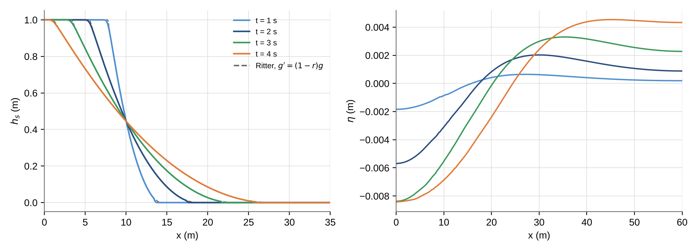

### 32 NTHMP benchmark 5: subaerial granular slide on 45° (Viroulet et al. 2014)

Dry glass beads behind a vertical gate on a 45° slope, the front face at the water line, released into 0.148 / 0.15 m of
water; gauges WG1-WG4 at 0.45 / 0.75 / 1.05 / 1.35 m from the gate (IRPHE flume, 2.2 m). Case 1: beads of 1.5 mm, a
triangle of L = 0.11 m; case 2: 10 mm, L = 0.135 m. Bulk density 1500 kg/m³ (packing 0.6, dry), Coulomb 24°, the
interface drag W 155 0.02. SFLOW hydrostatic and non-hydrostatic (A 220 2, W 162 0.1), NHFLOW non-hydrostatic (10
layers, W 162 0.02), dx 2.5 mm, 2.5 s. Times aligned on the first crest at WG1 (the record starts at the release; the
lead of each run in the table). Details in 32_slide_nthmp_bm5/README.md.

Gauge max / min (cm) up to the wave reflected at the end wall, and the RMS difference / measured range:

| case 1 | WG1 | WG2 | WG3 | WG4 | lead | runout |
|---|---|---|---|---|---|---|
| measured | 1.73 / −1.32 | 1.42 / −1.20 | 1.23 / −1.04 | 1.14 / −0.85 | | |
| SFLOW hydrostatic | 3.15 / −0.91, 0.30 | 3.19 / −0.91, 0.28 | 3.06 / −0.91, 0.28 | 2.77 / −0.90, 0.30 | 0.34 s | 0.94 m |
| SFLOW NH | 1.88 / −1.28, 0.19 | 1.59 / −1.13, 0.27 | 1.48 / −0.96, 0.22 | 1.39 / −0.58, 0.10 | 0.16 s | 1.05 m |
| NHFLOW NH | 1.74 / −0.89, 0.19 | 1.72 / −0.82, 0.22 | 1.56 / −0.84, 0.19 | 1.46 / −0.58, 0.13 | 0.20 s | 1.04 m |

| case 2 | WG1 | WG2 | WG3 | WG4 | lead | runout |
|---|---|---|---|---|---|---|
| measured | 2.27 / −1.38 | 1.92 / −1.48 | 1.69 / −1.42 | 1.54 / −1.24 | | |
| SFLOW hydrostatic | 3.85 / −1.00, 0.26 | 3.86 / −1.01, 0.23 | 3.86 / −1.01, 0.25 | 3.53 / −1.01, 0.27 | 0.30 s | 1.04 m |
| SFLOW NH | 2.58 / −1.49, 0.11 | 2.13 / −1.45, 0.13 | 2.06 / −1.19, 0.14 | 1.99 / −0.53, 0.16 | 0.12 s | 1.21 m |
| NHFLOW NH | 2.27 / −1.03, 0.12 | 2.37 / −0.95, 0.12 | 2.25 / −0.86, 0.12 | 2.13 / −0.52, 0.15 | 0.16 s | 1.20 m |

- The hydrostatic water makes a bore of twice the measured crest. Both non-hydrostatic waters give the leading crest at
  WG1 within 15 % (NHFLOW case 1: 1.74 against 1.73 cm, case 2: 2.27 against 2.27 cm) and its shape at all gauges; the
  crest is 10-40 % high at WG2-WG4 in case 2. The first trough is 20-40 % shallow in NHFLOW, closer in SFLOW.
- The waves come 0.12-0.2 s early: the gate of the experiment takes time to open, the model releases the triangle at once.
- **W 155:** without the interface drag the slide runs 1.7 m (case 1) and 2.1 m (case 2, up to the end wall) and the crests
  are 15 % low; with W 155 0.02 the slide stops about 1 m from the gate and WG1 matches; 0.05 makes the crests 10 % high.
  W 155 on NHFLOW is new with this case (the bottom water layer, `nhflow_bcmom`).
- **SFLOW NH:** W 162 0.02 lets the shoreline on the 45° slope oscillate (WG1 ±3 cm late in the run); 0.1 is stable.
- Grid: dx 1.25 mm changes the gauges by at most 0.06 cm (case 1, both models). Run times (2 cores): SFLOW hydrostatic
  7 s, SFLOW NH 18-20 s, NHFLOW NH 67-74 s; dx 1.25 mm 86 / 318 s.

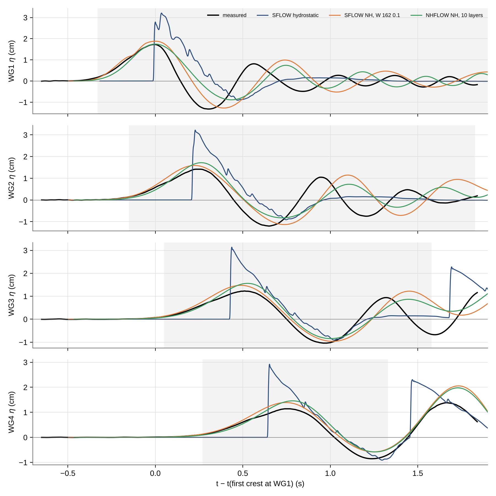
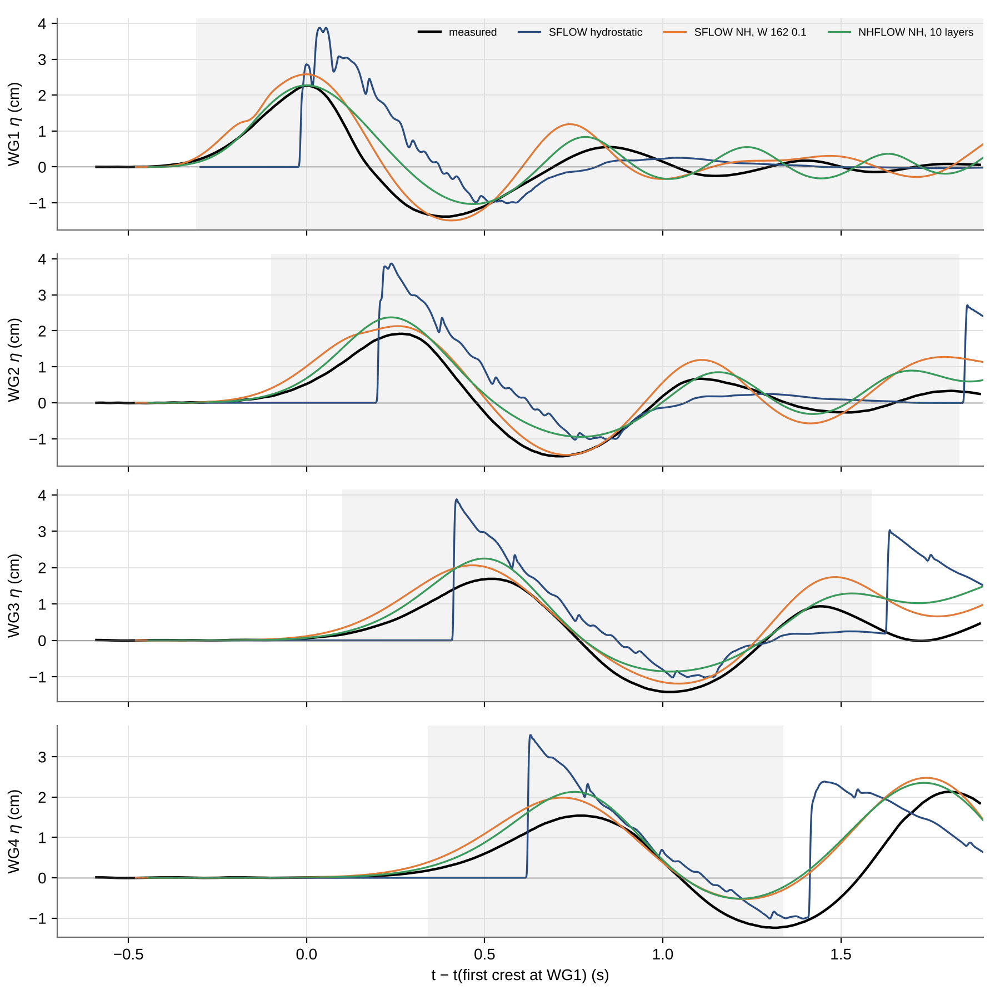

## Not covered yet

- Mesh refinement (G 1): the friction step runs in every level's stage. The pore pressure is advected per level and not exchanged between levels.
- Semi-implicit SFLOW on curvilinear grids: the rheology core stops with a message. `A 232` has to be set by hand (about 1 % of the flow depth).
- Restart from checkpoints: the pore pressure ratio is not in the checkpoints yet and starts again from W 127.
- CFD three-phase (W 140): interface currents of 0.05–0.1 m/s remain in the air next to a deposit at rest (31, 12); the flowing band of a slide without a yield stress keeps the share α of its viscosity; water filling the pores of a dry slide (imbibition) is not modelled (15); no inflow or outflow of slide material; base grid only (not with the mesh refinement G 1); p_e, φ and α_s are not in the checkpoints yet; one quasi-3D check (12) only.
- CFD: the μ(I) column collapse (07) with the side-wall friction of the channel experiments runs 15 % longer than Lube et al. at a = 2 (without walls 46 %); the a^⅔ regime (a > 3) is not checked.
- CFD: the side-wall friction only in `momentum_rk`. A body that is lifted through a closed top of the domain traps air (cases 20, 21).
- CFD 3D: the axisymmetric collapse (25) runs 25–35 % short of Lube et al. (2004) on coarse grids (r0/12.5 – r0/25); a finer grid is the next run.
- CFD: the multiphase level set (F 300 3) uses the adapter, but no case runs it.
- The effective pressure W 131 1 (lithostatic from φ) is only right under flat surfaces.
- Slide layer (W 150): the non-hydrostatic water with the slide is the one-layer quadratic pressure (A 220 2) only, explicit
  water only, with the filter W 162 chosen by hand (0.02 for case 28, 0.5 in deep water); the near field over the slide
  (WG1 of case 28) is underpredicted by half. A 220 1, 3, 4 stop with a message.
- Slide layer (W 150) under NHFLOW: explicit NHFLOW only (not the semi-implicit A 510 11-13), the slide sees the
  hydrostatic water pressure only (not the non-hydrostatic bottom pressure).
- Subaerial slides (case 32): the gate is removed at once, the waves come 0.12-0.2 s early (non-hydrostatic); the first
  trough behind the leading crest is 20-40 % too shallow; the interface drag W 155 is chosen by hand (0.02).
- Slide layer (W 150): sediment (S 10) together with the slide, curvilinear and refined grids; the dilatancy source of
  the pore pressure.
